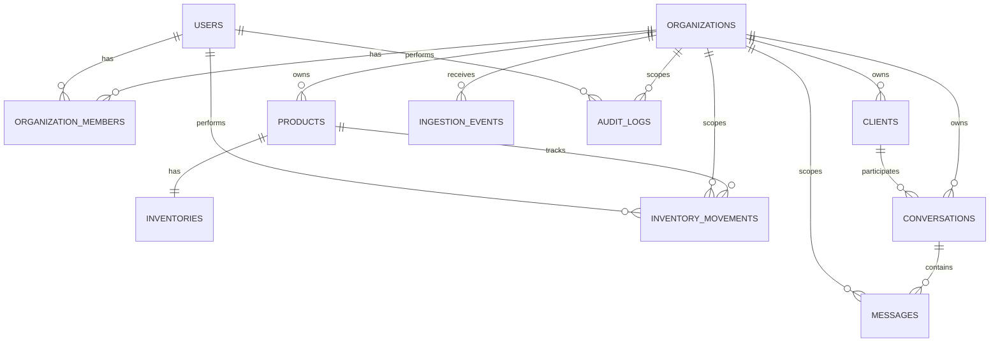

# Modelo de Datos

**Estado: diseñado; `organizations`, `users` y `organization_members` implementadas y validadas localmente desde la 3.1** ([brief-3.1](../decisions/brief-3.1-migraciones-de-identidad.md)). La migración inicial está en `drizzle/`; el resto de las tablas sigue sin migración.

Convenciones fijadas en la 3.1, que siguen las tablas futuras salvo justificación:

- Los enums son tipos `ENUM` de PostgreSQL (`pgEnum`), p. ej. `member_role`. Agregar un valor es un `ALTER TYPE ... ADD VALUE` aditivo (D-2).
- `id` usa `gen_random_uuid()` como default de base (D-6).
- `updated_at` lo mantiene la aplicación con `$onUpdate` de Drizzle. **Limitación**: un `UPDATE` escrito en SQL crudo no lo actualiza (D-3).
- Los esquemas viven en el módulo dueño: `users` en `src/modules/auth/schema.ts`; `organizations` y `organization_members` en `src/modules/organizations/schema.ts`.

## Reglas de diseño aplicadas a todas las tablas

1. Claves primarias `UUID` generadas por la aplicación o por `gen_random_uuid()`, independientes de cualquier identificador externo (Airtable, WhatsApp, etc.).
2. Toda tabla de datos de negocio tiene `organization_id` y ninguna consulta de negocio se ejecuta sin filtrarlo — aislamiento por organización desde el diseño, no como capa añadida después.
3. Todos los timestamps son `timestamptz` almacenados en UTC. La conversión a zona horaria de visualización ocurre en la capa de presentación/consulta, usando `organizations.timezone`.
4. Los enums de negocio se implementan como `CHECK` constraints o tipos `ENUM` de PostgreSQL explícitos, nunca como texto libre sin restricción.
5. Toda relación referencial usa `FOREIGN KEY` real con política `ON DELETE` explícita (`RESTRICT` por defecto; `CASCADE` solo donde el borrado lógico no aplica, ej. tablas puramente dependientes como `organization_members`).
6. Los índices se crean solo para consultas concretas del MVP (ver sección de índices), no especulativamente.
7. Unicidad e idempotencia se expresan como constraints `UNIQUE` de base de datos, no solo como validación de aplicación.
8. Borrado lógico con `is_active boolean` en entidades editables por el usuario (`products`, `clients`, `users`). Ninguna pantalla borra, solo desactiva, así que no existe `deleted_at` (subfase 1.2, H-1). Las tablas de eventos (`inventory_movements`, `audit_logs`, `ingestion_events`, `messages`) no se borran nunca, ni física ni lógicamente.
9. Auditoría de cambios sensibles vía `audit_logs`, poblada por la capa de aplicación dentro de la misma transacción que el cambio.
10. `inventory_movements` es estrictamente insert-only: la aplicación no otorga a ningún rol de base de datos permisos de `UPDATE`/`DELETE` sobre esta tabla.
11. Todo ajuste de stock ocurre dentro de una transacción de base de datos que actualiza `inventories` e inserta en `inventory_movements` atómicamente.
12. `inventories.quantity_on_hand >= 0` por `CHECK` constraint — no se permiten cantidades negativas en el MVP (ver ADR correspondiente si el negocio decide lo contrario explícitamente).
13. El modelo de `conversations`/`messages` incluye `channel` como enum extensible desde el día uno, aunque el MVP solo usa `whatsapp`, para no rediseñar el dominio al agregar un segundo canal.
14. Ningún modelo de ventas, compras, proveedores o pagos existe en este schema.

## Diagrama entidad-relación

## Tablas

### `organizations`

| Columna | Tipo | Notas |
|---|---|---|
| `id` | uuid PK | |
| `name` | text not null | |
| `timezone` | text not null default `'America/Argentina/Buenos_Aires'` | IANA tz, usada para presentar métricas. Valor por defecto fijado en la subfase 1.3 (D-5); en el MVP no hay pantalla para editarlo, pero la columna es real y el cálculo de métricas la respeta |
| `created_at`, `updated_at` | timestamptz not null | |

### `users`

| Columna | Tipo | Notas |
|---|---|---|
| `id` | uuid PK | |
| `email` | text not null | único sin distinguir mayúsculas: índice único `users_email_lower_unique` sobre `lower(email)` (brief-3.1, D-5). Las búsquedas por email usan `lower(email)` |
| `password_hash` | text not null | argon2id/bcrypt |
| `must_change_password` | boolean not null default false | `true` al crear un usuario con contraseña inicial; mientras esté en `true` ninguna ruta protegida responde hasta que el usuario define una nueva (subfase 1.2, D-6) |
| `name` | text not null | |
| `is_active` | boolean not null default true | global; con una sola organización por usuario equivale a su estado en ella (subfase 1.2, D-5) |
| `created_at`, `updated_at` | timestamptz not null | |

### `organization_members`

| Columna | Tipo | Notas |
|---|---|---|
| `id` | uuid PK | |
| `organization_id` | uuid FK → organizations, not null | `ON DELETE CASCADE` |
| `user_id` | uuid FK → users, not null | `ON DELETE CASCADE` |
| `role` | `member_role` enum(`admin`,`viewer`) not null | |
| `created_at`, `updated_at` | timestamptz not null | |
| — | `UNIQUE(user_id)` | en el MVP un usuario pertenece a una sola organización, con un único rol ([ADR 0010](../decisions/0010-un-usuario-una-organizacion-en-el-mvp.md)) |

Índices: el `UNIQUE(user_id)` cubre el lookup de membresía en cada request; `(organization_id)` sirve la lista de usuarios de la pantalla 10.

### `clients`

| Columna | Tipo | Notas |
|---|---|---|
| `id` | uuid PK | |
| `organization_id` | uuid FK → organizations, not null | |
| `display_name` | text not null | |
| `phone_e164` | text null | formato E.164 |
| `notes` | text null | |
| `is_active` | boolean not null default true | |
| `created_at`, `updated_at` | timestamptz not null | |
| — | `UNIQUE(organization_id, phone_e164) WHERE phone_e164 IS NOT NULL` | evita duplicados de teléfono por organización sin bloquear clientes sin teléfono |

Índices: `(organization_id, display_name text_pattern_ops)` para búsqueda por nombre; el `UNIQUE` parcial ya cubre búsqueda por teléfono.

### `products`

| Columna | Tipo | Notas |
|---|---|---|
| `id` | uuid PK | |
| `organization_id` | uuid FK → organizations, not null | |
| `sku` | text not null | |
| `name` | text not null | |
| `description` | text null | |
| `unit` | text not null default `'unidad'` | |
| `reorder_point` | numeric not null default 0 | único umbral del estado de stock (FR-PROD-05). `min_stock` se quitó en la subfase 1.2 (D-10) por no tener regla que lo usara |
| `is_active` | boolean not null default true | |
| `created_at`, `updated_at` | timestamptz not null | |
| — | `UNIQUE(organization_id, sku)` | |

Índices: el `UNIQUE(organization_id, sku)` cubre la unicidad y la búsqueda exacta por SKU; `(organization_id, name text_pattern_ops)` sirve la búsqueda por prefijo de nombre.

### `inventories`

Saldo actual, un registro por producto. Se mantiene siempre junto con `inventory_movements` en la misma transacción — nunca se escribe de forma aislada.

| Columna | Tipo | Notas |
|---|---|---|
| `id` | uuid PK | |
| `organization_id` | uuid FK → organizations, not null | |
| `product_id` | uuid FK → products, not null unique | 1:1 con producto |
| `quantity_on_hand` | numeric not null default 0 | `CHECK (quantity_on_hand >= 0)` |
| `updated_at` | timestamptz not null | |

Índice: `UNIQUE(product_id)` ya cubre el lookup principal.

### `inventory_movements`

Insert-only. Nunca se actualiza ni se borra.

| Columna | Tipo | Notas |
|---|---|---|
| `id` | uuid PK | |
| `organization_id` | uuid FK → organizations, not null | |
| `product_id` | uuid FK → products, not null | |
| `type` | enum(`adjustment_positive`,`adjustment_negative`) not null | solo los tipos con productor en el MVP; entradas y salidas llegarían con compras y ventas, fuera de alcance, como valores nuevos del enum (subfase 1.2, D-11) |
| `quantity` | numeric not null | `CHECK (quantity > 0)`; el signo del efecto lo da `type`, no la cantidad |
| `balance_after` | numeric not null | `CHECK (balance_after >= 0)`; saldo de `inventories.quantity_on_hand` después del movimiento, escrito en la misma transacción (subfase 1.2, D-1) |
| `reason` | text not null | motivo obligatorio, incluso para ajustes |
| `created_by` | uuid FK → users, not null | |
| `created_at` | timestamptz not null | |

Índices: `(organization_id, product_id, created_at desc)` para el historial por producto ordenado.

### `conversations`

| Columna | Tipo | Notas |
|---|---|---|
| `id` | uuid PK | |
| `organization_id` | uuid FK → organizations, not null | |
| `client_id` | uuid FK → clients, null | puede no resolverse a un cliente conocido |
| `channel` | enum(`whatsapp`) not null | extensible a futuro |
| `external_ref` | text null | referencia del sistema origen, para idempotencia |
| `status` | enum(`open`,`pending`,`closed`) not null default `'open'` | |
| `started_at` | timestamptz not null | |
| `last_message_at` | timestamptz null | |
| `created_at`, `updated_at` | timestamptz not null | |
| — | `UNIQUE(organization_id, channel, external_ref) WHERE external_ref IS NOT NULL` | idempotencia de ingestión |

Índices (revisados en la subfase 1.2):

- `(organization_id, last_message_at desc)`: lista de conversaciones de la pantalla 8, filtrada por período y ordenada por último mensaje (D-4).
- `(organization_id, client_id, last_message_at desc)`: última interacción y orden de la lista de clientes (pantalla 6), y conversaciones del cliente en la pantalla 7 (D-2).
- `(organization_id, started_at)`: métricas 1 y 10, que cuentan conversaciones por fecha de inicio.

Se quitaron `(organization_id, status, started_at desc)` y `(client_id, started_at desc)`: ninguna consulta ordena por inicio dentro de un estado, y las conversaciones del cliente se ordenan por último mensaje.

### `messages`

| Columna | Tipo | Notas |
|---|---|---|
| `id` | uuid PK | |
| `organization_id` | uuid FK → organizations, not null | |
| `conversation_id` | uuid FK → conversations, not null | |
| `direction` | enum(`inbound`,`outbound`) not null | |
| `external_ref` | text null | referencia del sistema origen |
| `sent_at` | timestamptz not null | |
| `body_text` | text null | contenido textual; adjuntos fuera de alcance del MVP |
| `created_at` | timestamptz not null | |
| — | `UNIQUE(organization_id, conversation_id, external_ref) WHERE external_ref IS NOT NULL` | idempotencia |

Índices: `(conversation_id, sent_at)` para el timeline (pantalla 9), el conteo por conversación (pantallas 7 y 8) y el primer mensaje de cada conversación (métrica 9); `(organization_id, sent_at)` para las métricas 2 a 10, que filtran mensajes de toda la organización por intervalo.

### `ingestion_events`

Ledger de idempotencia para el contrato de ingestión (diseñado, no conectado a tráfico real en el MVP).

| Columna | Tipo | Notas |
|---|---|---|
| `id` | uuid PK | |
| `organization_id` | uuid FK → organizations, not null | |
| `source` | text not null | identifica el sistema emisor |
| `external_ref` | text not null | id del evento en el sistema origen |
| `event_type` | text not null | |
| `payload_hash` | text not null | hash del payload canónico; detecta reenvíos con contenido distinto bajo la misma ref |
| `status` | enum(`received`,`processed`,`failed`) not null default `'received'` | |
| `error_code` | text null | código normalizado de la taxonomía de [Overview.md](Overview.md#estrategia-de-errores-diseño); nunca payload crudo, headers ni credenciales |
| `received_at` | timestamptz not null | |
| `processed_at` | timestamptz null | |
| — | `UNIQUE(organization_id, source, external_ref)` | idempotencia dura |

Índice: `(organization_id, received_at)` para la métrica 12, que filtra eventos por intervalo de recepción.

Reglas del ledger, derivadas del patrón *Reliable External Effects* del vault:

- **Reserva atómica**: `INSERT ... ON CONFLICT (organization_id, source, external_ref) DO NOTHING`, en la misma transacción que crea `conversations` y `messages`. Si no se insertó nada, es un reenvío.
- **Reenvío con el mismo `payload_hash`**: devuelve el resultado original sin generar efectos nuevos.
- **Reenvío con otro `payload_hash`**: `CONFLICT`, sin modificar datos. Nunca se sobrescribe en silencio.
- **Tabla dedicada**: la unicidad de `conversations.external_ref` y `messages.external_ref` es una segunda defensa, no el mecanismo de idempotencia.
- **Sanitización**: no se guarda el payload completo. El contenido útil ya vive en `messages` y el ledger solo guarda identidad, hash y resultado.

### `audit_logs`

Justificación de necesidad real: requisitos FR-AUD-01 y FR-AUD-02 sobre productos, clientes, stock, estado de conversaciones y roles. No se crea especulativamente.

| Columna | Tipo | Notas |
|---|---|---|
| `id` | uuid PK | |
| `organization_id` | uuid FK → organizations, not null | |
| `actor_user_id` | uuid FK → users, not null | |
| `entity_type` | enum(`product`,`client`,`inventory`,`conversation`,`organization_member`) not null | |
| `entity_id` | uuid not null | |
| `action` | enum(`create`,`update`,`deactivate`,`reactivate`,`stock_adjustment`,`status_change`,`role_change`) not null | |
| `diff` | jsonb not null | antes/después relevante |
| `created_at` | timestamptz not null | |

Índice: `(organization_id, entity_type, entity_id, created_at desc)` para "historial de esta entidad".

## Explícitamente fuera de este modelo

`sales`, `sale_details`, `purchases`, `purchase_details`, `suppliers`, `payments`, `cash_accounts`, cualquier tabla de contabilidad. Ninguna se crea vacía "para después".

## Preguntas abiertas sobre el modelo

- Política de retención de `messages` cuando exista tráfico real: ¿se conservan indefinidamente o hay un horizonte de borrado? **Diferida a la Fase 9** (subfase 1.3, D-7): en el MVP no hay tráfico ni volumen, así que decidirlo ahora sería decidirlo sin datos. En el MVP se conservan indefinidamente y `messages` no lleva columna de expiración; agregarla después es una migración aditiva, sin backfill.

Cerradas en la subfase 1.3 (2026-09-11):

- Identificador único de cliente: `(organization_id, phone_e164)` y nada más — [ADR 0007](../decisions/0007-identificador-de-cliente-solo-telefono.md).
- Excepciones al stock no negativo: no hay — [ADR 0008](../decisions/0008-stock-nunca-negativo.md).

Cerradas en la subfase 1.2 (2026-09-12), a partir de las brechas de los [wireframes](../product/wireframes/README.md#brechas-y-discrepancias):

- Organizaciones por usuario: una sola en el MVP — [ADR 0010](../decisions/0010-un-usuario-una-organizacion-en-el-mvp.md).
- Saldo por movimiento: `inventory_movements.balance_after`. Contraseña inicial: `users.must_change_password`. Se quitaron `products.min_stock` y los tipos de movimiento `inbound`/`outbound`.
- Última interacción del cliente y cantidad de mensajes: derivadas, con los índices de `conversations` y `messages`. Si en staging resultan lentas, se revisan con medición.
- Trazabilidad completa de pantallas, requisitos, índices y métricas: [TraceabilityMatrix.md](TraceabilityMatrix.md).
- Columnas sin consumidor detectadas al armar la matriz: se quitaron `deleted_at` de `users`, `clients` y `products` (H-1) y `organizations.slug` con su índice único (H-2).
