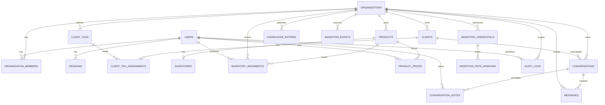

# Modelo de Datos

**Estado: diseñado; `organizations`, `users` y `organization_members` implementadas y validadas localmente desde la 3.1** ([brief-3.1](../decisions/brief-3.1-migraciones-de-identidad.md)), **`sessions` y `login_attempts` desde la 3.3** ([brief-3.3](../decisions/brief-3.3-autenticacion.md)), **`audit_logs` desde la 3.6** ([brief-3.6](../decisions/brief-3.6-modulo-de-auditoria.md)), **`products`, `inventories` e `inventory_movements` desde la 4.1** ([brief-4.1](../decisions/brief-4.1-migraciones-de-catalogo-e-inventario.md)), con sus servicios desde la 4.2 y la 4.3, **y `clients` desde la 5.1** ([brief-5.1](../decisions/brief-5.1-migracion-de-clientes.md)), con su servicio desde la 5.2 ([brief-5.2](../decisions/brief-5.2-servicio-de-clientes.md)), **y `conversations`, `messages` e `ingestion_events` desde la 6.1** ([brief-6.1](../decisions/brief-6.1-migraciones-de-conversaciones.md)), solo con su esquema, **e `ingestion_credentials` e `ingestion_rate_windows` desde la 6.5.3** ([brief-6.5.3](../decisions/brief-6.5.3-autenticacion-de-servicio-y-rate-limit.md)), **`product_prices` desde la 11.1** ([brief-11.1](../decisions/brief-11.1-catalogo-comercial.md)) **`knowledge_entries` desde la 11.2** ([brief-11.2](../decisions/brief-11.2-informacion-del-negocio.md)) **`client_tags` y `client_tag_assignments` desde la 16.1** ([brief-16.1](../decisions/brief-16.1-etiquetas-de-clientes.md)) **y `conversation_notes` desde la 16.4** ([brief-16.4](../decisions/brief-16.4-notas-de-la-conversacion.md)). **Los campos ampliados de `clients` llegan en la 17.1** ([brief-17.1](../decisions/brief-17.1-campos-de-clientes.md)) **y los campos de operación de `products`, en la 17.2** ([brief-17.2](../decisions/brief-17.2-campos-de-productos.md)). Las migraciones están en `drizzle/`. Todas las tablas del modelo tienen migración.

Convenciones fijadas en la 3.1, que siguen las tablas futuras salvo justificación:

- Los enums son tipos `ENUM` de PostgreSQL (`pgEnum`), p. ej. `member_role`. Agregar un valor es un `ALTER TYPE ... ADD VALUE` aditivo (D-2).
- `id` usa `gen_random_uuid()` como default de base (D-6).
- `updated_at` lo mantiene la aplicación con `$onUpdate` de Drizzle. **Limitación**: un `UPDATE` escrito en SQL crudo no lo actualiza (D-3).
- Los esquemas viven en el módulo dueño: `users` en `src/modules/auth/schema.ts`; `organizations` y `organization_members` en `src/modules/organizations/schema.ts`; `audit_logs` en `src/modules/audit/schema.ts`; `products` y `product_prices` en `src/modules/catalog/schema.ts`; `inventories` e `inventory_movements` en `src/modules/inventory/schema.ts`; `clients` y, desde la 16.1, `client_tags` y `client_tag_assignments` en `src/modules/crm/schema.ts`; `conversations`, `messages` y, desde la 16.4, `conversation_notes` en `src/modules/conversations/schema.ts`; `ingestion_events`, `ingestion_credentials` e `ingestion_rate_windows` en `src/modules/ingestion/schema.ts`; `knowledge_entries` en `src/modules/knowledge/schema.ts`.
- Las cantidades son `numeric(14, 3)`: hasta 99 999 999 999,999 con tres decimales, y comparaciones exactas (brief-4.1, D-4). Drizzle devuelve `numeric` como `string`: los servicios comparan y suman en SQL o con una representación decimal exacta, nunca con `number` de JavaScript. La representación exacta es `src/shared/quantity/`: `bigint` en milésimas, con parseo de entrada con coma o punto (brief-4.2, D-2).
- Privilegios ([ADR 0013](../decisions/0013-rol-de-aplicacion-y-tablas-de-solo-insercion.md), 3.6): cada migración que crea una tabla otorga sus privilegios al rol de aplicación `crm_app`. Una tabla de solo inserción recibe solo `SELECT` e `INSERT`, más un trigger que rechaza `UPDATE` y `DELETE`. `ingestion_events` recibe además `UPDATE`, sin `DELETE`, con un trigger que protege su identidad (brief-6.1, D-3). `knowledge_entries` también recibe `SELECT`, `INSERT` y `UPDATE` sin `DELETE`, pero sin trigger: es editable, y lo que se protege es que ninguna vía la borre (brief-11.2, D-4). Desde la 16.1, `client_tags` recibe lo mismo, sin `DELETE`, y `client_tag_assignments` recibe `SELECT`, `INSERT` y `DELETE`, **sin `UPDATE`**: una asignación se pone y se quita, nunca se modifica (brief-16.1, D-6). Los roles, privilegios y triggers van en migraciones a medida, porque Drizzle no los expresa en `schema.ts`.

## Reglas de diseño aplicadas a todas las tablas

1. Claves primarias `UUID` generadas por la aplicación o por `gen_random_uuid()`, independientes de cualquier identificador externo (Airtable, WhatsApp, etc.).
2. Toda tabla de datos de negocio tiene `organization_id` y ninguna consulta de negocio se ejecuta sin filtrarlo — aislamiento por organización desde el diseño, no como capa añadida después.
3. Todos los timestamps son `timestamptz` almacenados en UTC. La conversión a zona horaria de visualización ocurre en la capa de presentación/consulta, usando `organizations.timezone`.
4. Los enums de negocio se implementan como `CHECK` constraints o tipos `ENUM` de PostgreSQL explícitos, nunca como texto libre sin restricción.
5. Toda relación referencial usa `FOREIGN KEY` real con política `ON DELETE` explícita (`RESTRICT` por defecto; `CASCADE` solo donde el borrado lógico no aplica, ej. tablas puramente dependientes como `organization_members`).
6. Los índices se crean solo para consultas concretas del MVP (ver sección de índices), no especulativamente.
7. Unicidad e idempotencia se expresan como constraints `UNIQUE` de base de datos, no solo como validación de aplicación.
8. Borrado lógico con `is_active boolean` en entidades editables por el usuario (`products`, `clients`, `users`, desde la 11.2 `knowledge_entries` y desde la 16.1 `client_tags`). Ninguna pantalla borra, solo desactiva, así que no existe `deleted_at` (subfase 1.2, H-1). Las tablas de eventos (`inventory_movements`, `product_prices`, `audit_logs`, `ingestion_events`, `messages` y, desde la 16.4, `conversation_notes`) no se borran nunca, ni física ni lógicamente.
9. Auditoría de cambios sensibles vía `audit_logs`, poblada por la capa de aplicación dentro de la misma transacción que el cambio.
10. `inventory_movements`, `audit_logs`, desde la 6.1 `messages`, desde la 11.1 `product_prices` y desde la 16.4 `conversation_notes` son estrictamente insert-only: el rol de aplicación `crm_app` no tiene `UPDATE` ni `DELETE` sobre ellas, y un trigger rechaza ambas operaciones para cualquier rol ([ADR 0013](../decisions/0013-rol-de-aplicacion-y-tablas-de-solo-insercion.md)). **Excepción desde la 13.4** ([ADR 0015](../decisions/0015-vaciado-de-una-sola-direccion-en-tablas-de-solo-insercion.md)): el trigger de `messages` deja pasar un único `UPDATE`, el que lleva `body_text` y `external_ref` a nulo con el resto de la fila idéntico; el de `audit_logs`, el que lleva el `diff` de una entrada de cliente al marcador `{"before": null, "after": null, "vaciado": true}`; *desde la 16.4*, el de `conversation_notes`, el que lleva `body_text` a nulo con el resto de la fila idéntico. `crm_app` sigue sin `UPDATE`: vacía solo el operador con el rol dueño. Un mensaje o una nota nunca cambia de contenido, solo puede perderlo. `ingestion_events` admite `UPDATE` de su estado, pero no el borrado ni el cambio de su identidad (brief-6.1, D-3).
11. Todo ajuste de stock ocurre dentro de una transacción de base de datos que actualiza `inventories` e inserta en `inventory_movements` atómicamente.
12. `inventories.quantity_on_hand >= 0` por `CHECK` constraint — no se permiten cantidades negativas en el MVP (ver ADR correspondiente si el negocio decide lo contrario explícitamente).
13. El modelo de `conversations`/`messages` incluye `channel` como enum extensible desde el día uno, aunque el MVP solo usa `whatsapp`, para no rediseñar el dominio al agregar un segundo canal.
14. Ningún modelo de ventas, compras, proveedores o pagos existe en este schema.

## Diagrama entidad-relación

## Tablas

### `organizations`

| Columna | Tipo | Notas |
|---|---|---|
| `id` | uuid PK | |
| `name` | text not null | |
| `timezone` | text not null default `'America/Argentina/Buenos_Aires'` | IANA tz, usada para presentar métricas. Valor por defecto fijado en la subfase 1.3 (D-5); en el MVP no hay pantalla para editarlo, pero la columna es real y el cálculo de métricas la respeta |
| `created_at`, `updated_at` | timestamptz not null | |

### `users`

| Columna | Tipo | Notas |
|---|---|---|
| `id` | uuid PK | |
| `email` | text not null | único sin distinguir mayúsculas: índice único `users_email_lower_unique` sobre `lower(email)` (brief-3.1, D-5). Las búsquedas por email usan `lower(email)` |
| `password_hash` | text not null | argon2id/bcrypt |
| `must_change_password` | boolean not null default false | `true` al crear un usuario con contraseña inicial; mientras esté en `true` ninguna ruta protegida responde hasta que el usuario define una nueva (subfase 1.2, D-6) |
| `name` | text not null | |
| `is_active` | boolean not null default true | global; con una sola organización por usuario equivale a su estado en ella (subfase 1.2, D-5) |
| `created_at`, `updated_at` | timestamptz not null | |

### `organization_members`

| Columna | Tipo | Notas |
|---|---|---|
| `id` | uuid PK | |
| `organization_id` | uuid FK → organizations, not null | `ON DELETE CASCADE` |
| `user_id` | uuid FK → users, not null | `ON DELETE CASCADE` |
| `role` | `member_role` enum(`admin`,`viewer`) not null | |
| `created_at`, `updated_at` | timestamptz not null | |
| — | `UNIQUE(user_id)` | en el MVP un usuario pertenece a una sola organización, con un único rol ([ADR 0010](../decisions/0010-un-usuario-una-organizacion-en-el-mvp.md)) |

Índices: el `UNIQUE(user_id)` cubre el lookup de membresía en cada request; `(organization_id)` sirve la lista de usuarios de la pantalla 10.

Regla del último `admin` (FR-ORG-02): una organización nunca queda sin un miembro `admin` con `users.is_active = true`. No es una constraint, porque depende de dos tablas de dos módulos. La aplica `organizations` en cada cambio de rol o de estado de un miembro, dentro de una transacción que bloquea la fila de `organizations` ([brief-3.7](../decisions/brief-3.7-gestion-de-usuarios-y-roles.md), D-4).

### `sessions`

**Diseñada en la 3.2** ([ADR 0012](../decisions/0012-mecanismo-de-sesion.md)) **e implementada en la 3.3** ([brief-3.3](../decisions/brief-3.3-autenticacion.md)), migración `drizzle/0001_*`. Módulo dueño: `auth`.

| Columna | Tipo | Notas |
|---|---|---|
| `id` | text PK | SHA-256 en hexadecimal del token de la cookie. El token nunca se guarda |
| `user_id` | uuid FK → users, not null | `ON DELETE CASCADE`: la sesión depende del usuario y no tiene borrado lógico |
| `created_at` | timestamptz not null default `now()` | base del tope absoluto de 30 días |
| `expires_at` | timestamptz not null | deslizante de 7 días; se reescribe solo cuando queda menos de la mitad de la ventana |

Sin `updated_at`: la única columna que cambia es `expires_at`, que ya registra la última renovación.

Índices: la PK cubre la validación de cada request; `(user_id)` sirve para revocar todas las sesiones de un usuario (cambio de contraseña, desactivación) y para borrar sus sesiones expiradas al ingresar.

Limpieza: una sesión expirada se borra al detectarla en la validación, y las expiradas del usuario se borran en su login. En el MVP no hay tarea programada.

### `login_attempts`

**Implementada en la 3.3** ([brief-3.3](../decisions/brief-3.3-autenticacion.md), D-3). Módulo dueño: `auth`. Registra solo intentos de login fallidos para el límite por cuenta y por IP de [SecurityModel.md](SecurityModel.md).

| Columna | Tipo | Notas |
|---|---|---|
| `id` | uuid PK | |
| `scope` | `login_attempt_scope` enum(`account`,`ip`) not null | |
| `key_hash` | text not null | SHA-256 del email en minúsculas o de la IP. Ni el email ni la IP se guardan en claro |
| `attempted_at` | timestamptz not null default `now()` | |

Sin `organization_id` ni FK a `users`: el intento es anterior a la autenticación, y un email inexistente se registra igual que uno existente para no revelar qué cuentas existen. No es una tabla de datos de negocio.

Índice: `(scope, key_hash, attempted_at)` para contar los fallos de una clave dentro de la ventana de 15 minutos.

Limpieza: en cada intento se borran los registros vencidos **de todas las claves**, no solo los de la que intenta; un login correcto borra los fallos de la cuenta. *Desde la 13.4* (brief-13.4, D-7): si se borraran solo los de esa clave, el hash de una IP que no vuelve quedaría para siempre. La ventana es la misma para los dos alcances, así que no se borra nada que todavía cuente. Sin intentos de ingreso no se borra nada.

### `clients`

**Implementada en la 5.1** ([brief-5.1](../decisions/brief-5.1-migracion-de-clientes.md)), migraciones `drizzle/0008_*` y `drizzle/0009_*`; los campos ampliados desde la **17.1** ([brief-17.1](../decisions/brief-17.1-campos-de-clientes.md)), migración `drizzle/0031_*`. Módulo dueño: `crm`.

| Columna | Tipo | Notas |
|---|---|---|
| `id` | uuid PK | |
| `organization_id` | uuid FK → organizations, not null | `ON DELETE RESTRICT` |
| `display_name` | text not null | |
| `phone_e164` | text null | E.164 canónico: `CHECK (phone_e164 ~ '^\+[1-9][0-9]{1,14}$')`, constraint `clients_phone_e164_format` (brief-5.1, D-1). Valida la forma, no que el número exista. El servicio de `crm` normaliza la entrada antes de guardar y de buscar: exige `+` y quita espacios, guiones, puntos y paréntesis; sin `+` la rechaza, sin adivinar el país (brief-5.2, D-1) |
| `notes` | text null | |
| `email` | text null | *17.1*. Recortado y en minúsculas, hasta 254 caracteres: `CHECK clients_email_format` (en minúsculas, largo y una `@` que no es la primera letra). **Sin unicidad**: dos clientes pueden compartirlo, y no identifica a nadie (ADR 0007). No llega a un `viewer` |
| `kind` | `client_kind` enum(`person`,`company`) null | *17.1*, D-3. «Persona» o «Empresa»; nulo es «sin dato». «Consumidor final» no es un tipo: es una condición frente al IVA, que llega con el comprobante de la Fase 20 |
| `company_name` | text null | *17.1*. De 1 a 120 caracteres, recortado: `CHECK clients_company_name_length` |
| `job_title` | text null | *17.1*. De 1 a 120: `clients_job_title_length` |
| `address_line` | text null | *17.1*. Calle y número, de 1 a 200: `clients_address_line_length`. No llega a un `viewer` |
| `city` | text null | *17.1*. De 1 a 120: `clients_city_length` |
| `province` | text null | *17.1*, D-4. Código ISO 3166-2 de una de las 24 jurisdicciones de Argentina: `CHECK clients_province`, con la lista de `crm/provinces.ts`, la misma que valida el servicio y ofrecen los selectores. Un cliente de otro país queda sin provincia |
| `postal_code` | text null | *17.1*. Letras, números y espacios internos en mayúsculas, hasta 10: `CHECK clients_postal_code_format` (`^[A-Z0-9][A-Z0-9 ]{0,9}$`). No llega a un `viewer` |
| `segment` | text null | *17.1*, D-5. Texto libre de 1 a 60, con sugerencias de los ya cargados, como la marca de un producto: `clients_segment_length`. A lo sumo uno por cliente: por eso no es una etiqueta |
| `is_active` | boolean not null default true | |
| `created_at`, `updated_at` | timestamptz not null | |
| — | `UNIQUE(organization_id, phone_e164) WHERE phone_e164 IS NOT NULL` | índice `clients_organization_phone_unique`. Evita duplicados de teléfono por organización sin bloquear clientes sin teléfono. **Alcanza también a los inactivos**: un número pertenece a un solo cliente de la organización, y un alta con el número de un cliente inactivo devuelve `CONFLICT` para que se reactive el existente (brief-5.1, D-3) |

Índices: `clients_organization_display_name_unaccent_idx` sobre `(organization_id, immutable_unaccent(lower(display_name)) text_pattern_ops)` para la búsqueda por prefijo de nombre sin distinguir mayúsculas **ni acentos** (brief-5.1, D-2, igual que productos; normalizado en la 9.0.2, migración `drizzle/0015_*`, que reemplazó al índice sobre `lower(display_name)` de la 5.1); el `UNIQUE` parcial cubre la búsqueda exacta por teléfono completo. La búsqueda **sigue sin** encontrar palabras en medio del nombre: es por prefijo. **El ORDEN de la lista sigue usando `lower(display_name)` a secas y no se normalizó**: unir «Avila» con «Ávila» al ordenar es otra decisión de producto, y un test fija el orden actual (brief-9.0.2, hallazgo 5).

`display_name` vacío lo rechaza el servicio de la 5.2, que también recorta espacios: es editable y se corrige (mismo criterio que la 4.1, D-5).

**Campos ampliados (17.1)** ([brief-17.1](../decisions/brief-17.1-campos-de-clientes.md)). Los nueve son opcionales y los carga solo un `admin` desde el formulario; el agente no los lee ni los escribe (ningún contrato cambia). Cada uno entra con su motivo, escrito en el brief (D-2). **Documento y CUIT/CUIL no están**: los usa el comprobante de la Fase 20, y entran ahí con la condición frente al IVA, lo que deja intactos el ADR 0007 y FR-CLI-05 (C-1).

- **Lo que no llega a un `viewer`** (D-8, FR-CLI-13): el email, la calle y el código postal, como el teléfono completo. `crm` los devuelve en `contact`, que es `null` para un `viewer`.
- **Filtros de la lista** (D-9, FR-CLI-14): tipo, provincia y segmento, resueltos en `crm` dentro de `findClientIdsByName` y `countClients`, como la etiqueta. El segmento filtra por el valor exacto. Los selectores de la lista ofrecen solo los tipos, las provincias y los segmentos que tiene algún cliente de la organización, activo o no, y la página ignora cualquier otro valor de la URL, como una etiqueta ajena. **Límite**: la lista de valores se corta en 200, en orden alfabético, como las marcas de productos; un segmento más allá del puesto 200 no se ofrece ni se puede filtrar. El segmento distingue mayúsculas. **Sin índices** (D-10, regla 6): en local, con 10 000 clientes generados en una organización, la lista entera de la pantalla 6 con los tres filtros (`searchClientsByLastInteraction`) se mide en `crm.test.ts`, caso D-10, contra el umbral de 754 ms de la 13.2. Se revisa si el volumen real lo pide.
- **Datos de un cliente** (D-12): la exportación los incluye; el vaciado los lleva **todos** a nulo, también el tipo, la provincia y el segmento, porque describen a la persona. `client-data.test.ts` lee las columnas nulables de `clients` desde `information_schema` y exige que cada una tenga su valor de prueba y quede nula después del vaciado: **una columna nueva que no se sume al vaciado hace fallar el test**.

`UNIQUE(organization_id, id)` (`clients_organization_id_id_unique`, migración `drizzle/0010_*`): destino de la clave foránea compuesta de `conversations`. Llegó en la 6.1 junto con su consumidor (brief-5.1, D-4), en una migración propia, porque Drizzle Kit lo emitía después de la clave que lo usa. Desde la 16.1 también es el destino de la de `client_tag_assignments`.

### `client_tags`

**Implementada en la 16.1** ([brief-16.1](../decisions/brief-16.1-etiquetas-de-clientes.md)), migraciones `drizzle/0026_*` (tabla) y `drizzle/0027_*` (privilegios). Módulo dueño: `crm`.

El catálogo de etiquetas de clientes de una organización: «Interesado», «Quiere señar», «Reclamo», «No interesado» y las que defina. **«Quiere señar» es una etiqueta, nunca un pago** (regla 14): ninguna etiqueta dispara nada. Editable, con borrado lógico según la regla 8: `crm_app` tiene `SELECT`, `INSERT` y `UPDATE`, **sin `DELETE`** (D-8). El historial de cambios es la auditoría, con el tipo de entidad `client_tag`.

| Columna | Tipo | Notas |
|---|---|---|
| `id` | uuid PK | |
| `organization_id` | uuid FK → organizations, not null | `ON DELETE RESTRICT` |
| `name` | text not null | `CHECK client_tags_name_length`, de 1 a 40 caracteres; el servicio recorta. Único por organización sin distinguir mayúsculas, **también frente a las inactivas**: índice único `client_tags_organization_name_lower_unique` sobre `(organization_id, lower(name))`. Un nombre repetido es `CONFLICT` |
| `color` | text not null default `'gray'` | `CHECK client_tags_color`: uno de `gray`, `violet`, `blue`, `green`, `amber` y `red` (D-4). La lista sale de `TAG_COLORS` en `crm/tag-colors.ts`, la misma que valida el servicio y ofrece la pantalla |
| `is_active` | boolean not null default true | una inactiva no se ofrece para asignar ni filtra la lista; los clientes que la tienen la conservan (D-8) |
| `created_at`, `updated_at` | timestamptz not null | |
| — | `UNIQUE(organization_id, id)` | `client_tags_organization_id_id_unique`: destino de la clave compuesta de `client_tag_assignments` |

**Límites del servicio** (D-11): hasta 50 etiquetas activas por organización; se cuentan y se escriben bajo un `pg_advisory_xact_lock` por organización, así que dos altas simultáneas no lo pasan. El catálogo no tiene datos en ninguna migración: las cuatro sugeridas las crea un `admin` con un botón, solo con el catálogo vacío (D-3).

### `client_tag_assignments`

**Implementada en la 16.1** ([brief-16.1](../decisions/brief-16.1-etiquetas-de-clientes.md)), migraciones `drizzle/0026_*` y `drizzle/0027_*`. Módulo dueño: `crm`.

Qué cliente tiene qué etiqueta. **Es una relación, no una entidad**: quitar una etiqueta borra la fila, y quién la puso o la quitó, y cuándo, está en la auditoría del cliente (D-6). `crm_app` tiene `SELECT`, `INSERT` y `DELETE`, **sin `UPDATE`**.

| Columna | Tipo | Notas |
|---|---|---|
| `organization_id` | uuid not null | |
| `client_id` | uuid not null | FK compuesta `client_tag_assignments_client_fk`: `(organization_id, client_id)` → `clients (organization_id, id)`, **`ON DELETE CASCADE`**: la asignación depende del cliente (regla 5) |
| `tag_id` | uuid not null | FK compuesta `client_tag_assignments_tag_fk`: `(organization_id, tag_id)` → `client_tags (organization_id, id)`, `ON DELETE RESTRICT` |
| `created_at` | timestamptz not null default `now()` | cuándo se puso; sale en la exportación de los datos del cliente |
| — | PK `(client_id, tag_id)` | una etiqueta, una vez por cliente; poner una que ya tiene no escribe nada |

**Aislamiento en la base**: con las dos claves compuestas, una asignación no puede unir un cliente y una etiqueta de organizaciones distintas, aunque se escriba con SQL directo (invariante 1, con su corrida de mutación). **Límite del servicio**: hasta 10 etiquetas por cliente, contadas con la fila del cliente bloqueada (D-11).

**Quién escribe** (*desde la 16.2*, [brief-16.2](../decisions/brief-16.2-etiquetas-puestas-por-el-agente.md)): un `admin` desde la ficha y el emisor del contrato de ingestión v2 (`client.tag_added` y `client.tag_removed`), con **las mismas reglas en una sola función de `crm`**: solo activas para poner, hasta 10 por cliente, el cliente bloqueado y, al poner, la etiqueta leída con `FOR SHARE`. El emisor encuentra al cliente por teléfono y nunca lo crea. Sin migración: `tag_change` y el actor de servicio ya existían.

Índice: `client_tag_assignments_organization_tag_idx` sobre `(organization_id, tag_id)`, para el filtro de la lista de clientes por etiqueta (FR-CLI-10). La PK sirve las etiquetas de cada cliente.

**El filtro vive en `crm`**: la lista de clientes la compone `conversations` con los ids que `crm` le da (brief-6.3, D-1), y el filtro por etiqueta se resuelve dentro de `listClientOrderKeys`, con un `EXISTS` sobre esta tabla. `conversations` no lee ninguna tabla de etiquetas.

**Datos de un cliente (13.4)**: la exportación incluye sus etiquetas actuales; borrar la ficha se lleva sus asignaciones por la cascada, y el vaciado las borra, porque «Reclamo» o «Quiere señar» son datos sobre la persona (brief-16.1, D-10; [runbook](../runbooks/datos-de-un-cliente.md)). El catálogo no es de la persona y queda.

**Al vaciar `clients` con `TRUNCATE`** hay que incluir `client_tag_assignments` en la misma sentencia, como ya pasaba con `conversations`: PostgreSQL rechaza vaciar una tabla referenciada por una clave foránea aunque la otra esté vacía. Lo hacen los specs de end-to-end.

### `products`

**Implementada en la 4.1** ([brief-4.1](../decisions/brief-4.1-migraciones-de-catalogo-e-inventario.md)), migraciones `drizzle/0004_*` y `drizzle/0005_*`; marca, categoría, condición y búsqueda por palabras desde la **11.1** ([brief-11.1](../decisions/brief-11.1-catalogo-comercial.md)), migración `drizzle/0016_*`; campos de operación desde la **17.2** ([brief-17.2](../decisions/brief-17.2-campos-de-productos.md)), migración `drizzle/0032_*`. Módulo dueño: `catalog`.

| Columna | Tipo | Notas |
|---|---|---|
| `id` | uuid PK | |
| `organization_id` | uuid FK → organizations, not null | `ON DELETE RESTRICT` |
| `sku` | text not null | único por organización sin distinguir mayúsculas: índice único `products_organization_sku_lower_unique` sobre `(organization_id, lower(sku))` (brief-4.1, D-6). Se guarda como lo escribió el usuario; la búsqueda exacta usa `lower(sku) = lower($1)` |
| `name` | text not null | |
| `description` | text null | |
| `unit` | text not null default `'unidad'` | |
| `reorder_point` | numeric(14, 3) not null default 0 | `CHECK (reorder_point >= 0)` (brief-4.1, D-5). Único umbral del estado de stock (FR-PROD-05). `min_stock` se quitó en la subfase 1.2 (D-10) por no tener regla que lo usara |
| `brand` | text null | texto libre, recortado, hasta 100 caracteres; vacío se guarda como nulo (brief-11.1, D-2). Sin tabla propia de marcas |
| `category` | text null | ídem. Sin tabla propia ni jerarquía de categorías |
| `condition` | `product_condition` enum(`new`,`refurbished`) not null default `new` | condición comercial (brief-11.1, D-3). Los productos anteriores a la 0016 quedaron en `new` |
| `barcode` | text null | código de barras, guardado como se escribió. `CHECK (barcode ~ '^\S{1,64}$')`. Único por organización sin distinguir mayúsculas entre los que lo tienen: índice único parcial `products_organization_barcode_lower_unique` (brief-17.2, D-3). Sin dígito verificador: admite códigos internos |
| `weight_kg` | numeric(10, 3) null | peso en kg, `CHECK (weight_kg > 0)` (D-5) |
| `length_cm`, `width_cm`, `height_cm` | numeric(8, 1) null | dimensiones en cm, cada una `CHECK (> 0)`; `products_dimensions_together`: las tres nulas o las tres con valor (D-5) |
| `location` | text null | dónde está el producto (depósito, local), `CHECK` de 1 a 60 caracteres; el formulario sugiere las ya cargadas (D-6) |
| `shelf` | text null | estante dentro de la ubicación, `CHECK` de 1 a 30 caracteres (D-6) |
| `search` | tsvector, **columna generada** `to_tsvector('simple', immutable_unaccent(lower(name ‖ ' ' ‖ coalesce(brand, '') ‖ ' ' ‖ coalesce(category, ''))))` stored | la escribe PostgreSQL; un `UPDATE` de la columna falla con `428C9`. Búsqueda por palabras (brief-11.1, D-4) |
| `is_active` | boolean not null default true | |
| `created_at`, `updated_at` | timestamptz not null | |
| — | `UNIQUE(organization_id, id)` | destino de las claves foráneas compuestas de `inventories` e `inventory_movements` (brief-4.1, D-3) |

Índices: el único sobre `(organization_id, lower(sku))` cubre la unicidad y la búsqueda exacta por SKU; **`products_search_idx`**, GIN sobre `search`, sirve la búsqueda por palabras sueltas de nombre, marca y categoría (migración `drizzle/0016_*`, brief-11.1). Reemplaza a `products_organization_name_unaccent_idx` (prefijo de nombre sin acentos, 0015, brief-9.0.2), que la 0016 borra porque la búsqueda nueva lo contiene: «caf» sigue encontrando «Café». Límites de la 11.1:

- **El índice no lleva `organization_id`**: un GIN no lo combina sin la extensión `btree_gin`, así que la organización se filtra después del índice (`Filter` en el plan).
- **Las filas insertadas después de crear el índice esperan en su lista pendiente** hasta que un vacuum las integra, y el planificador cobra leerla: con 10 000 filas recién insertadas el índice costó 259 contra 13 y ganó el recorrido secuencial. En uso normal lo resuelve el autovacuum; el test con `EXPLAIN` la vacía con `gin_clean_pending_list`.
- **La consulta sale del mismo parser que el documento**: `searchQuery` en `src/shared/search` (hasta la 11.2, `productSearchQuery` en `catalog/schema.ts`) pasa el texto buscado por `to_tsvector('simple', …)` y arma el `tsquery` con sus palabras como prefijo, así que «1.5» es una sola palabra en los dos lados, y `&`, `|` o una comilla no son sintaxis.
- No encuentra por el medio de una palabra («phone» no encuentra «iPhone») ni reduce plurales.

**Campos de operación (17.2)** ([brief-17.2](../decisions/brief-17.2-campos-de-productos.md)). Los siete son opcionales y los carga solo un `admin`; los ve también un `viewer`. **El agente no los lee**: `read-v1` arma cada producto campo por campo y su búsqueda (`findActiveProductsRanked`) no encuentra por código de barras (D-10). **El código de barras se busca solo en la lista** (`findProducts`, D-4), con la misma expresión que el índice único parcial; las sugerencias del buscador comparten la función del agente y no lo usan. **Índices**: solo el del código de barras, que es una regla de unicidad (regla 7) y sirve la búsqueda exacta; peso, dimensiones, ubicación y estante no se filtran (D-12). **Límites**: la unidad es fija (kg y cm); las sugerencias de ubicación tienen el tope de 200 de las de marca; **con varios depósitos**, la ubicación pasaría a ser del saldo de cada depósito, y estas dos columnas se migran (D-6). «Visible en catálogo» y las marcas y categorías como listas administradas quedaron fuera (D-7, D-8).

El SKU **no** se normaliza: su índice único define la identidad del producto y cambiarlo cambiaría qué SKUs colisionan; `UNIQUE(organization_id, id)` existe solo porque PostgreSQL lo exige para la referencia compuesta. `sku`, `name` y `unit` vacíos los rechaza el servicio de la 4.2, que también recorta espacios: son editables y se corrigen.

### `product_prices`

**Implementada en la 11.1** ([brief-11.1](../decisions/brief-11.1-catalogo-comercial.md), D-5, migración `drizzle/0017_*`). Módulo dueño: `catalog`.

Precio de venta de un producto, con historial. Es un atributo del catálogo, no una transacción: no hay ventas, descuentos, listas por cliente, impuestos ni costo (regla 14). **El precio vigente es la última fila del producto** (`created_at desc, id desc`); un producto sin filas no tiene precio. No hay fecha de vigencia futura ni forma de retirar un precio sin fijar otro: para dejar de vender, el producto se desactiva.

Insert-only según la regla 10: `crm_app` solo tiene `SELECT` e `INSERT`, y el trigger `product_prices_insert_only` rechaza `UPDATE` y `DELETE` para cualquier rol con SQLSTATE `P0001`. En la aplicación, la única escritura es `insertProductPrice` de `src/modules/catalog/repository.ts`, y `tests/guards/price-writes.test.ts` falla ante cualquier otra en `src/` (FR-PROD-13).

| Columna | Tipo | Notas |
|---|---|---|
| `id` | uuid PK | |
| `organization_id` | uuid FK → organizations, not null | `ON DELETE RESTRICT` |
| `product_id` | uuid not null | FK compuesta `(organization_id, product_id)` → `products(organization_id, id)`, `ON DELETE RESTRICT`: un precio no puede apuntar al producto de otra organización |
| `amount` | numeric(14, 2) not null | `CHECK (amount > 0)`. Hasta doce dígitos enteros. La aplicación lo lee en centésimas como `bigint` (`src/shared/money`), nunca como `number` |
| `currency` | text not null | ISO 4217, `CHECK (currency ~ '^[A-Z]{3}$')`. Por fila: cambiar de moneda es fijar un precio nuevo. El servicio la valida contra la lista de `Intl` y rechaza las monedas con tres decimales (KWD, BHD, JOD, LYD, OMR, TND), que `numeric(14, 2)` no guarda |
| `created_by` | uuid FK → users, not null | `ON DELETE RESTRICT` |
| `created_at` | timestamptz not null default `clock_timestamp()` | Hora del `INSERT`, con el producto bloqueado (`FOR UPDATE`): el orden por `created_at` es el orden en que se fijaron los precios, como en `inventory_movements` |

Índice: `(organization_id, product_id, created_at desc)`, para el precio vigente (`DISTINCT ON (product_id)`) y el historial paginado. Asignado por la forma de la consulta. **Medido en la 11.3.2** ([brief-11.3](../decisions/brief-11.3-api-de-lectura.md), D-10): con 15 000 precios sintéticos, el precio vigente de los productos de una búsqueda usa el índice con `organization_id` y `product_id = ANY (…)` en la condición (`read-api.test.ts`, caso 21, con su corrida de mutación). El historial paginado sigue sin plan medido.

Como en `audit_logs`, el trigger no frena un `TRUNCATE`: el rol dueño puede vaciar la tabla, y es la vía que usan los tests. `crm_app` no tiene el privilegio.

### `inventories`

**Implementada en la 4.1.** Módulo dueño: `inventory`.

Saldo actual: **a lo sumo un registro por producto; sin registro, el saldo es 0** (brief-4.1, D-7). La fila la crea `inventory` en el primer ajuste, dentro de la misma transacción (`INSERT … ON CONFLICT (product_id) DO NOTHING` y después el bloqueo de la fila). Ni `catalog` ni un trigger la crean al dar de alta el producto. Se mantiene siempre junto con `inventory_movements` en la misma transacción — nunca se escribe de forma aislada.

Desde la 4.3.1 ([brief-4.3.1](../decisions/brief-4.3.1-transaccion-de-ajuste-de-stock.md)), en la aplicación solo dos funciones de `src/modules/inventory/repository.ts` escriben estas tablas: `lockBalance` crea la fila en 0 sin tocar un saldo existente, y `applyStockChange` es la única que cambia `quantity_on_hand`, siempre insertando antes el movimiento cuyo `balance_after` es el saldo nuevo. `tests/guards/stock-writes.test.ts` falla ante cualquier otra escritura en `src/` (D-6). SQL escrito a mano contra la base queda fuera de esa guarda.

| Columna | Tipo | Notas |
|---|---|---|
| `id` | uuid PK | |
| `organization_id` | uuid FK → organizations, not null | `ON DELETE RESTRICT` |
| `product_id` | uuid not null unique | a lo sumo 1 por producto. FK compuesta `(organization_id, product_id)` → `products(organization_id, id)`, `ON DELETE RESTRICT`: el saldo no puede apuntar al producto de otra organización (brief-4.1, D-3) |
| `quantity_on_hand` | numeric(14, 3) not null default 0 | `CHECK (quantity_on_hand >= 0)` |
| `updated_at` | timestamptz not null | |

Índice: `UNIQUE(product_id)` ya cubre el lookup principal.

### `inventory_movements`

**Implementada en la 4.1.** Módulo dueño: `inventory`.

Insert-only. Nunca se actualiza ni se borra: `crm_app` solo tiene `SELECT` e `INSERT`, y el trigger `inventory_movements_insert_only` rechaza `UPDATE` y `DELETE` para cualquier rol con SQLSTATE `P0001` ([ADR 0013](../decisions/0013-rol-de-aplicacion-y-tablas-de-solo-insercion.md)).

| Columna | Tipo | Notas |
|---|---|---|
| `id` | uuid PK | |
| `organization_id` | uuid FK → organizations, not null | `ON DELETE RESTRICT` |
| `product_id` | uuid not null | FK compuesta `(organization_id, product_id)` → `products(organization_id, id)`, `ON DELETE RESTRICT` (brief-4.1, D-3) |
| `type` | `inventory_movement_type` enum(`adjustment_positive`,`adjustment_negative`) not null | solo los tipos con productor en el MVP; entradas y salidas llegarían con compras y ventas, fuera de alcance, como valores nuevos del enum (subfase 1.2, D-11) |
| `quantity` | numeric(14, 3) not null | `CHECK (quantity > 0)`; el signo del efecto lo da `type`, no la cantidad |
| `balance_after` | numeric(14, 3) not null | `CHECK (balance_after >= 0)`; saldo de `inventories.quantity_on_hand` después del movimiento, escrito en la misma transacción (subfase 1.2, D-1) |
| `reason` | text not null | motivo obligatorio, incluso para ajustes: `CHECK (btrim(reason) <> '')` (brief-4.1, D-5) |
| `created_by` | uuid FK → users, not null | `ON DELETE RESTRICT`. Clave simple: un usuario pertenece a una sola organización (ADR 0010) y eso lo verifica la autorización |
| `created_at` | timestamptz not null default `clock_timestamp()` | Hora del `INSERT`, no del inicio de la transacción (migración `0007`, brief-4.3.3, D-1). El movimiento se inserta con el saldo bloqueado hasta confirmar, así que, para un producto, el orden por `created_at` sigue la cadena de `balance_after` también bajo concurrencia. Con `now()` no ocurría: una transacción que empezaba antes pero obtenía el bloqueo después quedaba fuera de secuencia (brief-4.3.2, hallazgo 4). **Límite aceptado**: un reloj del servidor que retrocede, o dos inserciones en el mismo microsegundo, pueden desordenar el historial |

Índices: `(organization_id, product_id, created_at desc)` para el historial por producto ordenado. El historial desempata por `id` y pagina en SQL (brief-4.3.3, D-2).

### `conversations`

**Implementada en la 6.1** ([brief-6.1](../decisions/brief-6.1-migraciones-de-conversaciones.md)), migraciones `drizzle/0011_*` y `drizzle/0012_*`. Módulo dueño: `conversations`. Escribible por `crm_app`; su estado cambia en la 6.3 (el `admin`) y, desde la 12.2, por la derivación de servicio (`conversation.escalated`, solo de `open` a `pending`), y ninguna pantalla la borra. *Desde la 16.3* ([brief-16.3](../decisions/brief-16.3-pausar-y-reanudar-al-agente.md)), el `admin` también pausa y reanuda al agente (`agent_paused_at`), y esa escritura nunca toca `status`.

| Columna | Tipo | Notas |
|---|---|---|
| `id` | uuid PK | |
| `organization_id` | uuid FK → organizations, not null | `ON DELETE RESTRICT` |
| `client_id` | uuid null | puede no resolverse a un cliente conocido. FK compuesta `conversations_client_fk`, `(organization_id, client_id)` → `clients(organization_id, id)`, `ON DELETE RESTRICT`; con `client_id` nulo no se verifica (brief-5.1, D-4) |
| `channel` | `conversation_channel` enum(`whatsapp`) not null | extensible a futuro |
| `external_ref` | text null | referencia del sistema origen, para idempotencia. Si no es nula, no puede estar vacía: `conversations_external_ref_not_blank` (brief-6.1, D-2) |
| `status` | `conversation_status` enum(`open`,`pending`,`closed`) not null default `'open'` | *Desde el 2026-09-25* ([brief-12.2](../decisions/brief-12.2-conversacion-vigente-y-derivacion.md), D-4): `pending` significa **«espera a una persona»**. Es el estado al que deriva `conversation.escalated`, el equivalente de la «Escalada a humano» del emisor. Una conversación `open` o `pending`, con `external_ref` y cuyo tramo queda a como mucho 24 horas del mensaje nuevo, a cada lado, es candidata a vigente del cliente, y entre varias gana la más cercana al mensaje (D-3, ventana simétrica desde la revisión independiente, R-2); una `closed` nunca lo es |
| `started_at` | timestamptz not null | |
| `last_message_at` | timestamptz null | `CHECK (last_message_at IS NULL OR last_message_at >= started_at)`, constraint `conversations_last_message_after_start` (brief-6.1, D-2) |
| `agent_paused_at` | timestamptz null | *Desde la 0028* ([brief-16.3](../decisions/brief-16.3-pausar-y-reanudar-al-agente.md), D-1 y D-2): desde cuándo un `admin` pausó al agente en esta conversación; nula, el agente está activo. **Independiente de `status`**: la derivación y el cambio de estado no la tocan, y pausar no cambia el estado. Se pausa una `open` o `pending` y se reanuda en cualquier estado (D-5); cerrar una pausada no la limpia. Una conversación nueva del mismo cliente nace con el agente activo. La lee el agente con `GET /api/read/v1/conversation-state` ([read-v1](../contracts/read-v1.md)). Sin índice: se lee por la clave única de `external_ref` |
| `created_at`, `updated_at` | timestamptz not null | |
| — | `UNIQUE(organization_id, channel, external_ref) WHERE external_ref IS NOT NULL` | índice `conversations_organization_channel_external_ref_unique`; idempotencia de ingestión (segunda defensa) |
| — | `UNIQUE(organization_id, id)` | `conversations_organization_id_id_unique`, destino de la FK compuesta de `messages` |

La regla "`started_at` coincide con el `sent_at` del primer mensaje" (y `last_message_at` con el último) cruza filas y no tiene constraint. La garantizan los productores: los seeds desde la 6.2, con test en `conversations-seed.test.ts`, y la ingestión desde la 6.5.2, con test en `ingestion.test.ts`, incluso con mensajes desordenados y entregas simultáneas; desde la 12.2 también `conversation.resolved`, con test en `conversation-resolution.test.ts`.

Índices (revisados en la subfase 1.2):

- `conversations_organization_last_message_idx` sobre `(organization_id, last_message_at desc)`: lista de conversaciones de la pantalla 8, filtrada por período y ordenada por último mensaje (D-4).
- `conversations_organization_client_last_message_idx` sobre `(organization_id, client_id, last_message_at desc)`: última interacción y orden de la lista de clientes (pantalla 6), y conversaciones del cliente en la pantalla 7 (D-2).
- `conversations_organization_started_idx` sobre `(organization_id, started_at)`: métricas 1 y 10, que cuentan conversaciones por fecha de inicio. Desde la 15.2 sirve también el orden por inicio de la pantalla 8, con o sin filtro de estado.

PostgreSQL ordena los nulos al final con `desc` (`NULLS LAST`): una conversación sin mensajes queda después de las que tienen.

Se quitaron `(organization_id, status, started_at desc)` y `(client_id, started_at desc)`: ninguna consulta ordena por inicio dentro de un estado, y las conversaciones del cliente se ordenan por último mensaje.

*Enmendado el 2026-10-06 (brief-15.2, hallazgo H-3 de la revisión independiente).* Desde la 15.2.1, `/conversaciones?estado=…&orden=inicio` sí ordena por inicio dentro de un estado. No se repone el índice: el plan recorre `conversations_organization_started_idx` hacia atrás y filtra el estado, y en local, con 10.000 conversaciones y 3.225 abiertas en una organización, la primera página tarda 6,9 ms de mediana y la última 7,5 ms, lejos del umbral de la 13.2. Se revisa si un estado llega a ser una fracción chica de un volumen mucho mayor.

### `messages`

**Implementada en la 6.1.** Módulo dueño: `conversations`. Insert-only (regla 10): `crm_app` solo tiene `SELECT` e `INSERT`, y el trigger `messages_insert_only` rechaza `UPDATE` y `DELETE` para cualquier rol con `P0001` (brief-6.1, D-3).

| Columna | Tipo | Notas |
|---|---|---|
| `id` | uuid PK | |
| `organization_id` | uuid FK → organizations, not null | `ON DELETE RESTRICT` |
| `conversation_id` | uuid not null | FK compuesta `messages_conversation_fk`, `(organization_id, conversation_id)` → `conversations(organization_id, id)`, `ON DELETE RESTRICT`: un mensaje no puede apuntar a la conversación de otra organización (brief-4.1, D-3) |
| `direction` | `message_direction` enum(`inbound`,`outbound`) not null | |
| `external_ref` | text null | referencia del sistema origen. Si no es nula, no puede estar vacía: `messages_external_ref_not_blank` |
| `sent_at` | timestamptz not null | |
| `body_text` | text null | contenido textual; adjuntos fuera de alcance del MVP. *Desde la 12.3*, la transcripción de un audio o el epígrafe de una imagen |
| `kind` | `message_kind` enum(`text`,`audio`,`image`,`video`,`document`,`other`) null | *Agregada el 2026-09-25 por la 12.3* ([brief-12.3](../decisions/brief-12.3-contrato-de-ingestion-v2.md), D-2; migración `0023`): el tipo original del mensaje, del modelo del CRM y no de la lista de ningún emisor. **`null` es «sin dato»**: los mensajes de v1 y de los seeds, que no se rellenan con `text` |
| `sent_by` | `message_sender` enum(`agent`,`person`) null | *Agregada el 2026-09-25 por la 12.3* (D-3): quién envió una salida. `person` no dice qué persona. `null` es «sin dato» en las salidas de v1, y siempre en las entradas: `CHECK messages_sent_by_only_outbound` (`direction = 'outbound' OR sent_by IS NULL`) |
| `created_at` | timestamptz not null default `now()` | |
| — | `UNIQUE(organization_id, conversation_id, external_ref) WHERE external_ref IS NOT NULL` | índice `messages_organization_conversation_external_ref_unique`; idempotencia (segunda defensa) |

Índices: `messages_conversation_sent_idx` sobre `(conversation_id, sent_at)` para el timeline (pantalla 9), el conteo por conversación (pantallas 7 y 8) y el primer mensaje de cada conversación (métrica 9); `messages_organization_sent_idx` sobre `(organization_id, sent_at)` para las métricas 2 a 10, que filtran mensajes de toda la organización por intervalo.

Vaciado (brief-13.4, D-2 y D-3; ADR 0015): ante un pedido de borrado, `body_text` y `external_ref` pasan a nulo y el resto de la fila queda igual. Las métricas no cambian, porque ninguna lee el texto. Un mensaje vaciado es indistinguible de uno sin texto, como un audio sin transcripción: el vaciado no deja marca en la fila, y su registro vive fuera de la base, en el ticket del pedido.

### `conversation_notes`

**Implementada en la 16.4** ([brief-16.4](../decisions/brief-16.4-notas-de-la-conversacion.md), D-1; migraciones `0029` y `0030`). Módulo dueño: `conversations`. Notas internas que un `admin` escribe en una conversación; los dos roles las leen. No las ve el cliente ni el agente: ninguna ruta de lectura ni evento de ingestión las expone (D-7). Insert-only (regla 10): `crm_app` solo tiene `SELECT` e `INSERT`, y el trigger `conversation_notes_insert_only` rechaza `UPDATE` y `DELETE` para cualquier rol con `P0001`, salvo el vaciado.

| Columna | Tipo | Notas |
|---|---|---|
| `id` | uuid PK | |
| `organization_id` | uuid FK → organizations, not null | `ON DELETE RESTRICT` |
| `conversation_id` | uuid not null | FK compuesta `conversation_notes_conversation_fk`, `(organization_id, conversation_id)` → `conversations(organization_id, id)`, `ON DELETE RESTRICT` |
| `actor_user_id` | uuid FK → users, not null | el `admin` que la escribió; `ON DELETE RESTRICT`. El nombre se compone con `getMemberSummaries` de `organizations`, sin `JOIN` |
| `body_text` | text null | texto plano, recortado, de 1 a 1000 caracteres: `CHECK conversation_notes_body_text_valid`. Nulo solo después del vaciado |
| `created_at` | timestamptz not null default `clock_timestamp()` | hora del `INSERT` |

Índice: `conversation_notes_conversation_created_idx` sobre `(organization_id, conversation_id, created_at desc)`, para la tarjeta «Notas» de la pantalla 9, de a 25 con cursor `(created_at, id)`.

**El texto vive solo acá** (invariante 2): la auditoría `note_added` guarda el id de la nota, no el texto, y el log tampoco lo lleva. Una nota no se edita ni se borra; una equivocada se corrige con otra.

Vaciado (brief-16.4, D-5; ADR 0015, enmienda del 2026-10-07): `scripts/client-data-delete.ts --vaciar` lleva a nulo `body_text` de las notas de todas las conversaciones del cliente, en la misma transacción que sus mensajes. Quedan la fecha y el autor. Las notas de una conversación sin cliente no se alcanzan, como sus mensajes.

### `ingestion_events`

Ledger de idempotencia para el contrato de ingestión (no conectado a tráfico real en el MVP). **Tabla implementada en la 6.1**; su lógica, en la 6.5.2 ([brief-6.5.2](../decisions/brief-6.5.2-registro-idempotente-y-proyeccion.md)): la reserva y su cierre (`processed` o `failed`) van en una sola transacción, así que un evento `received` nunca se confirma. Módulo dueño: `ingestion`.

Protección (brief-6.1, D-3): `crm_app` tiene `SELECT`, `INSERT` y `UPDATE`, sin `DELETE`. El trigger `ingestion_events_identity_immutable` rechaza con `P0001`, para cualquier rol, el borrado y todo cambio de `id`, `organization_id`, `source`, `external_ref`, `event_type`, `payload_hash` o `received_at`. Solo cambian `status`, `error_code` y `processed_at`.

| Columna | Tipo | Notas |
|---|---|---|
| `id` | uuid PK | |
| `organization_id` | uuid FK → organizations, not null | `ON DELETE RESTRICT` |
| `source` | text not null | identifica el sistema emisor |
| `external_ref` | text not null | id del evento en el sistema origen |
| `event_type` | text not null | |
| `payload_hash` | text not null | hash del payload canónico; detecta reenvíos con contenido distinto bajo la misma ref. SHA-256 en hexadecimal del evento normalizado con las claves ordenadas ([contrato v1](../contracts/ingestion-v1.md#payload_hash), brief-6.5.1, D-4); la base solo exige que no esté vacío |
| `status` | `ingestion_event_status` enum(`received`,`processed`,`failed`) not null default `'received'` | |
| `error_code` | text null | código normalizado de la taxonomía de [Overview.md](Overview.md#estrategia-de-errores-diseño); nunca payload crudo, headers ni credenciales. Presente si y solo si `status = 'failed'`: `ingestion_events_error_code_matches_status`. *Desde la 12.2 (decisión del usuario del 2026-09-25)*, un rechazo de negocio de los tipos nuevos guarda **la regla** en lugar del código general: `client_not_found`, `conversation_not_found` o `conversation_closed`, y *desde la 16.2* `tag_not_found` o `client_tag_limit`. Así un reenvío responde la misma regla, y la métrica 12 agrupa por ella. *Desde la 12.3 (enmienda de D-7, decisión del usuario del 2026-09-25)*, un `CONFLICT` de un evento de **v2** guarda su motivo: `message_already_recorded` o `conversation_ref_taken`. Los de v1 siguen guardando `CONFLICT` |
| `received_at` | timestamptz not null default `now()` | |
| `processed_at` | timestamptz null | nulo si y solo si `status = 'received'`: `ingestion_events_processed_at_matches_status` |
| — | `UNIQUE(organization_id, source, external_ref)` | constraint `ingestion_events_organization_source_external_ref_unique`, que usa `ON CONFLICT ON CONSTRAINT`; idempotencia dura |
| — | `CHECK` de identidad | `ingestion_events_identity_not_blank`: `source`, `external_ref`, `event_type` y `payload_hash` no vacíos (brief-6.1, D-2) |

Índice: `ingestion_events_organization_received_idx` sobre `(organization_id, received_at)` para la métrica 12, que filtra eventos por intervalo de recepción.

**Sin columnas de resultado (brief-6.5.1, D-5)**: la tabla no guarda qué conversación o mensaje creó cada evento, porque un reenvío solo devuelve referencias del emisor, que ya están en el evento. El hueco del brief-6.1 (D-4) queda cerrado sin migración.

**Qué rechazos se registran (brief-6.5.1, D-6)**: solo los de negocio, posteriores a la validación, como `failed`. Un payload inválido, una credencial inválida o un exceso de tasa se responden sin fila.

Reglas del ledger, derivadas del patrón *Reliable External Effects* del vault:

- **Reserva atómica**: `INSERT ... ON CONFLICT (organization_id, source, external_ref) DO NOTHING`, en la misma transacción que produce el efecto: la que crea `conversations` y `messages` o, *desde la 12.1*, la que resuelve el cliente de un `client.resolved` o, *desde la 12.2*, la que registra el mensaje de un `conversation.resolved` o deriva la conversación de un `conversation.escalated`. Si no se insertó nada, es un reenvío.
- **Reenvío con el mismo `payload_hash`**: no genera efectos nuevos. Para `message.recorded` devuelve el resultado original. Para los demás tipos vuelve a leer, sin escribir, porque el ledger no guarda resultados:
  - *`client.resolved` (12.1, D-9)*: el cliente por teléfono; si el teléfono se editó en el backoffice, puede devolver `null`;
  - *`conversation.resolved` (12.2, D-5)*: la conversación del cliente que contiene el mensaje del evento, o `null`;
  - *`conversation.escalated` (12.2, D-6)*: el estado **actual** de la conversación, que puede no ser `pending`, o `null`.
  - *`client.tag_added` y `client.tag_removed` (16.2, D-5)*: nada; la respuesta no lleva datos, así que el reenvío no lee ni escribe.
- **Reenvío de un evento `failed`**: responde el mismo rechazo, aunque la causa ya no exista. Desde la 12.2, la regla de un rechazo de negocio sale de `error_code`, y desde la 12.3, también el motivo del `CONFLICT` de un evento de v2.
- **v1 y v2 comparten el ledger** (12.3, D-1): la misma identidad `(organization_id, source, external_ref)`. El mismo `event_id` enviado por las dos versiones da `CONFLICT`, porque `contract_version` entra en el `payload_hash`.
- **Reenvío con otro `payload_hash`**: `CONFLICT`, sin modificar datos. Nunca se sobrescribe en silencio.
- **Tabla dedicada**: la unicidad de `conversations.external_ref` y `messages.external_ref` es una segunda defensa, no el mecanismo de idempotencia.
- **Sanitización**: no se guarda el payload completo. El contenido útil ya vive en `messages` y el ledger solo guarda identidad, hash y resultado.

### `ingestion_credentials`

Credenciales de servicio del endpoint de ingestión. **Implementada en la 6.5.3** ([brief-6.5.3](../decisions/brief-6.5.3-autenticacion-de-servicio-y-rate-limit.md), D-1 y D-2), migraciones 0013 y 0014. Módulo dueño: `ingestion`.

**Desde la 11.3** ([brief-11.3](../decisions/brief-11.3-api-de-lectura.md), D-2; migración `0020`) guarda también las credenciales de la [API de lectura](../contracts/read-v1.md), con la columna `scope`. Cada credencial tiene **un solo alcance**, así que el consumidor que lee y escribe usa dos. **Deuda de nombre, registrada**: la tabla y el módulo se llaman `ingestion` aunque guarden credenciales que no son de ingestión. Se renombran cuando aparezca un tercer alcance, no antes. *Enmienda del 2026-09-26, por decisión del usuario en la 12.4* ([brief-12.4](../decisions/brief-12.4-historial-y-memorias.md), H-1): el tercer alcance, `context`, llegó en la 12.4, y **el renombre se posterga**. Tocaría la tabla, una migración, el módulo y sus imports: un cambio grande de puro nombre, sin conducta nueva, que no se mezcla con una subfase de funcionalidad. La deuda sigue registrada y se paga en su propia subfase, con su brief. No se agenda en la Fase 12.

Protección: `crm_app` tiene `SELECT`, `INSERT` y `UPDATE`, sin `DELETE`. Una credencial se revoca, no se borra.

| Columna | Tipo | Notas |
|---|---|---|
| `id` | uuid PK | se lista en `INGESTION_ALLOWED_CREDENTIALS` |
| `organization_id` | uuid FK → organizations not null | `ON DELETE RESTRICT`; organización de los eventos |
| `source` | text not null | referencia opaca del emisor; `source` de los eventos |
| `scope` | text not null default `'ingest'` | `ingest` (token `crm_ing_`) o `read` (token `crm_read_`), desde la 11.3; las credenciales anteriores quedaron en `ingest`. *Desde la 12.4* ([brief-12.4](../decisions/brief-12.4-historial-y-memorias.md), D-6; migración `0024`), también `context` (token `crm_ctx_`): lee el historial de conversaciones de la API de lectura, y nada más |
| `token_hash` | text not null unique | SHA-256 en hexadecimal del token; el token nunca se guarda |
| `created_at` | timestamptz not null default now() | |
| `revoked_at` | timestamptz null | con valor, la credencial responde `FORBIDDEN` |
| — | `CHECK` | `ingestion_credentials_not_blank`: `source` y `token_hash` no vacíos |
| — | `CHECK` | `ingestion_credentials_scope_valid`: `scope` es `ingest`, `read` o, desde la `0024`, `context` |
| — | `UNIQUE (organization_id, id)` | `ingestion_credentials_organization_id_id_unique`, desde la `0021` (brief-12.1, D-3): destino de la clave foránea compuesta del actor de servicio de `audit_logs` |

Índice: `ingestion_credentials_organization_id_idx`. Varias credenciales pueden compartir organización y `source`, para rotar sin corte.

### `ingestion_rate_windows`

Contador del límite de tasa por credencial, en ventanas fijas de un minuto. **Implementada en la 6.5.3** (D-3). Desde la 11.3 cuenta también las credenciales de lectura, cada una con su propio presupuesto. Módulo dueño: `ingestion`. `crm_app` tiene los cuatro privilegios: cada request borra las ventanas vencidas de su credencial.

| Columna | Tipo | Notas |
|---|---|---|
| `credential_id` | uuid FK → ingestion_credentials not null | `ON DELETE CASCADE` |
| `window_start` | timestamptz not null | inicio del minuto |
| `request_count` | integer not null | se incrementa con `INSERT … ON CONFLICT DO UPDATE` |
| — | PK `(credential_id, window_start)` | |

### `knowledge_entries`

**Implementada en la 11.2** ([brief-11.2](../decisions/brief-11.2-informacion-del-negocio.md)), migraciones `drizzle/0018_*` (tabla) y `drizzle/0019_*` (privilegios). Módulo dueño: `knowledge`.

Información del negocio: horarios, ubicación, medios de pago, envíos, garantía y todo lo que un vendedor responde a diario. Es texto que describe al negocio, no un modelo de sus operaciones: «aceptamos transferencia» es una entrada, no una tabla de medios de pago (regla 14). La forma sale del modelo del CRM, no de las tablas del sistema que hoy usa el agente ([ADR 0014](../decisions/0014-el-agente-de-whatsapp-como-consumidor-del-crm.md)).

Editable, con borrado lógico según la regla 8: `crm_app` tiene `SELECT`, `INSERT` y `UPDATE`, **sin `DELETE`** (D-4). El historial de cambios es la auditoría, con el tipo de entidad `knowledge_entry`.

| Columna | Tipo | Notas |
|---|---|---|
| `id` | uuid PK | |
| `organization_id` | uuid FK → organizations, not null | `ON DELETE RESTRICT` |
| `title` | text not null | `CHECK` de 1 a 200 caracteres. Único por organización sin distinguir mayúsculas, **también frente a las inactivas**: índice único `knowledge_entries_organization_title_lower_unique` sobre `(organization_id, lower(title))` (D-5). Un título repetido es `CONFLICT` |
| `category` | text not null | `CHECK` de 1 a 100 caracteres. Texto libre con sugerencias de las que ya usa la organización, un solo nivel (D-2) |
| `content` | text not null | `CHECK` de 1 a 4000 caracteres. Texto plano; el servicio normaliza los saltos de línea a `\n` (un `textarea` los envía como CRLF) |
| `is_active` | boolean not null default true | |
| `valid_from`, `valid_until` | date null | Fechas de calendario inclusivas y opcionales, en la zona de la organización (D-3). `CHECK (valid_until >= valid_from)`, que pasa si alguna es nula |
| `search` | tsvector, **columna generada** `setweight(v(title), 'A') ‖ setweight(v(category), 'B') ‖ setweight(v(content), 'C')` stored, con `v(x) = to_tsvector('simple', immutable_unaccent(lower(x)))` | la escribe PostgreSQL. Búsqueda por palabras con relevancia (D-6) |
| `created_at`, `updated_at` | timestamptz not null | |

**Vigencia** (FR-INFO-03). El estado de cada entrada lo calcula PostgreSQL contra `(now() at time zone organizations.timezone)::date`, nunca con el reloj de la aplicación. Se evalúa en este orden: inactiva, programada (`valid_from` posterior a hoy), vencida (`valid_until` anterior a hoy) y vigente. La expresión es una sola en `knowledge/repository.ts` y la usan la etiqueta de cada fila y el filtro, así que no pueden contradecirse. La lectura de vigentes es `listKnowledgeEntries` con estado `current`.

Índices: el único sobre `(organization_id, lower(title))`; **`knowledge_entries_search_idx`**, GIN sobre `search`, con los mismos límites que `products_search_idx`: no lleva `organization_id`, depende del vacuum para su lista pendiente y encuentra por prefijo desde el comienzo de cada palabra. La consulta sale de `searchQuery` en `src/shared/search`, compartida con `catalog` (D-6). Un test con `EXPLAIN` exige el índice. Con texto, el orden es por `ts_rank` y después por título e id; sin texto, por categoría, título e id. El filtro de estado **no** tiene índice: una organización tiene decenas o cientos de entradas, no miles.

### `audit_logs`

**Implementada en la 3.6** ([brief-3.6](../decisions/brief-3.6-modulo-de-auditoria.md)). Módulo dueño: `audit`. Solo inserción según la regla 10.

Justificación de necesidad real: requisitos FR-AUD-01 y FR-AUD-02 sobre productos, clientes, stock, estado de conversaciones y roles. No se crea especulativamente.

| Columna | Tipo | Notas |
|---|---|---|
| `id` | uuid PK | |
| `organization_id` | uuid FK → organizations, not null | |
| `actor_user_id` | uuid FK → users, nulable desde la 0022 | ~~not null~~ (brief-12.1, D-3) |
| `actor_credential_id` | uuid, nulable; FK compuesta `(organization_id, actor_credential_id)` → `ingestion_credentials (organization_id, id)` | actor de servicio, desde la 0022 (brief-12.1, D-3) |
| `entity_type` | enum(`product`,`client`,`inventory`,`conversation`,`organization_member`,`knowledge_entry`,`client_tag`) not null | `knowledge_entry` desde la 0018 (brief-11.2); `client_tag` desde la 0026 (brief-16.1) |
| `entity_id` | uuid not null | |
| `action` | enum(`create`,`update`,`deactivate`,`reactivate`,`stock_adjustment`,`status_change`,`role_change`,`price_change`,`tag_change`,`agent_pause_change`,`note_added`) not null | `price_change` desde la 0017 (brief-11.1, D-7); `tag_change` desde la 0026 (brief-16.1, D-7); `agent_pause_change` desde la 0028 (brief-16.3, D-6); `note_added` desde la 0029 (brief-16.4, D-4) |
| `diff` | jsonb not null | antes/después relevante |
| `created_at` | timestamptz not null | |

Índice: `(organization_id, entity_type, entity_id, created_at desc)` para "historial de esta entidad".

Las claves foráneas usan `ON DELETE RESTRICT`: un registro de auditoría impide borrar su organización o su actor, sea usuario o credencial.

**Actor de servicio, desde la 12.1** ([brief-12.1](../decisions/brief-12.1-actor-de-servicio-y-cliente-por-telefono.md), D-3; migraciones `0021` y `0022`):
- Cada fila tiene **exactamente un actor**: `CHECK audit_logs_exactly_one_actor`, con `num_nonnulls(actor_user_id, actor_credential_id) = 1`.
- La credencial es de la misma organización que la fila, por la clave foránea compuesta hacia el `UNIQUE (organization_id, id)` de `ingestion_credentials` (`0021`), como exige la convención de la 4.1, D-3. Con `actor_credential_id` nulo, `MATCH SIMPLE` no la comprueba.
- Una credencial revocada sigue siendo autor de sus filas: se revoca con fecha, no se borra.

*Enmienda del 2026-09-25 al brief-3.6, D-5*: `audit` ya no depende solo de `auth` y `organizations`. `audit/schema.ts` importa también `ingestion/schema`, que ESLint permite (`!@/modules/*/schema`). La lectura sigue sin `JOIN` entre módulos: `audit` devuelve el actor discriminado, y el `source` de la credencial lo compone la página con `getCredentialSources` de `ingestion` (D-4).

Forma de `diff` (brief-3.6, D-4), validada por `recordAudit` antes de insertar:

- `{ before, after }`, con solo los campos que cambiaron y valores JSON primitivos;
- `before` es `null` en `create`; en el resto de las acciones, `before` y `after` llevan los mismos campos y al menos uno cambia;
- se rechazan las claves que contengan `password`, `hash`, `token` o `secret`.

Productor `organization_member`, desde la 3.7 ([brief-3.7](../decisions/brief-3.7-gestion-de-usuarios-y-roles.md), D-8). `entity_id` es el id de la membresía, y el `diff` no lleva datos personales:

- `create`: `before` en `null` y `after = { userId, role, isActive: true }`;
- `role_change`: `{ role }`;
- `deactivate` y `reactivate`: `{ isActive }`;
- una operación que no cambia nada no escribe auditoría.

Productor `inventory`, desde la 4.3.1 ([brief-4.3.1](../decisions/brief-4.3.1-transaccion-de-ajuste-de-stock.md), D-4). `entity_id` es el id del **producto**, no el de la fila de `inventories`: el historial del producto reúne sus ediciones (`product`) y sus ajustes (`inventory`) con una sola condición sobre `entity_id`, aunque la fila de saldo todavía no exista:

- `stock_adjustment`: `{ quantityOnHand }`, con el saldo antes y después en la escala de la base (`"6.000"`);
- el id del movimiento no entra al `diff`; el movimiento se ubica por producto y fecha;
- un ajuste rechazado no escribe auditoría.

Productor `product`, acción `price_change`, desde la 11.1 ([brief-11.1](../decisions/brief-11.1-catalogo-comercial.md), D-7). `entity_id` es el id del producto:

- `{ amount, currency }`, antes y después, con el monto en la escala de la base (`"1234.50"`);
- en el primer precio, `before` es `{ amount: null, currency: null }` y no `null`: `recordAudit` reserva `before: null` para `create`, y fijar un precio es un cambio del producto, no su alta;
- un precio igual al vigente, en monto y moneda, no escribe auditoría.

Productor `knowledge_entry`, desde la 11.2 ([brief-11.2](../decisions/brief-11.2-informacion-del-negocio.md), D-4). `entity_id` es el id de la entrada:

- `create`: `before` en `null` y `after` con `title`, `category`, `content`, `validFrom`, `validUntil` e `isActive: true`;
- `update`: solo los campos que cambiaron, con el antes leído bajo `FOR UPDATE`. El contenido entra completo, hasta 4000 caracteres: la auditoría es el historial de versiones de la entrada (D-4);
- `deactivate` y `reactivate`: `{ isActive }`;
- una operación que no cambia nada no escribe auditoría.

Productor `client`, acción `tag_change`, desde la 16.1 ([brief-16.1](../decisions/brief-16.1-etiquetas-de-clientes.md), D-7). `entity_id` es el id del **cliente**: la etiqueta puesta o quitada entra en su historial, junto con sus ediciones:

- poner: `{ before: { tag: null }, after: { tag: "Reclamo" } }`; quitar, el inverso. `before` no es `null`, como en el primer precio: `recordAudit` lo reserva para `create`;
- el valor es el **nombre que la etiqueta tenía en ese momento**, no su id: el historial se sigue leyendo si después se renombra;
- poner una que ya tiene o quitar una que no tiene no escribe auditoría;
- *desde la 16.2*, el actor es el usuario de la ficha o la credencial de ingestión que mandó el evento (`actor_credential_id`); el diff tiene la misma forma;
- el vaciado de la 13.4 vacía estas entradas con el resto de la auditoría del cliente.

Productor `conversation`, acción `agent_pause_change`, desde la 16.3 ([brief-16.3](../decisions/brief-16.3-pausar-y-reanudar-al-agente.md), D-6). `entity_id` es el id de la conversación y el actor, siempre un usuario `admin`:

- pausar: `{ before: { agentPaused: false }, after: { agentPaused: true } }`; reanudar, el inverso. Sin la hora: es la de `created_at`;
- pausar una ya pausada o reanudar una activa no escribe auditoría;
- el diff no tiene datos de una persona, así que el vaciado de la 13.4 no lo alcanza.

Productor `conversation`, acción `note_added`, desde la 16.4 ([brief-16.4](../decisions/brief-16.4-notas-de-la-conversacion.md), D-4). `entity_id` es el id de la conversación y el actor, siempre un usuario `admin`:

- `{ before: { noteId: null }, after: { noteId } }`. `before` no es `null`, como en `tag_change`: `recordAudit` lo reserva para `create`;
- **sin el texto de la nota**, que vive solo en `conversation_notes`. Así el diff sigue sin datos de una persona y el vaciado de la 13.4 no necesita alcanzarlo;
- una nota rechazada no escribe auditoría.

Productor `client_tag`, desde la 16.1 (D-7). `entity_id` es el id de la etiqueta:

- `create`: `before` en `null` y `after = { name, color, isActive: true }`; las sugeridas, una entrada por etiqueta;
- `update`: solo los campos que cambiaron, de `name` y `color`;
- `deactivate` y `reactivate`: `{ isActive }`;
- una operación que no cambia nada no escribe auditoría.

## Explícitamente fuera de este modelo

`sales`, `sale_details`, `purchases`, `purchase_details`, `suppliers`, `payments`, `cash_accounts`, cualquier tabla de contabilidad. Ninguna se crea vacía "para después".

## Preguntas abiertas sobre el modelo

No queda ninguna.

**Reabierta y decidida en la 13.4 (2026-10-01)** — [brief-13.4](../decisions/brief-13.4-retencion-y-borrado.md), D-1 y D-2, decisión del usuario: los mensajes se conservan **mientras haga falta, con borrado a pedido**, sin horizonte por edad. Borrar es vaciar el contenido y conservar la forma ([ADR 0015](../decisions/0015-vaciado-de-una-sola-direccion-en-tablas-de-solo-insercion.md)). Se reabre si el negocio lo pide, si el volumen lo exige o si una obligación legal lo impone. Un horizonte por edad, si llega, es un timer que usa el mismo vaciado, no un rediseño. Lo que sigue es la historia de la decisión anterior.

Cerrada en la subfase 9.2 (2026-09-22) — [brief-9.2](../decisions/brief-9.2-backups-y-restauracion.md), D-2:

- **Retención de `messages`: se conservan indefinidamente.** Venía diferida desde la 1.3 con un motivo explícito —«en el MVP no hay tráfico ni volumen, así que decidirlo ahora sería decidirlo sin datos»— y el Roadmap la asignó a la 9.2. Al escribir el brief se comprobó que **ese motivo seguía intacto**: staging tiene datos sintéticos, así que fijar hoy un horizonte de borrado sería decidirlo con la misma información que hace once días. Lo que cambia es que deja de estar «pendiente» y pasa a ser una decisión con condición de reapertura, que sí se puede auditar.
  - **Condición de reapertura**: el primer tráfico real. Se escribió como «la **9.4** (piloto con ventana de observación)», y la 9.4 se disolvió el 2026-09-23 al cerrar la Fase 9 con su gate enmendado por el usuario. La reapertura pasó a la **Fase 10**, y con más razón que antes: ahí se decide conectar al agente de WhatsApp, o sea el primer tráfico real con datos de clientes reales. **Reevaluada en la 10.1 el 2026-09-23** ([evaluación](../decisions/evaluacion-10.1-mvp.md), R-3): la política sigue, y se reabre en la **fase de producción de la integración (Fase 13)**, antes del primer mensaje real, junto con el borrado real de los datos de un cliente. **Se adelanta** a la fase del contexto del turno (Fase 12) si sus pruebas en staging usan teléfonos o mensajes reales, porque [NonFunctionalRequirements](../product/NonFunctionalRequirements.md) la dispara ante cualquier dato personal no sintético.
  - **No se agregó ningún mecanismo**: ni columna de expiración, ni tarea de borrado, ni tabla. `CLAUDE.md` prohíbe los módulos especulativos, y agregar la columna después sigue siendo una migración aditiva sin backfill.
  - **Lo que costaría un horizonte, medido ahora para que la decisión futura no empiece de cero**: `messages` es de solo inserción por [ADR 0013](../decisions/0013-rol-de-aplicacion-y-tablas-de-solo-insercion.md), con `crm_app` sin `DELETE` **y** el trigger `messages_insert_only` (`drizzle/0012`) que rechaza `DELETE` y `UPDATE` **para cualquier rol**. *Corregido el 2026-10-01 (brief-13.4, H-2)*: decía «para cualquier rol que no sea superusuario». La migración no mira el rol, y un superusuario también es rechazado; lo que puede hacer es desactivar el trigger, y el dueño de la tabla también puede (revisión independiente de la 13.4, R-10). Un borrado por retención no es «agregar un cron»: exige revisar ese ADR y decidir quién tiene permiso de borrar, que es exactamente la defensa que el ADR levantó a propósito. La 8.2 ya chocó con esto y por eso su borrado de datos de un cliente se llama **minimización** y no eliminación.

Cerradas en la subfase 1.3 (2026-09-11):

- Identificador único de cliente: `(organization_id, phone_e164)` y nada más — [ADR 0007](../decisions/0007-identificador-de-cliente-solo-telefono.md).
- Excepciones al stock no negativo: no hay — [ADR 0008](../decisions/0008-stock-nunca-negativo.md).

Cerradas en la subfase 1.2 (2026-09-12), a partir de las brechas de los [wireframes](../product/wireframes/README.md#brechas-y-discrepancias):

- Organizaciones por usuario: una sola en el MVP — [ADR 0010](../decisions/0010-un-usuario-una-organizacion-en-el-mvp.md).
- Saldo por movimiento: `inventory_movements.balance_after`. Contraseña inicial: `users.must_change_password`. Se quitaron `products.min_stock` y los tipos de movimiento `inbound`/`outbound`.
- Última interacción del cliente y cantidad de mensajes: derivadas, con los índices de `conversations` y `messages`. Si en staging resultan lentas, se revisan con medición.
- Trazabilidad completa de pantallas, requisitos, índices y métricas: [TraceabilityMatrix.md](TraceabilityMatrix.md).
- Columnas sin consumidor detectadas al armar la matriz: se quitaron `deleted_at` de `users`, `clients` y `products` (H-1) y `organizations.slug` con su índice único (H-2).

## Extensiones de PostgreSQL

Una sola, desde la 9.0.2 (migración `drizzle/0015_unaccent_search_indexes.sql`).

| Extensión | Para qué | Notas |
| --- | --- | --- |
| `unaccent` | buscar clientes por prefijo de nombre, productos por palabras (desde la 11.1) e información del negocio por palabras (desde la 11.2), sin distinguir acentos | `trusted = true`, así que la instala el dueño de la base sin superusuario (PostgreSQL 13+) |

La migración define además la función `immutable_unaccent(text)`, y conviene entender por qué existe antes de tocarla:

- `unaccent()` está declarada **`STABLE`**, no `IMMUTABLE` —verificado en la fuente de la extensión y en `pg_proc.provolatile`, que devuelve `s`—, y PostgreSQL solo admite funciones inmutables en una expresión de índice.
- `immutable_unaccent` es una envoltura declarada `IMMUTABLE` que llama a `unaccent('public.unaccent'::regdictionary, $1)`, con el diccionario explícito para no depender del `search_path`.
- **Limitación aceptada, no un detalle de implementación**: esa declaración le promete al planificador una inmutabilidad que la función no tiene. Es correcta mientras el diccionario `unaccent` no cambie. Si cambiara —otra versión de la extensión con reglas distintas, o un diccionario propio—, los índices que la usan quedan silenciosamente mal y hay que `REINDEX`. Está escrito también en la cabecera de la migración.
- La expresión de cada índice y la de su consulta salen de **una sola función** por módulo: `searchNormalized` en el `schema.ts` de `crm` y, desde la 11.1, `searchVector`, `productSearchQuery` y `productSearchCondition` en el de `catalog`. Desde la 11.2, `searchVector` y `searchQuery` viven en `src/shared/search`, compartidas por `catalog` y `knowledge`, y cada módulo conserva su condición (`productSearchCondition`, `knowledgeSearchCondition`). Si se separaran, el índice dejaría de usarse y la búsqueda recorrería la tabla sin que ningún test falle, porque los resultados no cambian. Un test con `EXPLAIN` lo comprueba en cada módulo: en `crm`, que el prefijo entra como cota del índice (`~>=~`) y no como `Filter`; en `catalog`, que el plan hace `Bitmap Index Scan on products_search_idx` (brief-11.1, AC-4, con su corrida de mutación).

