# Modelo de Datos

**Estado: diseñado; `organizations`, `users` y `organization_members` implementadas y validadas localmente desde la 3.1** ([brief-3.1](../decisions/brief-3.1-migraciones-de-identidad.md)), **`sessions` y `login_attempts` desde la 3.3** ([brief-3.3](../decisions/brief-3.3-autenticacion.md)), **`audit_logs` desde la 3.6** ([brief-3.6](../decisions/brief-3.6-modulo-de-auditoria.md)), **`products`, `inventories` e `inventory_movements` desde la 4.1** ([brief-4.1](../decisions/brief-4.1-migraciones-de-catalogo-e-inventario.md)), con sus servicios desde la 4.2 y la 4.3, **y `clients` desde la 5.1** ([brief-5.1](../decisions/brief-5.1-migracion-de-clientes.md)), con su servicio desde la 5.2 ([brief-5.2](../decisions/brief-5.2-servicio-de-clientes.md)), **y `conversations`, `messages` e `ingestion_events` desde la 6.1** ([brief-6.1](../decisions/brief-6.1-migraciones-de-conversaciones.md)), solo con su esquema, **e `ingestion_credentials` e `ingestion_rate_windows` desde la 6.5.3** ([brief-6.5.3](../decisions/brief-6.5.3-autenticacion-de-servicio-y-rate-limit.md)), **`product_prices` desde la 11.1** ([brief-11.1](../decisions/brief-11.1-catalogo-comercial.md)) **`knowledge_entries` desde la 11.2** ([brief-11.2](../decisions/brief-11.2-informacion-del-negocio.md)) **`client_tags` y `client_tag_assignments` desde la 16.1** ([brief-16.1](../decisions/brief-16.1-etiquetas-de-clientes.md)) **y `conversation_notes` desde la 16.4** ([brief-16.4](../decisions/brief-16.4-notas-de-la-conversacion.md)). **Los campos ampliados de `clients` llegan en la 17.1** ([brief-17.1](../decisions/brief-17.1-campos-de-clientes.md)) **y los campos de operación de `products`, en la 17.2** ([brief-17.2](../decisions/brief-17.2-campos-de-productos.md)). **`business_hours` y `business_hour_exceptions` llegan en la 17.4** ([brief-17.4](../decisions/brief-17.4-informacion-del-negocio-estructurada.md)) **y `product_images`, en la 17.5** ([brief-17.5](../decisions/brief-17.5-imagenes-de-producto.md)). **`product_costs` llega en la 18.2** ([brief-18.2](../decisions/brief-18.2-costo-y-margen.md)). **`orders`, `order_lines` y `document_counters` llegan en la 19.2** ([brief-19.2](../decisions/brief-19.2-el-pedido.md), [ADR 0020](../decisions/0020-el-pedido.md)), **e `inventories.quantity_reserved` y el tipo de movimiento `order_delivery`, en la 19.3** ([brief-19.3](../decisions/brief-19.3-reserva-y-ciclo.md)). **El autor de servicio de `orders` y el evento que creó un pedido llegan en la 19.4** ([brief-19.4](../decisions/brief-19.4-el-pedido-del-agente.md)). **`sales` y `sale_lines` llegan en la 20.2** ([brief-20.2](../decisions/brief-20.2-la-venta-de-un-pedido.md), [ADR 0021](../decisions/0021-la-venta.md)), **y la venta sin pedido, en la 20.3**: `sales.order_id` y `sales.client_id` nulables y el tipo de movimiento `sale` ([brief-20.3](../decisions/brief-20.3-la-venta-sin-pedido.md)), **y la anulación, en la 20.4**: `sale_voids`, `sales.replaces_sale_id` y el tipo de movimiento `sale_void` ([brief-20.4](../decisions/brief-20.4-la-anulacion.md)). **Los medios de pago y la caja del efectivo llegan en la 21.2**: `payment_methods`, `cash_sessions`, `cash_session_opening_amounts`, `cash_session_closings`, `cash_session_closing_amounts` y `cash_movements` ([brief-21.2](../decisions/brief-21.2-los-medios-de-pago-y-la-caja.md), [ADR 0022](../decisions/0022-cobros-y-caja.md)). **Los cobros de una venta llegan en la 21.3**: `receipts` ([brief-21.3](../decisions/brief-21.3-el-cobro-de-una-venta.md)), **y la seña, en la 21.4**: el destino pedido de `receipts` ([brief-21.4](../decisions/brief-21.4-la-sena.md)). **La anulación de un cobro, la devolución y su anulación llegan en la 21.5**: `receipt_voids`, `refunds` y `refund_voids` ([brief-21.5](../decisions/brief-21.5-la-anulacion-y-la-devolucion.md)). Las migraciones están en `drizzle/`. Todas las tablas del modelo tienen migración. **Los proveedores llegan en la 22.2**: `suppliers` ([brief-22.2](../decisions/brief-22.2-los-proveedores.md)). **La orden de compra llega en la 22.3**: `purchase_orders` y `purchase_order_lines` ([brief-22.3](../decisions/brief-22.3-la-orden-de-compra.md)). **La recepción llega en la 22.4**: `goods_receipts`, `goods_receipt_lines` y el tipo de movimiento `goods_receipt` ([brief-22.4](../decisions/brief-22.4-la-recepcion.md)). **Su anulación llega en la 22.5**: `goods_receipt_voids`, el motivo `goods_receipt_void_reason` y el tipo de movimiento `goods_receipt_void` ([brief-22.5](../decisions/brief-22.5-la-anulacion-de-la-recepcion.md)). **Las capacidades y las variantes llegan en la 29.2**: `organization_capabilities`, `product_models`, `attribute_definitions`, `attribute_options`, `attribute_values` y `products.model_id` ([brief-29.2](../decisions/brief-29.2-capacidades-y-variantes.md), [ADR 0024](../decisions/0024-rubros-y-capacidades.md)). **El tipo de cambio llega en la 29.4**: `organizations.main_currency`, `exchange_rate_settings`, `exchange_rates` y lo recibido en `receipts` y `receipt_voids` ([brief-29.4](../decisions/brief-29.4-el-tipo-de-cambio.md), [ADR 0025](../decisions/0025-tipo-de-cambio.md)). **La lectura automática llega en la 29.4.2**: la fuente `dolarapi_blue`, el ajuste y las fechas de la lectura en `exchange_rate_settings`, las columnas de una cotización automática en `exchange_rates`, el rol `crm_fx_reader` y sus dos funciones ([brief-29.4.2](../decisions/brief-29.4.2-la-lectura-de-la-cotizacion.md)). **Las unidades llegan en la 29.5**: `stock_units`, `unit_grades`, `goods_receipt_line_units`, `products.tracking`, `inventory_movements.unit_id`, la condición `used` y la capacidad `serialized_units` ([brief-29.5](../decisions/brief-29.5-las-unidades.md)). **Las reparaciones de equipos de clientes llegan en la 29.6**: `repair_types`, `repair_prices`, `service_orders`, `service_order_lines`, `products.is_service`, `suppliers.is_technician`, la capacidad `repairs` y el tipo de documento `service_order` ([brief-29.6](../decisions/brief-29.6-las-reparaciones-de-equipos-de-clientes.md)). **La recepción de usados llega en la 29.7**: `trade_in_checklist_items`, `trade_ins`, `trade_in_checklist_results`, `trade_in_voids`, `clients.document_number` y `clients.instagram`, el origen `trade_in` de una unidad, el tipo de movimiento `unit_written_off`, la capacidad `trade_ins` y los tipos de documento `trade_in` y `trade_in_void` ([brief-29.7](../decisions/brief-29.7-la-recepcion-de-usados.md)). **La permuta y la compra de usados llegan en la 29.7.2**: `payment_methods.system_role`, `receipts.trade_in_id`, `trade_in_payments`, `trade_in_payment_voids`, los tipos de documento `trade_in_payment` y `trade_in_payment_void` y la entidad de auditoría `trade_in_payment` ([brief-29.7.2](../decisions/brief-29.7.2-la-permuta-y-la-compra-de-usados.md)). **La cotización de usados llega en la 29.7.3**: `trade_in_settings`, `trade_in_margins`, `trade_in_checklist_items.repair_type_id` y las entidades de auditoría `trade_in_settings` y `trade_in_margin` ([brief-29.7.3](../decisions/brief-29.7.3-la-cotizacion-de-usados.md)). **La garantía llega en la 29.9**: `stock_units.warranty_days`, `unit_settings`, `service_settings` y las entidades de auditoría `unit_settings` y `service_settings` ([brief-29.9](../decisions/brief-29.9-la-garantia.md)). La garantía misma no tiene tabla: se deriva. **Los turnos llegan en la 29.10**: `appointment_settings`, `appointment_reasons`, `appointments`, la capacidad `appointments` y las entidades de auditoría `appointment`, `appointment_reason` y `appointment_settings` ([brief-29.10](../decisions/brief-29.10-los-turnos.md)). **El autor de servicio de `appointments` y el evento que creó un turno llegan en la 29.10.2** ([brief-29.10.2](../decisions/brief-29.10.2-los-turnos-para-el-agente.md)).

Convenciones fijadas en la 3.1, que siguen las tablas futuras salvo justificación:

- Los enums son tipos `ENUM` de PostgreSQL (`pgEnum`), p. ej. `member_role`. Agregar un valor es un `ALTER TYPE ... ADD VALUE` aditivo (D-2).
- `id` usa `gen_random_uuid()` como default de base (D-6).
- `updated_at` lo mantiene la aplicación con `$onUpdate` de Drizzle. **Limitación**: un `UPDATE` escrito en SQL crudo no lo actualiza (D-3).
- Los esquemas viven en el módulo dueño: `users` en `src/modules/auth/schema.ts`; `organizations` y `organization_members` en `src/modules/organizations/schema.ts`; `audit_logs` en `src/modules/audit/schema.ts`; `products`, `product_prices`, desde la 17.5 `product_images` y desde la 18.2 `product_costs` en `src/modules/catalog/schema.ts`; `inventories` e `inventory_movements` en `src/modules/inventory/schema.ts`; `clients` y, desde la 16.1, `client_tags` y `client_tag_assignments` en `src/modules/crm/schema.ts`; `conversations`, `messages` y, desde la 16.4, `conversation_notes` en `src/modules/conversations/schema.ts`; `ingestion_events`, `ingestion_credentials` e `ingestion_rate_windows` en `src/modules/ingestion/schema.ts`; `knowledge_entries` y, desde la 17.4, `business_hours` y `business_hour_exceptions` en `src/modules/knowledge/schema.ts`; desde la 19.2, `orders` y `order_lines` en `src/modules/orders/schema.ts` y `document_counters` en `src/modules/numbering/schema.ts`; desde la 20.2, `sales` y `sale_lines` en `src/modules/sales/schema.ts`; desde la 21.2, `payment_methods` y las cinco tablas de la caja en `src/modules/cash/schema.ts`; desde la 22.2, `suppliers` y, desde la 22.3, `purchase_orders` y `purchase_order_lines` en `src/modules/purchasing/schema.ts`; desde la 29.2, `organization_capabilities` en `src/modules/organizations/schema.ts`, y `product_models`, `attribute_definitions`, `attribute_options` y `attribute_values` en `src/modules/catalog/schema.ts`; desde la 29.4, `exchange_rate_settings` y `exchange_rates` en `src/modules/fx/schema.ts`; desde la 29.5, `stock_units` y `unit_grades` en `src/modules/inventory/schema.ts` y `goods_receipt_line_units` en `src/modules/purchasing/schema.ts`; desde la 29.6, `repair_types`, `repair_prices`, `service_orders` y `service_order_lines` en `src/modules/service/schema.ts`.
- Las cantidades son `numeric(14, 3)`: hasta 99 999 999 999,999 con tres decimales, y comparaciones exactas (brief-4.1, D-4). Drizzle devuelve `numeric` como `string`: los servicios comparan y suman en SQL o con una representación decimal exacta, nunca con `number` de JavaScript. La representación exacta es `src/shared/quantity/`: `bigint` en milésimas, con parseo de entrada con coma o punto (brief-4.2, D-2).
- Privilegios ([ADR 0013](../decisions/0013-rol-de-aplicacion-y-tablas-de-solo-insercion.md), 3.6): cada migración que crea una tabla otorga sus privilegios al rol de aplicación `crm_app`. Una tabla de solo inserción recibe solo `SELECT` e `INSERT`, más un trigger que rechaza `UPDATE` y `DELETE`. `ingestion_events` recibe además `UPDATE`, sin `DELETE`, con un trigger que protege su identidad (brief-6.1, D-3). `knowledge_entries` también recibe `SELECT`, `INSERT` y `UPDATE` sin `DELETE`, pero sin trigger: es editable, y lo que se protege es que ninguna vía la borre (brief-11.2, D-4). Desde la 16.1, `client_tags` recibe lo mismo, sin `DELETE`, y `client_tag_assignments` recibe `SELECT`, `INSERT` y `DELETE`, **sin `UPDATE`**: una asignación se pone y se quita, nunca se modifica (brief-16.1, D-6). Desde la 17.4, `business_hours` recibe `SELECT`, `INSERT` y `UPDATE`, sin `DELETE`, y `business_hour_exceptions`, `SELECT`, `INSERT` y `DELETE`, sin `UPDATE` (brief-17.4, P-1 y P-2). Desde la 17.5, `product_images` recibe `SELECT`, `INSERT` y `DELETE`, sin `UPDATE`: reemplazar una imagen es borrar e insertar (brief-17.5, D-3). Los roles, privilegios y triggers van en migraciones a medida, porque Drizzle no los expresa en `schema.ts`; *desde la 17.4*, los `GRANT` de una tabla sin trigger pueden ir al final de la migración generada que la crea, como en la `0033`. *Desde la 21.2*, `payment_methods` recibe `SELECT`, `INSERT` y `UPDATE`, sin `DELETE`, con un trigger que impide cambiar `is_cash` y la organización, y las cinco tablas de la caja reciben `SELECT` e `INSERT` (brief-21.2, D-1 y D-6). *Desde la 22.2*, `suppliers` recibe `SELECT`, `INSERT` y `UPDATE`, sin `DELETE` y sin trigger, con el `GRANT` al final de la `0047` (brief-22.2, D-1). *Desde la 22.3*, `purchase_orders` recibe `SELECT`, `INSERT` y `UPDATE`, sin `DELETE`, con su trigger de estados, y `purchase_order_lines`, `SELECT` e `INSERT`, con su trigger de solo inserción, en la `0048` (brief-22.3, D-2). *Desde la 29.2*, `organization_capabilities` recibe `SELECT` e `INSERT`, sin trigger; `product_models`, `attribute_definitions` y `attribute_options`, `SELECT`, `INSERT` y `UPDATE`, sin `DELETE`; y `attribute_values`, los cuatro, porque los valores de un producto se reemplazan borrando e insertando. Todo al final de la `0052` (brief-29.2). *Desde la 29.4*, `exchange_rate_settings` y `exchange_rates` reciben `SELECT` e `INSERT`, con el trigger de solo inserción `fx_reject_change()`, al final de la `0053`; la configuración no se edita hasta la 29.4.2, que le suma `UPDATE` para la fuente y el ajuste (brief-29.4, D-3). *Desde la 29.4.2*, `exchange_rate_settings` recibe `UPDATE` **solo en `source` y `adjustment`**, por columna y sin `DELETE` (`last_confirmed_at` lo escribe solo `fx_record_reading`; revisión independiente, B-1), y su trigger pasa a ser `exchange_rate_settings_guard_change()`: rechaza el borrado y el cambio del id, la organización, la otra moneda y el alta, y anota `source_changed_at` cuando cambia la fuente. El rol **`crm_fx_reader`**, `NOLOGIN`, no recibe ningún privilegio sobre tablas: solo `EXECUTE` sobre `fx_reader_targets()` y `fx_record_reading(uuid, text, timestamptz)`, `SECURITY DEFINER` con `search_path` fijo, revocadas de `PUBLIC`. Todo al final de la `0054` (brief-29.4.2, D-2). *Desde la 29.5*, `stock_units` y `unit_grades` reciben `SELECT`, `INSERT` y `UPDATE`, sin `DELETE` (la unidad tiene el trigger `stock_units_guard`), y `goods_receipt_line_units`, `SELECT` e `INSERT`, con su trigger de solo inserción, al final de la `0056` (brief-29.5, D-2).

## Reglas de diseño aplicadas a todas las tablas

1. Claves primarias `UUID` generadas por la aplicación o por `gen_random_uuid()`, independientes de cualquier identificador externo (Airtable, WhatsApp, etc.).
2. Toda tabla de datos de negocio tiene `organization_id` y ninguna consulta de negocio se ejecuta sin filtrarlo — aislamiento por organización desde el diseño, no como capa añadida después.
3. Todos los timestamps son `timestamptz` almacenados en UTC. La conversión a zona horaria de visualización ocurre en la capa de presentación/consulta, usando `organizations.timezone`.
4. Los enums de negocio se implementan como `CHECK` constraints o tipos `ENUM` de PostgreSQL explícitos, nunca como texto libre sin restricción.
5. Toda relación referencial usa `FOREIGN KEY` real con política `ON DELETE` explícita (`RESTRICT` por defecto; `CASCADE` solo donde el borrado lógico no aplica, ej. tablas puramente dependientes como `organization_members`).
6. Los índices se crean solo para consultas concretas del MVP (ver sección de índices), no especulativamente.
7. Unicidad e idempotencia se expresan como constraints `UNIQUE` de base de datos, no solo como validación de aplicación.
8. Borrado lógico con `is_active boolean` en entidades editables por el usuario (`products`, `clients`, `users`, desde la 11.2 `knowledge_entries` y desde la 16.1 `client_tags`). Ninguna pantalla borra, solo desactiva, así que no existe `deleted_at` (subfase 1.2, H-1). Las tablas de eventos (`inventory_movements`, `product_prices`, `audit_logs`, `ingestion_events`, `messages`, desde la 16.4 `conversation_notes` y desde la 18.2 `product_costs`) no se borran nunca, ni física ni lógicamente. *Desde la 19.2*, tampoco los pedidos (`orders`, `order_lines`) ni el contador de numeración (`document_counters`): un pedido no tiene `is_active`, se cancela por su estado ([ADR 0020](../decisions/0020-el-pedido.md), punto 3). *Desde la 20.2*, tampoco las ventas (`sales`, `sale_lines`): una venta emitida no cambia nunca, y se anula con otro comprobante ([ADR 0021](../decisions/0021-la-venta.md), punto 2). *Desde la 21.2*, `payment_methods` se desactiva con `is_active` y no se borra, y la caja (`cash_sessions`, sus filas por moneda, sus cierres y `cash_movements`) no se borra nunca: una sesión se cierra con otro registro ([ADR 0022](../decisions/0022-cobros-y-caja.md), punto 8). *Desde la 22.2*, también `suppliers`: un proveedor se desactiva con `is_active` y no se borra ([ADR 0023](../decisions/0023-compras-y-proveedores.md), punto 2). *Desde la 22.3*, tampoco las órdenes de compra (`purchase_orders`, `purchase_order_lines`): una orden no tiene `is_active`, se cancela por su estado (ADR 0023, punto 3). *Desde la 22.4*, tampoco las recepciones (`goods_receipts`, `goods_receipt_lines`): una recepción emitida no cambia, y se anula en la 22.5 con otro comprobante (ADR 0023, punto 4).
9. Auditoría de cambios sensibles vía `audit_logs`, poblada por la capa de aplicación dentro de la misma transacción que el cambio.
10. `inventory_movements`, `audit_logs`, desde la 6.1 `messages`, desde la 11.1 `product_prices`, desde la 16.4 `conversation_notes`, desde la 18.2 `product_costs`, desde la 19.2 `order_lines` y desde la 20.2 `sales` y `sale_lines` son estrictamente insert-only: el rol de aplicación `crm_app` no tiene `UPDATE` ni `DELETE` sobre ellas, y un trigger rechaza ambas operaciones para cualquier rol ([ADR 0013](../decisions/0013-rol-de-aplicacion-y-tablas-de-solo-insercion.md)). **Excepción desde la 13.4** ([ADR 0015](../decisions/0015-vaciado-de-una-sola-direccion-en-tablas-de-solo-insercion.md)): el trigger de `messages` deja pasar un único `UPDATE`, el que lleva `body_text` y `external_ref` a nulo con el resto de la fila idéntico; el de `audit_logs`, el que lleva el `diff` de una entrada de cliente al marcador `{"before": null, "after": null, "vaciado": true}`; *desde la 16.4*, el de `conversation_notes`, el que lleva `body_text` a nulo con el resto de la fila idéntico. `crm_app` sigue sin `UPDATE`: vacía solo el operador con el rol dueño. Un mensaje o una nota nunca cambia de contenido, solo puede perderlo. `ingestion_events` admite `UPDATE` de su estado, pero no el borrado ni el cambio de su identidad (brief-6.1, D-3). *Desde la 19.2*, dos tablas más admiten `UPDATE` sin borrado, cada una con su trigger: `orders`, cuyo trigger deja cambiar solo una lista de columnas permitidas (el estado y sus fechas) y solo por las transiciones del ADR 0020; y `document_counters`, cuyo trigger solo deja sumar 1 al último número (brief-19.2, D-2). *Desde la 21.2*, también `cash_sessions`, `cash_session_opening_amounts`, `cash_session_closings`, `cash_session_closing_amounts` y `cash_movements`, con la función `cash_reject_change()`, propia de `cash` para no depender de `sales` en la base (brief-21.2, H-3). *Desde la 21.3*, también `receipts`, con la misma función ([brief-21.3](../decisions/brief-21.3-el-cobro-de-una-venta.md), D-1). *Desde la 21.5*, también `receipt_voids`, `refunds` y `refund_voids`, con la misma función ([brief-21.5](../decisions/brief-21.5-la-anulacion-y-la-devolucion.md), D-1 a D-3). *Desde la 22.3*, `purchase_order_lines` es de solo inserción, con su función propia, y `purchase_orders` admite `UPDATE` sin borrado, con un trigger como el de `orders`: solo cambian el estado y sus fechas, de `open` a `closed` o a `cancelled` ([brief-22.3](../decisions/brief-22.3-la-orden-de-compra.md), D-2). *Desde la 22.4*, también `goods_receipts` y `goods_receipt_lines`, cada una con su función propia ([brief-22.4](../decisions/brief-22.4-la-recepcion.md), D-2). *Desde la 22.5*, también `goods_receipt_voids`, con el trigger `goods_receipt_voids_guard`, que además exige la moneda y el total de su recepción ([brief-22.5](../decisions/brief-22.5-la-anulacion-de-la-recepcion.md), D-1).
11. Todo ajuste de stock ocurre dentro de una transacción de base de datos que actualiza `inventories` e inserta en `inventory_movements` atómicamente. *Enmendada el 2026-10-11 por el [ADR 0020](../decisions/0020-el-pedido.md), en vigor desde la 19.3*: **el saldo físico (`quantity_on_hand`) no cambia nunca sin su movimiento**, sea un ajuste o la entrega de un pedido. Lo reservado (`quantity_reserved`) se escribe sin movimiento, al confirmar, cancelar o entregar un pedido, en la misma transacción que la transición del pedido y su auditoría.
12. `inventories.quantity_on_hand >= 0` por `CHECK` constraint — no se permiten cantidades negativas en el MVP (ver ADR correspondiente si el negocio decide lo contrario explícitamente).
13. El modelo de `conversations`/`messages` incluye `channel` como enum extensible desde el día uno, aunque el MVP solo usa `whatsapp`, para no rediseñar el dominio al agregar un segundo canal.
14. Ningún modelo de ventas, compras, proveedores o pagos existe en este schema. *Precisado el 2026-10-10 por el [ADR 0019](../decisions/0019-bases-de-los-comprobantes.md)*: sigue siendo cierto. El ADR fija el diseño de la numeración, la moneda y el IVA de los comprobantes **sin crear ninguna tabla**; cada una la crea la fase que la usa (punto 7 del ADR). La primera es `product_costs`, en la 18.2. *Implementada el 2026-10-10* ([brief-18.2](../decisions/brief-18.2-costo-y-margen.md)): es un atributo del catálogo, como el precio, y no un modelo de compras. *Enmendado el 2026-10-12 por el [ADR 0021](../decisions/0021-la-venta.md); el texto anterior se conserva arriba*: **deja de ser cierto para las ventas desde la 20.2**, que crea `sales` y `sale_lines`; la 20.4 crea `sale_voids`. Compras, proveedores y pagos siguen sin modelo. *Implementada en la 20.2 el 2026-10-13* ([brief-20.2](../decisions/brief-20.2-la-venta-de-un-pedido.md)): `sales` y `sale_lines` existen (abajo). *Enmendado el 2026-10-13 por el [ADR 0022](../decisions/0022-cobros-y-caja.md); el texto anterior se conserva arriba*: **deja de ser cierto para los cobros y la caja**. La 21.2 crea `payment_methods`, `cash_sessions`, `cash_session_closings` y `cash_movements`; la 21.3, `receipts`; la 21.5, `receipt_voids`, `refunds` y `refund_voids`. La cuenta corriente no tiene tabla: se deriva (ADR 0022, punto 9). **Los pagos a proveedores siguen sin modelo**, y ninguna tabla de cobros se llama `payments`. *Implementada en la 21.2 el 2026-10-13* ([brief-21.2](../decisions/brief-21.2-los-medios-de-pago-y-la-caja.md)): `payment_methods` y la caja existen (abajo), con dos tablas que la enmienda de arriba no nombra, `cash_session_opening_amounts` y `cash_session_closing_amounts`: las filas por moneda de la apertura y del cierre, que el ADR 0022, punto 11, dejó a ese brief (H-1). Los cobros siguen sin tabla hasta la 21.3. *Implementada en la 21.3 el 2026-10-14* ([brief-21.3](../decisions/brief-21.3-el-cobro-de-una-venta.md)): `receipts` existe (abajo), con el destino venta. *Implementada en la 21.5 el 2026-10-14* ([brief-21.5](../decisions/brief-21.5-la-anulacion-y-la-devolucion.md)): `receipt_voids`, `refunds` y `refund_voids` existen (abajo). *Implementada en la 21.6 el 2026-10-15* ([brief-21.6](../decisions/brief-21.6-la-cuenta-corriente.md)): el cobro a cuenta es un `receipts` con el destino `account`, sin tabla nueva; la cuenta corriente sigue sin tabla. *Enmendado el 2026-10-15 por el [ADR 0023](../decisions/0023-compras-y-proveedores.md); el texto anterior se conserva arriba*: **deja de ser cierto para las compras, los proveedores y los pagos a proveedores**. La 22.2 crea `suppliers`; la 22.3, `purchase_orders` y `purchase_order_lines`; la 22.4, `goods_receipts` y `goods_receipt_lines`; la 22.5, `goods_receipt_voids`; la 22.6, `supplier_payments` y `supplier_payment_voids`, en `cash`. La cuenta corriente con proveedores no tiene tabla: se deriva (ADR 0023, punto 9). Hasta que cada subfase cree su tabla, sigue sin existir. *Implementada en la 22.2 el 2026-10-15* ([brief-22.2](../decisions/brief-22.2-los-proveedores.md)): `suppliers` existe (abajo); las demás tablas de compras siguen sin existir. *Implementada en la 22.3 el 2026-10-15* ([brief-22.3](../decisions/brief-22.3-la-orden-de-compra.md)): `purchase_orders` y `purchase_order_lines` existen (abajo); la recepción, su anulación y los pagos siguen sin tabla. *Implementada en la 22.6 el 2026-10-16* ([brief-22.6](../decisions/brief-22.6-los-pagos-a-proveedores.md)): `supplier_payments` y `supplier_payment_voids` existen (abajo), en `cash`, con la `0051`. La cuenta corriente con proveedores sigue sin tabla: la deriva `imputeAccount`.

## Diagrama entidad-relación

```mermaid
erDiagram
    ORGANIZATIONS ||--o{ ORGANIZATION_MEMBERS : has
    USERS ||--o{ ORGANIZATION_MEMBERS : has
    USERS ||--o{ SESSIONS : has
    ORGANIZATIONS ||--o{ CLIENTS : owns
    ORGANIZATIONS ||--o{ CLIENT_TAGS : defines
    CLIENTS ||--o{ CLIENT_TAG_ASSIGNMENTS : has
    CLIENT_TAGS ||--o{ CLIENT_TAG_ASSIGNMENTS : marks
    ORGANIZATIONS ||--o{ PRODUCTS : owns
    PRODUCTS ||--o| INVENTORIES : has
    PRODUCTS ||--o{ INVENTORY_MOVEMENTS : tracks
    PRODUCTS ||--o{ PRODUCT_PRICES : prices
    USERS ||--o{ PRODUCT_PRICES : sets
    PRODUCTS ||--o{ PRODUCT_COSTS : costs
    USERS ||--o{ PRODUCT_COSTS : sets
    PRODUCTS ||--o{ PRODUCT_IMAGES : shows
    USERS ||--o{ PRODUCT_IMAGES : uploads
    ORGANIZATIONS ||--o{ INVENTORY_MOVEMENTS : scopes
    ORGANIZATIONS ||--o{ KNOWLEDGE_ENTRIES : publishes
    ORGANIZATIONS ||--o{ BUSINESS_HOURS : opens
    ORGANIZATIONS ||--o{ BUSINESS_HOUR_EXCEPTIONS : overrides
    ORGANIZATIONS ||--o{ CONVERSATIONS : owns
    CLIENTS ||--o{ CONVERSATIONS : participates
    CONVERSATIONS ||--o{ MESSAGES : contains
    CONVERSATIONS ||--o{ CONVERSATION_NOTES : annotates
    USERS ||--o{ CONVERSATION_NOTES : writes
    ORGANIZATIONS ||--o{ MESSAGES : scopes
    ORGANIZATIONS ||--o{ INGESTION_EVENTS : receives
    ORGANIZATIONS ||--o{ INGESTION_CREDENTIALS : authorizes
    INGESTION_CREDENTIALS ||--o{ INGESTION_RATE_WINDOWS : limits
    ORGANIZATIONS ||--o{ AUDIT_LOGS : scopes
    USERS ||--o{ AUDIT_LOGS : performs
    USERS ||--o{ INVENTORY_MOVEMENTS : performs
```

## Tablas

### `organizations`

| Columna | Tipo | Notas |
|---|---|---|
| `id` | uuid PK | |
| `name` | text not null | |
| `timezone` | text not null default `'America/Argentina/Buenos_Aires'` | IANA tz, usada para presentar métricas. Valor por defecto fijado en la subfase 1.3 (D-5); en el MVP no hay pantalla para editarlo, pero la columna es real y el cálculo de métricas la respeta |
| `main_currency` | text | *Desde la 29.4* ([ADR 0025](../decisions/0025-tipo-de-cambio.md), punto 2; [brief-29.4](../decisions/brief-29.4-el-tipo-de-cambio.md), D-2): la moneda principal, opcional; `CHECK organizations_main_currency_format` de tres mayúsculas, y el servicio exige que sea de las aceptadas. Sin ella, el CRM se comporta como siempre. La fija una sola vez `org:currency`, con un `admin` como autor auditado (`entity_type` `organization`, `update` con `{ main_currency }`); fijarla por primera vez se permite con datos, y cambiarla no |
| `created_at`, `updated_at` | timestamptz not null | |

### `users`

| Columna | Tipo | Notas |
|---|---|---|
| `id` | uuid PK | |
| `email` | text not null | único sin distinguir mayúsculas: índice único `users_email_lower_unique` sobre `lower(email)` (brief-3.1, D-5). Las búsquedas por email usan `lower(email)` |
| `password_hash` | text not null | argon2id/bcrypt |
| `must_change_password` | boolean not null default false | `true` al crear un usuario con contraseña inicial; mientras esté en `true` ninguna ruta protegida responde hasta que el usuario define una nueva (subfase 1.2, D-6) |
| `name` | text not null | |
| `is_active` | boolean not null default true | global; con una sola organización por usuario equivale a su estado en ella (subfase 1.2, D-5) |
| `created_at`, `updated_at` | timestamptz not null | |

### `organization_members`

| Columna | Tipo | Notas |
|---|---|---|
| `id` | uuid PK | |
| `organization_id` | uuid FK → organizations, not null | `ON DELETE CASCADE` |
| `user_id` | uuid FK → users, not null | `ON DELETE CASCADE` |
| `role` | `member_role` enum(`admin`,`viewer`) not null | |
| `created_at`, `updated_at` | timestamptz not null | |
| — | `UNIQUE(user_id)` | en el MVP un usuario pertenece a una sola organización, con un único rol ([ADR 0010](../decisions/0010-un-usuario-una-organizacion-en-el-mvp.md)) |

Índices: el `UNIQUE(user_id)` cubre el lookup de membresía en cada request; `(organization_id)` sirve la lista de usuarios de la pantalla 10.

Regla del último `admin` (FR-ORG-02): una organización nunca queda sin un miembro `admin` con `users.is_active = true`. No es una constraint, porque depende de dos tablas de dos módulos. La aplica `organizations` en cada cambio de rol o de estado de un miembro, dentro de una transacción que bloquea la fila de `organizations` ([brief-3.7](../decisions/brief-3.7-gestion-de-usuarios-y-roles.md), D-4).

### `sessions`

**Diseñada en la 3.2** ([ADR 0012](../decisions/0012-mecanismo-de-sesion.md)) **e implementada en la 3.3** ([brief-3.3](../decisions/brief-3.3-autenticacion.md)), migración `drizzle/0001_*`. Módulo dueño: `auth`.

| Columna | Tipo | Notas |
|---|---|---|
| `id` | text PK | SHA-256 en hexadecimal del token de la cookie. El token nunca se guarda |
| `user_id` | uuid FK → users, not null | `ON DELETE CASCADE`: la sesión depende del usuario y no tiene borrado lógico |
| `created_at` | timestamptz not null default `now()` | base del tope absoluto de 30 días |
| `expires_at` | timestamptz not null | deslizante de 7 días; se reescribe solo cuando queda menos de la mitad de la ventana |

Sin `updated_at`: la única columna que cambia es `expires_at`, que ya registra la última renovación.

Índices: la PK cubre la validación de cada request; `(user_id)` sirve para revocar todas las sesiones de un usuario (cambio de contraseña, desactivación) y para borrar sus sesiones expiradas al ingresar.

Limpieza: una sesión expirada se borra al detectarla en la validación, y las expiradas del usuario se borran en su login. En el MVP no hay tarea programada.

### `login_attempts`

**Implementada en la 3.3** ([brief-3.3](../decisions/brief-3.3-autenticacion.md), D-3). Módulo dueño: `auth`. Registra solo intentos de login fallidos para el límite por cuenta y por IP de [SecurityModel.md](SecurityModel.md).

| Columna | Tipo | Notas |
|---|---|---|
| `id` | uuid PK | |
| `scope` | `login_attempt_scope` enum(`account`,`ip`) not null | |
| `key_hash` | text not null | SHA-256 del email en minúsculas o de la IP. Ni el email ni la IP se guardan en claro |
| `attempted_at` | timestamptz not null default `now()` | |

Sin `organization_id` ni FK a `users`: el intento es anterior a la autenticación, y un email inexistente se registra igual que uno existente para no revelar qué cuentas existen. No es una tabla de datos de negocio.

Índice: `(scope, key_hash, attempted_at)` para contar los fallos de una clave dentro de la ventana de 15 minutos.

Limpieza: en cada intento se borran los registros vencidos **de todas las claves**, no solo los de la que intenta; un login correcto borra los fallos de la cuenta. *Desde la 13.4* (brief-13.4, D-7): si se borraran solo los de esa clave, el hash de una IP que no vuelve quedaría para siempre. La ventana es la misma para los dos alcances, así que no se borra nada que todavía cuente. Sin intentos de ingreso no se borra nada.

### `clients`

**Implementada en la 5.1** ([brief-5.1](../decisions/brief-5.1-migracion-de-clientes.md)), migraciones `drizzle/0008_*` y `drizzle/0009_*`; los campos ampliados desde la **17.1** ([brief-17.1](../decisions/brief-17.1-campos-de-clientes.md)), migración `drizzle/0031_*`. Módulo dueño: `crm`.

| Columna | Tipo | Notas |
|---|---|---|
| `id` | uuid PK | |
| `organization_id` | uuid FK → organizations, not null | `ON DELETE RESTRICT` |
| `display_name` | text not null | |
| `phone_e164` | text null | E.164 canónico: `CHECK (phone_e164 ~ '^\+[1-9][0-9]{1,14}$')`, constraint `clients_phone_e164_format` (brief-5.1, D-1). Valida la forma, no que el número exista. El servicio de `crm` normaliza la entrada antes de guardar y de buscar: exige `+` y quita espacios, guiones, puntos y paréntesis; sin `+` la rechaza, sin adivinar el país (brief-5.2, D-1) |
| `notes` | text null | |
| `email` | text null | *17.1*. Recortado y en minúsculas, hasta 254 caracteres: `CHECK clients_email_format` (en minúsculas, largo y una `@` que no es la primera letra). **Sin unicidad**: dos clientes pueden compartirlo, y no identifica a nadie (ADR 0007). No llega a un `viewer` |
| `kind` | `client_kind` enum(`person`,`company`) null | *17.1*, D-3. «Persona» o «Empresa»; nulo es «sin dato». «Consumidor final» no es un tipo: es una condición frente al IVA, que llega con el comprobante de la Fase 20. *Enmendado el 2026-10-12 por el [ADR 0021](../decisions/0021-la-venta.md), punto 11*: la Fase 20 no discrimina el IVA; la condición llega con la subfase que lo discrimine |
| `company_name` | text null | *17.1*. De 1 a 120 caracteres, recortado: `CHECK clients_company_name_length` |
| `job_title` | text null | *17.1*. De 1 a 120: `clients_job_title_length` |
| `address_line` | text null | *17.1*. Calle y número, de 1 a 200: `clients_address_line_length`. No llega a un `viewer` |
| `city` | text null | *17.1*. De 1 a 120: `clients_city_length` |
| `province` | text null | *17.1*, D-4. Código ISO 3166-2 de una de las 24 jurisdicciones de Argentina: `CHECK clients_province`, con la lista de `crm/provinces.ts`, la misma que valida el servicio y ofrecen los selectores. Un cliente de otro país queda sin provincia |
| `postal_code` | text null | *17.1*. Letras, números y espacios internos en mayúsculas, hasta 10: `CHECK clients_postal_code_format` (`^[A-Z0-9][A-Z0-9 ]{0,9}$`). No llega a un `viewer` |
| `segment` | text null | *17.1*, D-5. Texto libre de 1 a 60, con sugerencias de los ya cargados, como la marca de un producto: `clients_segment_length`. A lo sumo uno por cliente: por eso no es una etiqueta |
| `document_number` | text null | *Desde la 29.7* ([brief-29.7](../decisions/brief-29.7-la-recepcion-de-usados.md), D-6; ADR 0024, punto 14). El DNI, de 7 u 8 dígitos sin puntos: `CHECK clients_document_number_format` (`^[0-9]{7,8}$`); el servicio quita puntos y espacios. **Sin unicidad ni índice**: no identifica al cliente ni se busca por él (ADR 0007). No llega a un `viewer` ni al agente; el vaciado lo deja nulo |
| `instagram` | text null | *Desde la 29.7* (D-6). El usuario sin `@`: `CHECK clients_instagram_format` (`^[A-Za-z0-9._]{1,30}$`); el servicio quita la `@`. No llega a un `viewer` ni al agente; el vaciado lo deja nulo |
| `is_active` | boolean not null default true | |
| `created_at`, `updated_at` | timestamptz not null | |
| — | `UNIQUE(organization_id, phone_e164) WHERE phone_e164 IS NOT NULL` | índice `clients_organization_phone_unique`. Evita duplicados de teléfono por organización sin bloquear clientes sin teléfono. **Alcanza también a los inactivos**: un número pertenece a un solo cliente de la organización, y un alta con el número de un cliente inactivo devuelve `CONFLICT` para que se reactive el existente (brief-5.1, D-3) |

Índices: `clients_organization_display_name_unaccent_idx` sobre `(organization_id, immutable_unaccent(lower(display_name)) text_pattern_ops)` para la búsqueda por prefijo de nombre sin distinguir mayúsculas **ni acentos** (brief-5.1, D-2, igual que productos; normalizado en la 9.0.2, migración `drizzle/0015_*`, que reemplazó al índice sobre `lower(display_name)` de la 5.1); el `UNIQUE` parcial cubre la búsqueda exacta por teléfono completo. La búsqueda **sigue sin** encontrar palabras en medio del nombre: es por prefijo. **El ORDEN de la lista sigue usando `lower(display_name)` a secas y no se normalizó**: unir «Avila» con «Ávila» al ordenar es otra decisión de producto, y un test fija el orden actual (brief-9.0.2, hallazgo 5).

`display_name` vacío lo rechaza el servicio de la 5.2, que también recorta espacios: es editable y se corrige (mismo criterio que la 4.1, D-5).

**Campos ampliados (17.1)** ([brief-17.1](../decisions/brief-17.1-campos-de-clientes.md)). Los nueve son opcionales y los carga solo un `admin` desde el formulario; el agente no los lee ni los escribe (ningún contrato cambia). Cada uno entra con su motivo, escrito en el brief (D-2). **Documento y CUIT/CUIL no están**: los usa el comprobante de la Fase 20, y entran ahí con la condición frente al IVA, lo que deja intactos el ADR 0007 y FR-CLI-05 (C-1). *Enmendado el 2026-10-12 por el [ADR 0021](../decisions/0021-la-venta.md), punto 11; el texto anterior se conserva*: la 20.1 los posterga. El comprobante interno de la Fase 20 no discrimina el IVA y no los necesita; entran con la subfase que discrimine el IVA o con el ADR de la factura de ARCA, con una enmienda del ADR 0007 y su lugar en el vaciado.

- **Lo que no llega a un `viewer`** (D-8, FR-CLI-13): el email, la calle y el código postal, como el teléfono completo. `crm` los devuelve en `contact`, que es `null` para un `viewer`.
- **Filtros de la lista** (D-9, FR-CLI-14): tipo, provincia y segmento, resueltos en `crm` dentro de `findClientIdsByName` y `countClients`, como la etiqueta. El segmento filtra por el valor exacto. Los selectores de la lista ofrecen solo los tipos, las provincias y los segmentos que tiene algún cliente de la organización, activo o no, y la página ignora cualquier otro valor de la URL, como una etiqueta ajena. **Límite**: la lista de valores se corta en 200, en orden alfabético, como las marcas de productos; un segmento más allá del puesto 200 no se ofrece ni se puede filtrar. El segmento distingue mayúsculas. **Sin índices** (D-10, regla 6): en local, con 10 000 clientes generados en una organización, la lista entera de la pantalla 6 con los tres filtros (`searchClientsByLastInteraction`) se mide en `crm.test.ts`, caso D-10, contra el umbral de 754 ms de la 13.2. Se revisa si el volumen real lo pide.
- **Datos de un cliente** (D-12): la exportación los incluye; el vaciado los lleva **todos** a nulo, también el tipo, la provincia y el segmento, porque describen a la persona. `client-data.test.ts` lee las columnas nulables de `clients` desde `information_schema` y exige que cada una tenga su valor de prueba y quede nula después del vaciado: **una columna nueva que no se sume al vaciado hace fallar el test**.

*Diseñado el 2026-10-18 por el [ADR 0024](../decisions/0024-rubros-y-capacidades.md), punto 14 (decisión del usuario U-5), sin columnas todavía*: la 29.7 suma `document_number` (el DNI, de 7 u 8 dígitos, opcional, **sin unicidad y nunca como identificador**: la identidad sigue siendo el teléfono, con una nota fechada en el [ADR 0007](../decisions/0007-identificador-de-cliente-solo-telefono.md)) e `instagram` (el usuario, opcional). Ninguna de las dos llega a un `viewer` ni al agente, y las dos entran en la exportación y el vaciado. El texto de arriba, que dejaba el documento para la factura, se conserva.

`UNIQUE(organization_id, id)` (`clients_organization_id_id_unique`, migración `drizzle/0010_*`): destino de la clave foránea compuesta de `conversations`. Llegó en la 6.1 junto con su consumidor (brief-5.1, D-4), en una migración propia, porque Drizzle Kit lo emitía después de la clave que lo usa. Desde la 16.1 también es el destino de la de `client_tag_assignments`.

### `client_tags`

**Implementada en la 16.1** ([brief-16.1](../decisions/brief-16.1-etiquetas-de-clientes.md)), migraciones `drizzle/0026_*` (tabla) y `drizzle/0027_*` (privilegios). Módulo dueño: `crm`.

El catálogo de etiquetas de clientes de una organización: «Interesado», «Quiere señar», «Reclamo», «No interesado» y las que defina. **«Quiere señar» es una etiqueta, nunca un pago** (regla 14; *desde el 2026-10-13*, [ADR 0022](../decisions/0022-cobros-y-caja.md), punto 5: la seña es un cobro contra un pedido que registra una persona, y ninguna etiqueta lo crea ni lo sugiere): ninguna etiqueta dispara nada. Editable, con borrado lógico según la regla 8: `crm_app` tiene `SELECT`, `INSERT` y `UPDATE`, **sin `DELETE`** (D-8). El historial de cambios es la auditoría, con el tipo de entidad `client_tag`.

| Columna | Tipo | Notas |
|---|---|---|
| `id` | uuid PK | |
| `organization_id` | uuid FK → organizations, not null | `ON DELETE RESTRICT` |
| `name` | text not null | `CHECK client_tags_name_length`, de 1 a 40 caracteres; el servicio recorta. Único por organización sin distinguir mayúsculas, **también frente a las inactivas**: índice único `client_tags_organization_name_lower_unique` sobre `(organization_id, lower(name))`. Un nombre repetido es `CONFLICT` |
| `color` | text not null default `'gray'` | `CHECK client_tags_color`: uno de `gray`, `violet`, `blue`, `green`, `amber` y `red` (D-4). La lista sale de `TAG_COLORS` en `crm/tag-colors.ts`, la misma que valida el servicio y ofrece la pantalla |
| `is_active` | boolean not null default true | una inactiva no se ofrece para asignar ni filtra la lista; los clientes que la tienen la conservan (D-8) |
| `created_at`, `updated_at` | timestamptz not null | |
| — | `UNIQUE(organization_id, id)` | `client_tags_organization_id_id_unique`: destino de la clave compuesta de `client_tag_assignments` |

**Límites del servicio** (D-11): hasta 50 etiquetas activas por organización; se cuentan y se escriben bajo un `pg_advisory_xact_lock` por organización, así que dos altas simultáneas no lo pasan. El catálogo no tiene datos en ninguna migración: las cuatro sugeridas las crea un `admin` con un botón, solo con el catálogo vacío (D-3).

### `client_tag_assignments`

**Implementada en la 16.1** ([brief-16.1](../decisions/brief-16.1-etiquetas-de-clientes.md)), migraciones `drizzle/0026_*` y `drizzle/0027_*`. Módulo dueño: `crm`.

Qué cliente tiene qué etiqueta. **Es una relación, no una entidad**: quitar una etiqueta borra la fila, y quién la puso o la quitó, y cuándo, está en la auditoría del cliente (D-6). `crm_app` tiene `SELECT`, `INSERT` y `DELETE`, **sin `UPDATE`**.

| Columna | Tipo | Notas |
|---|---|---|
| `organization_id` | uuid not null | |
| `client_id` | uuid not null | FK compuesta `client_tag_assignments_client_fk`: `(organization_id, client_id)` → `clients (organization_id, id)`, **`ON DELETE CASCADE`**: la asignación depende del cliente (regla 5) |
| `tag_id` | uuid not null | FK compuesta `client_tag_assignments_tag_fk`: `(organization_id, tag_id)` → `client_tags (organization_id, id)`, `ON DELETE RESTRICT` |
| `created_at` | timestamptz not null default `now()` | cuándo se puso; sale en la exportación de los datos del cliente |
| — | PK `(client_id, tag_id)` | una etiqueta, una vez por cliente; poner una que ya tiene no escribe nada |

**Aislamiento en la base**: con las dos claves compuestas, una asignación no puede unir un cliente y una etiqueta de organizaciones distintas, aunque se escriba con SQL directo (invariante 1, con su corrida de mutación). **Límite del servicio**: hasta 10 etiquetas por cliente, contadas con la fila del cliente bloqueada (D-11).

**Quién escribe** (*desde la 16.2*, [brief-16.2](../decisions/brief-16.2-etiquetas-puestas-por-el-agente.md)): un `admin` desde la ficha y el emisor del contrato de ingestión v2 (`client.tag_added` y `client.tag_removed`), con **las mismas reglas en una sola función de `crm`**: solo activas para poner, hasta 10 por cliente, el cliente bloqueado y, al poner, la etiqueta leída con `FOR SHARE`. El emisor encuentra al cliente por teléfono y nunca lo crea. Sin migración: `tag_change` y el actor de servicio ya existían.

Índice: `client_tag_assignments_organization_tag_idx` sobre `(organization_id, tag_id)`, para el filtro de la lista de clientes por etiqueta (FR-CLI-10). La PK sirve las etiquetas de cada cliente.

**El filtro vive en `crm`**: la lista de clientes la compone `conversations` con los ids que `crm` le da (brief-6.3, D-1), y el filtro por etiqueta se resuelve dentro de `listClientOrderKeys`, con un `EXISTS` sobre esta tabla. `conversations` no lee ninguna tabla de etiquetas.

**Datos de un cliente (13.4)**: la exportación incluye sus etiquetas actuales; borrar la ficha se lleva sus asignaciones por la cascada, y el vaciado las borra, porque «Reclamo» o «Quiere señar» son datos sobre la persona (brief-16.1, D-10; [runbook](../runbooks/datos-de-un-cliente.md)). El catálogo no es de la persona y queda.

**Al vaciar `clients` con `TRUNCATE`** hay que incluir `client_tag_assignments` en la misma sentencia, como ya pasaba con `conversations`: PostgreSQL rechaza vaciar una tabla referenciada por una clave foránea aunque la otra esté vacía. Lo hacen los specs de end-to-end.

### `products`

**Implementada en la 4.1** ([brief-4.1](../decisions/brief-4.1-migraciones-de-catalogo-e-inventario.md)), migraciones `drizzle/0004_*` y `drizzle/0005_*`; marca, categoría, condición y búsqueda por palabras desde la **11.1** ([brief-11.1](../decisions/brief-11.1-catalogo-comercial.md)), migración `drizzle/0016_*`; campos de operación desde la **17.2** ([brief-17.2](../decisions/brief-17.2-campos-de-productos.md)), migración `drizzle/0032_*`. Módulo dueño: `catalog`.

| Columna | Tipo | Notas |
|---|---|---|
| `id` | uuid PK | |
| `organization_id` | uuid FK → organizations, not null | `ON DELETE RESTRICT` |
| `sku` | text not null | único por organización sin distinguir mayúsculas: índice único `products_organization_sku_lower_unique` sobre `(organization_id, lower(sku))` (brief-4.1, D-6). Se guarda como lo escribió el usuario; la búsqueda exacta usa `lower(sku) = lower($1)` |
| `name` | text not null | |
| `description` | text null | |
| `unit` | text not null default `'unidad'` | |
| `reorder_point` | numeric(14, 3) not null default 0 | `CHECK (reorder_point >= 0)` (brief-4.1, D-5). Único umbral del estado de stock (FR-PROD-05). `min_stock` se quitó en la subfase 1.2 (D-10) por no tener regla que lo usara |
| `brand` | text null | texto libre, recortado, hasta 100 caracteres; vacío se guarda como nulo (brief-11.1, D-2). Sin tabla propia de marcas |
| `category` | text null | ídem. Sin tabla propia ni jerarquía de categorías |
| `condition` | `product_condition` enum(`new`,`refurbished`,`used`) not null default `new` | condición comercial (brief-11.1, D-3). Los productos anteriores a la 0016 quedaron en `new`. *Desde la 29.5*, `used` ([brief-29.5](../decisions/brief-29.5-las-unidades.md), D-2): solo con la capacidad `serialized_units`, y las lecturas de servicio del agente dejan afuera esos productos hasta la 29.8 (D-7). *Desde la 29.8*, `read-v1` y `read-v2` siguen sin ellos, y `read-v3` los incluye ([brief-29.8](../decisions/brief-29.8-el-catalogo-del-rubro-para-el-agente.md), D-2). **La condición de un producto `unit` no cambia** (`unit_condition_locked`, D-3) |
| `tracking` | `stock_tracking` enum(`quantity`,`unit`) not null default `quantity` | *Desde la 29.5* (D-3): cómo se lleva el stock. **Lo cambia solo `inventory`** (`changeProductTracking`), que bloquea el producto `FOR UPDATE`, comprueba que no tiene movimientos y escribe con `writeProductTracking` de `catalog`; pasar a `unit` exige `serialized_units`. No es un campo del formulario del producto |
| `is_service` | boolean not null default false | *Desde la 29.6* ([brief-29.6](../decisions/brief-29.6-las-reparaciones-de-equipos-de-clientes.md), D-5): **el producto de servicio** de las reparaciones, uno por organización (índice único parcial `products_organization_service_unique (organization_id) WHERE is_service`). Lo crea `createServiceProduct` de `catalog`, que llama solo `org:capability` al activar `repairs`; no se crea desde la pantalla. `products_service_quantity`: se lleva por cantidad. El trigger `products_service_fixed` rechaza cambiarlo, en los dos sentidos. **Nunca tiene saldo ni movimientos**: lo rechazan el pedido, la venta de la pantalla (regla `service_product` de `evaluateLines`), el pedido del agente, el ajuste, el cambio de seguimiento, la orden de compra y la recepción; la última defensa son los triggers `inventories_no_service_product` e `inventory_movements_no_service_product`. No sale en las lecturas del agente ni en los buscadores de los comprobantes, y no entra en un filtro de estado de stock. Se vende solo por su orden de servicio (`issueServiceSale`) |
| `barcode` | text null | código de barras, guardado como se escribió. `CHECK (barcode ~ '^\S{1,64}$')`. Único por organización sin distinguir mayúsculas entre los que lo tienen: índice único parcial `products_organization_barcode_lower_unique` (brief-17.2, D-3). Sin dígito verificador: admite códigos internos |
| `weight_kg` | numeric(10, 3) null | peso en kg, `CHECK (weight_kg > 0)` (D-5) |
| `length_cm`, `width_cm`, `height_cm` | numeric(8, 1) null | dimensiones en cm, cada una `CHECK (> 0)`; `products_dimensions_together`: las tres nulas o las tres con valor (D-5) |
| `location` | text null | dónde está el producto (depósito, local), `CHECK` de 1 a 60 caracteres; el formulario sugiere las ya cargadas (D-6) |
| `shelf` | text null | estante dentro de la ubicación, `CHECK` de 1 a 30 caracteres (D-6) |
| `search` | tsvector, **columna generada** `to_tsvector('simple', immutable_unaccent(lower(name ‖ ' ' ‖ coalesce(brand, '') ‖ ' ' ‖ coalesce(category, ''))))` stored | la escribe PostgreSQL; un `UPDATE` de la columna falla con `428C9`. Búsqueda por palabras (brief-11.1, D-4) |
| `is_active` | boolean not null default true | |
| `created_at`, `updated_at` | timestamptz not null | |
| — | `UNIQUE(organization_id, id)` | destino de las claves foráneas compuestas de `inventories` e `inventory_movements` (brief-4.1, D-3) |

Índices: el único sobre `(organization_id, lower(sku))` cubre la unicidad y la búsqueda exacta por SKU; **`products_search_idx`**, GIN sobre `search`, sirve la búsqueda por palabras sueltas de nombre, marca y categoría (migración `drizzle/0016_*`, brief-11.1). Reemplaza a `products_organization_name_unaccent_idx` (prefijo de nombre sin acentos, 0015, brief-9.0.2), que la 0016 borra porque la búsqueda nueva lo contiene: «caf» sigue encontrando «Café». Límites de la 11.1:

- **El índice no lleva `organization_id`**: un GIN no lo combina sin la extensión `btree_gin`, así que la organización se filtra después del índice (`Filter` en el plan).
- **Las filas insertadas después de crear el índice esperan en su lista pendiente** hasta que un vacuum las integra, y el planificador cobra leerla: con 10 000 filas recién insertadas el índice costó 259 contra 13 y ganó el recorrido secuencial. En uso normal lo resuelve el autovacuum; el test con `EXPLAIN` la vacía con `gin_clean_pending_list`.
- **La consulta sale del mismo parser que el documento**: `searchQuery` en `src/shared/search` (hasta la 11.2, `productSearchQuery` en `catalog/schema.ts`) pasa el texto buscado por `to_tsvector('simple', …)` y arma el `tsquery` con sus palabras como prefijo, así que «1.5» es una sola palabra en los dos lados, y `&`, `|` o una comilla no son sintaxis.
- No encuentra por el medio de una palabra («phone» no encuentra «iPhone») ni reduce plurales.

**Campos de operación (17.2)** ([brief-17.2](../decisions/brief-17.2-campos-de-productos.md)). Los siete son opcionales y los carga solo un `admin`; los ve también un `viewer`. **El agente no los lee**: `read-v1` arma cada producto campo por campo y su búsqueda (`findActiveProductsRanked`) no encuentra por código de barras (D-10). **El código de barras se busca solo en la lista** (`findProducts`, D-4), con la misma expresión que el índice único parcial; las sugerencias del buscador comparten la función del agente y no lo usan. **Índices**: solo el del código de barras, que es una regla de unicidad (regla 7) y sirve la búsqueda exacta; peso, dimensiones, ubicación y estante no se filtran (D-12). **Límites**: la unidad es fija (kg y cm); las sugerencias de ubicación tienen el tope de 200 de las de marca; **con varios depósitos**, la ubicación pasaría a ser del saldo de cada depósito, y estas dos columnas se migran (D-6). «Visible en catálogo» y las marcas y categorías como listas administradas quedaron fuera (D-7, D-8).

El SKU **no** se normaliza: su índice único define la identidad del producto y cambiarlo cambiaría qué SKUs colisionan; `UNIQUE(organization_id, id)` existe solo porque PostgreSQL lo exige para la referencia compuesta. `sku`, `name` y `unit` vacíos los rechaza el servicio de la 4.2, que también recorta espacios: son editables y se corrigen.

### `product_prices`

**Implementada en la 11.1** ([brief-11.1](../decisions/brief-11.1-catalogo-comercial.md), D-5, migración `drizzle/0017_*`). Módulo dueño: `catalog`.

Precio de venta de un producto, con historial. Es un atributo del catálogo, no una transacción: no hay ventas, descuentos, listas por cliente, impuestos ni costo (regla 14). *Desde la 18.2*, el costo vive en su propia tabla, `product_costs`, con la misma forma: el precio no cambia. **El precio vigente es la última fila del producto** (`created_at desc, id desc`); un producto sin filas no tiene precio. No hay fecha de vigencia futura ni forma de retirar un precio sin fijar otro: para dejar de vender, el producto se desactiva.

*Precisado el 2026-10-10 por el [ADR 0019](../decisions/0019-bases-de-los-comprobantes.md), punto 4*: `amount` es el **precio final al consumidor, con los impuestos incluidos si corresponden**. Hasta esa fecha la semántica no estaba escrita. La columna no cambia. Un comprobante futuro copia este monto al emitirse y nunca lo recalcula.

Insert-only según la regla 10: `crm_app` solo tiene `SELECT` e `INSERT`, y el trigger `product_prices_insert_only` rechaza `UPDATE` y `DELETE` para cualquier rol con SQLSTATE `P0001`. En la aplicación, la única escritura es `insertProductPrice` de `src/modules/catalog/repository.ts`, y `tests/guards/price-writes.test.ts` falla ante cualquier otra en `src/` (FR-PROD-13).

| Columna | Tipo | Notas |
|---|---|---|
| `id` | uuid PK | |
| `organization_id` | uuid FK → organizations, not null | `ON DELETE RESTRICT` |
| `product_id` | uuid not null | FK compuesta `(organization_id, product_id)` → `products(organization_id, id)`, `ON DELETE RESTRICT`: un precio no puede apuntar al producto de otra organización |
| `amount` | numeric(14, 2) not null | `CHECK (amount > 0)`. Hasta doce dígitos enteros. La aplicación lo lee en centésimas como `bigint` (`src/shared/money`), nunca como `number` |
| `currency` | text not null | ISO 4217, `CHECK (currency ~ '^[A-Z]{3}$')`. Por fila: cambiar de moneda es fijar un precio nuevo. El servicio la valida contra la lista de `Intl` y rechaza las monedas con tres decimales (KWD, BHD, JOD, LYD, OMR, TND), que `numeric(14, 2)` no guarda |
| `created_by` | uuid FK → users, not null | `ON DELETE RESTRICT` |
| `created_at` | timestamptz not null default `clock_timestamp()` | Hora del `INSERT`, con el producto bloqueado (`FOR UPDATE`): el orden por `created_at` es el orden en que se fijaron los precios, como en `inventory_movements` |

Índice: `(organization_id, product_id, created_at desc)`, para el precio vigente (`DISTINCT ON (product_id)`) y el historial paginado. Asignado por la forma de la consulta. **Medido en la 11.3.2** ([brief-11.3](../decisions/brief-11.3-api-de-lectura.md), D-10): con 15 000 precios sintéticos, el precio vigente de los productos de una búsqueda usa el índice con `organization_id` y `product_id = ANY (…)` en la condición (`read-api.test.ts`, caso 21, con su corrida de mutación). El historial paginado sigue sin plan medido.

Como en `audit_logs`, el trigger no frena un `TRUNCATE`: el rol dueño puede vaciar la tabla, y es la vía que usan los tests. `crm_app` no tiene el privilegio.

### `product_costs`

**Implementada en la 18.2** ([brief-18.2](../decisions/brief-18.2-costo-y-margen.md), migración `drizzle/0035_*`), según el [ADR 0019](../decisions/0019-bases-de-los-comprobantes.md), puntos 5 y 7. Módulo dueño: `catalog`.

Costo de un producto, con historial: **lo que el negocio paga por una unidad, con el IVA incluido, lo recupere o no**. Tiene la forma de `product_prices`, columna por columna, con el mismo `CHECK` de monto y de moneda, la misma clave foránea compuesta y el mismo índice de historial (`product_costs_product_history_idx`). **El costo vigente es la última fila del producto** (`created_at desc, id desc`); un producto sin filas no tiene costo. La moneda del costo puede diferir de la del precio.

Insert-only según la regla 10: `crm_app` solo tiene `SELECT` e `INSERT`, y el trigger `product_costs_insert_only` rechaza `UPDATE` y `DELETE` para cualquier rol con `P0001`. La única escritura de la aplicación es `insertProductCost` de `src/modules/catalog/repository.ts`, que vigila `tests/guards/cost-writes.test.ts` (FR-PROD-20). Cada cambio se audita como `cost_change` en la misma transacción.

*Enmendado el 2026-10-15 por el [ADR 0023](../decisions/0023-compras-y-proveedores.md), punto 5, en vigor desde la 22.4; el texto anterior se conserva arriba*: **la recepción de una compra también fija el costo**: el último costo recibido, en la moneda de la recepción, con una fila nueva si difiere del vigente. La escribe una función nueva del servicio de `catalog` que recibe la transacción de `purchasing`, sin la comparación optimista de la ficha, y la audita como `cost_change` con el origen en claves planas. `insertProductCost` sigue siendo la única escritura del repositorio, y `cost-writes` pasa a fijar quién la llama. Anular la recepción no restaura el costo.

*Implementado el 2026-10-16 en la 22.4* ([brief-22.4](../decisions/brief-22.4-la-recepcion.md), D-4 y D-5): la función es `recordReceivedCosts` del servicio de `catalog`. **Lee el costo vigente en la transacción de `purchasing`, después de la entrada de stock**: dos recepciones del mismo producto las ordena el bloqueo del saldo, y leído antes, la segunda compararía contra un costo viejo (H-2). Audita `cost_change` con `source: "goods_receipt"` y `goods_receipt_number` a los dos lados del `diff` (D-6). **`product_costs` no cambia**: el origen se muestra en la historia del producto, leído de la auditoría, porque guardarlo en la tabla haría que `catalog` conociera las recepciones (D-5). `cost-writes` fija que `insertProductCost` la llaman solo `setProductCost` y `recordReceivedCosts`, y que `recordReceivedCosts`, fuera de `catalog`, la llama solo `src/modules/purchasing/`.

**Solo la leen los `admin`** (FR-PROD-21): es el primer dato de un producto que un `viewer` no ve, y el servicio lo exige antes de consultar. **Ninguna lectura de servicio la lee**: el agente no ve el costo, y `read-v1` no cambia (`read-api.test.ts`, caso 6c).

**El margen no se guarda**: se deriva del precio vigente y del costo vigente (`src/modules/catalog/margin.ts`), con la base del ADR 0019, punto 5.

### `product_images`

**Implementada en la 17.5** ([brief-17.5](../decisions/brief-17.5-imagenes-de-producto.md), D-3, migración `drizzle/0034_*`, con sus privilegios), según el [ADR 0018](../decisions/0018-imagenes-de-producto.md). Módulo dueño: `catalog`.

La imagen principal de un producto, en la base: el backup cifrado, la copia externa y el ejercicio de restauración la cubren sin cambios, y quitarla es borrar una fila en la misma transacción que su auditoría. Separada de `products`, así que listar o buscar productos nunca lee los bytes. **Se guarda solo la versión procesada**: JPEG en sRGB, sin metadatos, de a lo sumo 1600 px de lado, y su miniatura de 400 px (D-1). El original no se guarda.

`crm_app` tiene `SELECT`, `INSERT` y `DELETE`, **sin `UPDATE`**: subir la primera es insertar, reemplazar es borrar e insertar en una transacción con el producto bloqueado (`FOR UPDATE`), y quitar es borrar. Desactivar un producto no borra su imagen (D-8). Las lecturas de la versión (`findImageVersions`) no traen los bytes: solo la ruta que sirve la imagen los lee.

| Columna | Tipo | Notas |
|---|---|---|
| `id` | uuid PK | |
| `organization_id` | uuid FK → organizations, not null | `ON DELETE RESTRICT` |
| `product_id` | uuid not null | FK compuesta `(organization_id, product_id)` → `products(organization_id, id)`, `ON DELETE RESTRICT`: una imagen no puede apuntar al producto de otra organización |
| `position` | smallint not null default 0 | `CHECK (position = 0)` mientras haya una sola imagen por producto; una galería cambia el `CHECK`, no los datos (ADR 0018, punto 2). Único `(organization_id, product_id, position)` |
| `image` | bytea not null | El JPEG procesado. `CHECK` de 1 byte a 2 MB, por encima de lo que produce el procesamiento: es una red, no la validación |
| `thumbnail` | bytea not null | La miniatura en JPEG. `CHECK` de 1 byte a 200 KB |
| `sha256` | text not null | SHA-256 de `image`, en hexadecimal, `CHECK (sha256 ~ '^[0-9a-f]{64}$')`. Versiona la dirección de la imagen (D-6) y lo compara el ejercicio de restauración (D-10) |
| `width`, `height` | smallint not null | Del JPEG guardado, `CHECK` de 1 a 1600 |
| `created_by` | uuid FK → users, not null | `ON DELETE RESTRICT` |
| `created_at` | timestamptz not null default `now()` | |

La auditoría es del producto: subir, reemplazar y quitar se registran como `update` con el campo `image` y, como valor, el hash corto y el tamaño («a1b2c3d4, 182 KB»), **nunca los bytes** (D-8). Una imagen no es un dato de un cliente: la exportación y el vaciado de la 13.4 no cambian (ADR 0018, punto 8).

### Capacidades y variantes (29.2)

**Implementadas en la 29.2** ([brief-29.2](../decisions/brief-29.2-capacidades-y-variantes.md), migración `drizzle/0052_*`, con sus privilegios al final), según el [ADR 0024](../decisions/0024-rubros-y-capacidades.md), puntos 3 a 5 y 13. Cinco tablas nuevas y una columna de `products`. **Una organización sin la capacidad `variants` no las usa**: ni el menú, ni el formulario, ni la lista del producto cambian (invariante 1 del brief). Los contratos del agente (`read-v1`, `read-v2`) y la búsqueda global no las leen. *Desde la 29.8* ([brief-29.8](../decisions/brief-29.8-el-catalogo-del-rubro-para-el-agente.md), D-2), `read-v3` lee el modelo y los atributos que son variante y están activos, solo con la capacidad. **La 29.8 no agrega tablas ni columnas.**

#### `organization_capabilities`

Módulo dueño: `organizations`. Qué capacidades tiene activadas una organización. **La activa quien opera el CRM con `npm run org:capability`**, nunca la pantalla, y no se desactiva: no hay comando, y desactivarla necesita su ADR (D-2).

| Columna | Tipo | Notas |
|---|---|---|
| `id` | uuid PK | |
| `organization_id` | uuid FK → organizations, not null | `ON DELETE RESTRICT` |
| `capability` | enum `capability` (`variants`, `serialized_units`, `repairs`, `trade_ins`) not null | Único `(organization_id, capability)`: activarla dos veces no hace nada (`ON CONFLICT DO NOTHING`). `serialized_units`, desde la 29.5: los productos por unidad, con IMEI ([brief-29.5](../decisions/brief-29.5-las-unidades.md)). `repairs`, desde la 29.6 (`ALTER TYPE` en la `0058`): la lista de reparaciones, los técnicos y las órdenes de servicio; usa los modelos de `variants` ([brief-29.6](../decisions/brief-29.6-las-reparaciones-de-equipos-de-clientes.md)) |
| `activated_by` | uuid FK → users, not null | `ON DELETE RESTRICT`. Un `admin` activo de la organización, nombrado por correo en el script |
| `activated_at` | timestamptz not null default `now()` | |

`crm_app` tiene `SELECT` e `INSERT`, sin trigger. **Solo la leen y la escriben dos funciones de `organizations/repository.ts`**, `findCapabilities` e `insertCapability`; `hasCapability` y `getAppFrame` la exponen, y desde la 29.8 `listCapabilitiesForService`, para la API de lectura v3, y `tests/guards/capability-reads.test.ts` falla ante cualquier otro acceso en `src/` (invariante 4).

#### `product_models`

Módulo dueño: `catalog`. El modelo agrupa las variantes de un mismo equipo («iPhone 13»). Cada variante sigue siendo un producto (ADR 0024, punto 5).

| Columna | Tipo | Notas |
|---|---|---|
| `id` | uuid PK | |
| `organization_id` | uuid FK → organizations, not null | `ON DELETE RESTRICT` |
| `name` | text not null | `CHECK` de 1 a 120 caracteres. Único por organización sin distinguir mayúsculas: `product_models_organization_name_lower_unique`, también contra los inactivos |
| `brand` | text null | `CHECK` de 1 a 100 caracteres |
| `position` | smallint not null default 0 | `CHECK (>= 0)`. El alta lo pone al final; un `admin` lo sube o lo baja un lugar, y la lista se renumera de 0 en adelante con todas sus filas bloqueadas |
| `is_active` | boolean not null default true | Un modelo desactivado no se ofrece en el formulario, y sus productos siguen |
| `created_at`, `updated_at` | timestamptz not null | |
| — | `UNIQUE(organization_id, id)` | destino de `products_model_fk` |

`crm_app` tiene `SELECT`, `INSERT` y `UPDATE`, sin `DELETE`: un modelo se desactiva, no se borra (regla 8).

**`products.model_id`**: uuid nulo, con la clave foránea compuesta `products_model_fk (organization_id, model_id)` → `product_models (organization_id, id)`, `ON DELETE RESTRICT`. Nulo es un producto sin modelo, como un accesorio (H-5). Índice parcial `products_model_idx (organization_id, model_id) WHERE model_id IS NOT NULL`, para el filtro de la lista y la ficha del modelo.

#### `attribute_definitions`

Módulo dueño: `catalog`. Los atributos que define cada organización. **Sin `jsonb`**: el valor va en una columna por tipo (ADR 0024, punto 4).

| Columna | Tipo | Notas |
|---|---|---|
| `id` | uuid PK | |
| `organization_id` | uuid FK → organizations, not null | `ON DELETE RESTRICT` |
| `entity` | enum `attribute_entity` (`product`) not null | Solo `product` en la 29.2 |
| `key` | text not null | `^[a-z][a-z0-9_]{0,39}$`, derivada del nombre al crearla y fija después. Única `(organization_id, entity, key)` |
| `name` | text not null | `CHECK` de 1 a 60 caracteres |
| `type` | enum `attribute_type` (`text`, `number`, `boolean`, `option`) not null | No cambia: la pantalla no lo ofrece y el servicio no lo recibe |
| `is_required` | boolean not null default false | **Se exige solo en un producto con modelo**: un accesorio no tiene color |
| `is_variant` | boolean not null default false | `attribute_definitions_variant_rule`: un atributo de variante es `option`, obligatorio y de `product` (D-5) |
| `position` | smallint not null default 0 | `CHECK (>= 0)` |
| `is_active` | boolean not null default true | Desactivarla conserva los valores guardados y la saca del formulario y de la regla del duplicado |
| `created_at`, `updated_at` | timestamptz not null | |
| — | `UNIQUE(organization_id, id)` | destino de las claves compuestas de opciones y valores |

`crm_app` tiene `SELECT`, `INSERT` y `UPDATE`, sin `DELETE`.

#### `attribute_options`

Módulo dueño: `catalog`. Las opciones de un atributo `option`.

| Columna | Tipo | Notas |
|---|---|---|
| `id` | uuid PK | |
| `organization_id` | uuid FK → organizations, not null | `ON DELETE RESTRICT` |
| `definition_id` | uuid not null | FK compuesta `attribute_options_definition_fk (organization_id, definition_id)` → `attribute_definitions`, `ON DELETE RESTRICT` |
| `label` | text not null | `CHECK` de 1 a 60 caracteres. Única dentro de la definición sin distinguir mayúsculas: `attribute_options_definition_label_lower_unique` |
| `position` | smallint not null default 0 | `CHECK (>= 0)` |
| `is_active` | boolean not null default true | Una opción desactivada no se ofrece a un producto nuevo; el que ya la tiene la conserva |
| `created_at` | timestamptz not null | |
| — | `UNIQUE(organization_id, definition_id, id)` | destino de `attribute_values_option_fk`: el valor no puede apuntar a la opción de otra definición |

`crm_app` tiene `SELECT`, `INSERT` y `UPDATE`, sin `DELETE`: una opción en uso no se borra.

#### `attribute_values`

Módulo dueño: `catalog`. El valor de un atributo en un producto.

| Columna | Tipo | Notas |
|---|---|---|
| `id` | uuid PK | |
| `organization_id` | uuid FK → organizations, not null | `ON DELETE RESTRICT` |
| `product_id` | uuid not null | FK compuesta `attribute_values_product_fk` → `products (organization_id, id)`, `ON DELETE RESTRICT` |
| `definition_id` | uuid not null | FK compuesta `attribute_values_definition_fk` → `attribute_definitions (organization_id, id)`, `ON DELETE RESTRICT`. Único `(organization_id, product_id, definition_id)` |
| `text_value` | text null | `CHECK` de 1 a 200 caracteres |
| `number_value` | numeric(14, 3) null | Como las cantidades: la aplicación lo lee como texto |
| `boolean_value` | boolean null | |
| `option_id` | uuid null | FK compuesta `attribute_values_option_fk (organization_id, definition_id, option_id)` → `attribute_options` |

`attribute_values_exactly_one`: `num_nonnulls(text_value, number_value, boolean_value, option_id) = 1`. **Que la columna con valor sea la del tipo de la definición lo valida el servicio**, no la base: un `CHECK` no puede leer otra tabla. Índice `attribute_values_definition_idx (organization_id, definition_id)`, para la regla del duplicado.

`crm_app` tiene `SELECT`, `INSERT`, `UPDATE` y `DELETE`: guardar los atributos de un producto borra sus filas e inserta las nuevas, en la misma transacción que el producto y su auditoría. La única tabla nueva con `DELETE`.

#### La regla del duplicado

**Dos productos activos del mismo modelo, con la misma condición y la misma opción en todos los atributos de variante activos, son un duplicado** (ADR 0024, punto 5; D-6). La base no lo puede expresar con un índice, porque los valores están en filas separadas. **El servicio bloquea la fila del modelo `FOR UPDATE`** antes de buscar el duplicado, al crear, al editar y al reactivar; el orden de los bloqueos es producto y después modelo. **Una edición que no cambia la identidad de la variante** (el modelo, la condición, las opciones de variante y que esté activo) no vuelve a comprobarlo: desactivar un atributo de variante puede hacer coincidir a dos productos que ya existían, y eso no impide corregir el nombre de uno. Guardar sin cambios en los atributos no reescribe sus filas. Dos altas simultáneas de la misma variante: entra una sola (`tests/integration/variants.test.ts`).

#### La plantilla del perfil

`src/modules/organizations/profiles/iphone.ts` no es una tabla: son datos versionados (D-8). `org:capability --profile iphone` activa la capacidad y copia sus definiciones y opciones a la organización, en una transacción, con `applyAttributeTemplate` de `catalog`. **La copia es de la organización**: cambiar la plantilla no toca las que ya la copiaron.

### El tipo de cambio (29.4)

**Implementado en la 29.4** ([brief-29.4](../decisions/brief-29.4-el-tipo-de-cambio.md); [ADR 0025](../decisions/0025-tipo-de-cambio.md), puntos 2, 3 y 13), **con la lectura automática desde la 29.4.2** ([brief-29.4.2](../decisions/brief-29.4.2-la-lectura-de-la-cotizacion.md), migración `0054`). Módulo dueño: `fx`, del núcleo, que depende solo de `organizations` y `audit`; entre los módulos, solo `cash` lo usa (guarda `fx-dependencies`). La moneda principal es `organizations.main_currency` (arriba).

**Ningún `CHECK` nombra `'dolarapi_blue'`**: la `0054` agrega el valor al enum, y las migraciones pendientes corren en una sola transacción, donde PostgreSQL no deja usarlo (brief-29.4.2, H-1). Se escriben contra `'manual'`, y las dos funciones son `plpgsql`.

#### `exchange_rate_settings`

| Columna | Tipo | Notas |
|---|---|---|
| `id` | uuid PK | |
| `organization_id` | uuid FK → organizations, not null | `UNIQUE`: una por organización |
| `quote_currency` | text not null | la otra moneda (`ARS`), distinta de la principal: lo valida el servicio; `CHECK` de tres mayúsculas |
| `source` | enum `exchange_rate_source` (`manual`, `dolarapi_blue`) not null default `manual` | `dolarapi_blue` desde la 29.4.2 |
| `adjustment` | numeric(14, 2) not null default 0 | *Desde la 29.4.2*: lo que se suma a la fuente automática, en la otra moneda; puede ser cero o negativo. En TypeScript, centésimos con signo, nunca `number` |
| `last_confirmed_at` | timestamptz | *Desde la 29.4.2*: la última vez que el lector guardó o confirmó un valor. La antigüedad de una automática vigente se mide desde acá |
| `source_changed_at` | timestamptz not null default `now()` | *Desde la 29.4.2*: el último cambio de fuente, que mantiene el trigger. Desde ahí se busca la última automática (D-5) |
| `created_at` | timestamptz not null | |

La crea `org:currency` en la transacción que fija la moneda principal, auditada como `exchange_rate_setting` con `origen: "script"`, con la fuente `manual`. *Desde la 29.4.2* el `admin` cambia la fuente y el ajuste en Caja → Cotización, auditado como `update`; la automática solo se ofrece con USD y ARS.

#### `exchange_rates`

| Columna | Tipo | Notas |
|---|---|---|
| `id` | uuid PK | `UNIQUE (organization_id, id)`, destino de las claves de los cobros |
| `organization_id` | uuid FK → organizations, not null | |
| `base_currency`, `quote_currency` | text not null | la principal y la otra, copiadas; `CHECK` de formato y distintas |
| `rate` | numeric(18, 6) not null | cuántas unidades de la otra moneda vale una de la principal; `CHECK (rate >= 1)` |
| `source` | enum `exchange_rate_source` not null | `manual` o, desde la 29.4.2, `dolarapi_blue` |
| `recorded_by` | uuid FK → users | el `admin` que la cargó; vacío en una automática (*desde la 29.4.2*; `exchange_rates_author_by_source`) |
| `source_rate`, `adjustment`, `source_observed_at` | numeric(18, 6), numeric(14, 2), timestamptz | *Desde la 29.4.2*, solo en una automática: lo que dio DolarAPI, el ajuste que se sumó y la fecha que da la fuente (`exchange_rates_reading_by_source`). `exchange_rates_reading_sum`: `rate = source_rate + adjustment` |
| `recorded_at` | timestamptz not null default `clock_timestamp()` | índice `(organization_id, base_currency, quote_currency, recorded_at)` |

**De solo inserción**: la vigente es la última del par, por `recorded_at` y después por `id`, y una corrección es otra fila. Una carga que se mueve más de un 10 % contra la vigente pide una confirmación, sin bloquear. Una manual se audita como `exchange_rate` con `create`; una automática no tiene autor y no se audita, porque la fila guarda de dónde salió (brief-29.4.2, H-5). En TypeScript la cotización es un `bigint` en millonésimos, leído y escrito como texto, nunca `number`. **La antigüedad** se avisa pasadas 24 horas sin contar sábados ni domingos, en la zona de la organización, desde la carga de una manual o desde `last_confirmed_at` de una automática; nada se bloquea.

**La lectura automática** (*desde la 29.4.2*). La guarda solo `fx_record_reading`, que el lector llama con la venta de DolarAPI como texto. En una transacción, con la configuración bloqueada:
- suma el ajuste en `numeric`;
- si el valor es igual a la última automática guardada desde `source_changed_at`, solo avanza `last_confirmed_at`;
- si cambió, lo compara contra la vigente, y con más de un 10 % lo rechaza sin escribir (D-4);
- si no, inserta la fila.

`fx_reader_targets()` devuelve el id de las organizaciones con la fuente `dolarapi_blue`, ARS y moneda principal USD.

**Los totales de referencia** no se guardan: la caja, el cierre, el detalle de una sesión, la ficha del cliente, su estado de cuenta y la lista de deudores suman en la principal con la vigente, y una tercera moneda queda sin convertir.

### `inventories`

**Implementada en la 4.1.** Módulo dueño: `inventory`.

Saldo actual: **a lo sumo un registro por producto; sin registro, el saldo es 0** (brief-4.1, D-7). La fila la crea `inventory` en el primer ajuste, dentro de la misma transacción (`INSERT … ON CONFLICT (product_id) DO NOTHING` y después el bloqueo de la fila). Ni `catalog` ni un trigger la crean al dar de alta el producto. Se mantiene siempre junto con `inventory_movements` en la misma transacción — nunca se escribe de forma aislada.

Desde la 4.3.1 ([brief-4.3.1](../decisions/brief-4.3.1-transaccion-de-ajuste-de-stock.md)), en la aplicación solo dos funciones de `src/modules/inventory/repository.ts` escriben estas tablas: `lockBalance` crea la fila en 0 sin tocar un saldo existente, y `applyStockChange` es la única que cambia `quantity_on_hand`, siempre insertando antes el movimiento cuyo `balance_after` es el saldo nuevo. `tests/guards/stock-writes.test.ts` falla ante cualquier otra escritura en `src/` (D-6). SQL escrito a mano contra la base queda fuera de esa guarda.

*Enmendado el 2026-10-11 por el [ADR 0020](../decisions/0020-el-pedido.md), punto 4, en vigor desde la 19.3; el texto anterior se conserva arriba*: la 19.3 suma `quantity_reserved numeric(14, 3) not null default 0`, con `CHECK (quantity_reserved >= 0 AND quantity_reserved <= quantity_on_hand)`; lo disponible es `quantity_on_hand − quantity_reserved`, derivado. Desde entonces, «nunca se escribe de forma aislada» vale para el saldo físico y no para lo reservado:
- `quantity_on_hand` lo cambian `applyStockChange` (ajustes) y la función de entrega de un pedido, **siempre con su movimiento**; la entrega usa el tipo nuevo `order_delivery` y cambia saldo y reservado en una sola sentencia;
- `quantity_reserved` lo cambian solo las funciones de reserva, liberación y entrega, **sin movimiento**; su traza es la auditoría del pedido;
- las escrituras de estas tablas son `lockBalance`, `applyStockChange` y esas tres funciones, y `stock-writes` se extiende a ellas.

*Implementado el 2026-10-11 en la 19.3* ([brief-19.3](../decisions/brief-19.3-reserva-y-ciclo.md)), con la migración `0037`. Las tres funciones del servicio son `reserveStock`, `releaseStock` y `deliverStock`, que reciben la transacción de `orders` y bloquean los saldos ordenados por producto; escriben por dos funciones del repositorio, `setReserved` (solo lo reservado) y `applyDelivery` (el movimiento `order_delivery` y después saldo y reservado en una sentencia), que son las que autoriza `stock-writes`. La guarda no distingue columnas: que el saldo físico cambie solo con su movimiento lo fija `orders-cycle.test.ts`, con la conciliación de D-11.

*Enmendado el 2026-10-12 por el [ADR 0021](../decisions/0021-la-venta.md), puntos 5 y 6; el texto anterior se conserva arriba*: la lista de quién cambia `quantity_on_hand` suma dos funciones de `inventory`, que reciben la transacción de `sales`:
- **desde la 20.3**, la venta sin pedido, que descuenta con un movimiento del tipo nuevo `sale` y comprueba **lo disponible**, no el saldo;
- **desde la 20.4**, la reposición de la anulación de una venta sin pedido, con un movimiento del tipo nuevo `sale_void`.

Las dos cambian el saldo físico **siempre con su movimiento** y no tocan lo reservado. `stock-writes` se extiende a ellas, y el ajuste manual sigue aceptando solo sus dos tipos. La regla que se conserva: el saldo físico nunca cambia sin su movimiento, y lo reservado lo cambian solo la reserva, la liberación y la entrega.

*Implementado en parte el 2026-10-13 en la 20.3* ([brief-20.3](../decisions/brief-20.3-la-venta-sin-pedido.md)), con la migración `0040`: la venta sin pedido es `sellStock` del servicio, que recibe la transacción de `sales`, bloquea los saldos ordenados por producto, comprueba lo disponible de cada línea y, si todas alcanzan, escribe por `applySale` del repositorio el movimiento `sale` y el saldo nuevo, sin tocar lo reservado. Si alguna no alcanza, no escribe y devuelve las faltas; `sales` revierte la transacción. El motivo lleva el número de la venta y el contador va después de los saldos (ADR 0021, punto 7): por eso `sellStock` recibe el motivo como una función, que llama una sola vez después de comprobar y antes de escribir, y en la que `sales` toma el número. `stock-writes` autoriza `applySale` y fija que la llama solo `sellStock`, y que `sellStock`, fuera de `inventory`, la llama solo `src/modules/sales/service.ts`. La reposición de la 20.4 sigue sin existir.

*Implementado entero el 2026-10-13 en la 20.4* ([brief-20.4](../decisions/brief-20.4-la-anulacion.md)), con la migración `0041`: la reposición es `restoreSaleStock` del servicio, que recibe la transacción de `sales`, bloquea los saldos ordenados por producto y suma a cada uno la cantidad que la venta descontó, sin mirar si el producto está activo. Si algún saldo nuevo no cabe en `numeric(14, 3)`, no escribe y devuelve los productos (`stock_limit`). Si caben, escribe por `applySaleVoid` del repositorio el movimiento `sale_void` y el saldo nuevo, sin tocar lo reservado. El motivo llega como función, como en `sellStock`. `stock-writes` autoriza `applySaleVoid` y fija que la llama solo `restoreSaleStock`, y que `restoreSaleStock`, fuera de `inventory`, la llama solo `src/modules/sales/service.ts`.

*Enmendado el 2026-10-15 por el [ADR 0023](../decisions/0023-compras-y-proveedores.md), puntos 4 y 6; el texto anterior se conserva arriba*: la lista de quién cambia `quantity_on_hand` suma dos funciones de `inventory`, que reciben la transacción de `purchasing`:
- **desde la 22.4**, la entrada de una recepción, con un movimiento del tipo nuevo `goods_receipt` por línea, que rechaza con `stock_limit` si el saldo no cabe;
- **desde la 22.5**, la salida de la anulación de una recepción, con un movimiento del tipo nuevo `goods_receipt_void`, que **comprueba lo disponible** y no deja el saldo por debajo de lo reservado.

Ninguna toca lo reservado, las dos reciben el motivo como función y `stock-writes` se extiende a ellas y a su llamador. Hasta la 22.4 no existen.

*Implementada la entrada el 2026-10-16 en la 22.4* ([brief-22.4](../decisions/brief-22.4-la-recepcion.md), D-3), con la migración `0049`: es `receiveStock` del servicio, con la conducta de `restoreSaleStock`: bloquea los saldos ordenados por producto, creando la fila en 0 si falta, suma la cantidad recibida sin mirar si el producto está activo (lo comprobó `purchasing`), rechaza con los productos si un saldo no cabe (`stock_limit`) y, si caben, pide el motivo y escribe por `applyGoodsReceipt` del repositorio el movimiento `goods_receipt` y el saldo nuevo, sin tocar lo reservado. `stock-writes` autoriza `applyGoodsReceipt` y fija que la llama solo `receiveStock`, y que `receiveStock`, fuera de `inventory`, la llama solo `src/modules/purchasing/`. La salida de la 22.5 sigue sin existir.

*Implementada la salida el 2026-10-16 en la 22.5* ([brief-22.5](../decisions/brief-22.5-la-anulacion-de-la-recepcion.md), D-3), con la migración `0050`: es `removeReceivedStock` del servicio, con la conducta de `sellStock`: bloquea los saldos ordenados por producto y comprueba lo disponible de cada línea; si alguna no alcanza, no escribe, no pide el motivo y devuelve las faltas, con lo que hay que sacar y lo disponible; si todas alcanzan, pide el motivo y escribe por `applyGoodsReceiptVoid` del repositorio el movimiento `goods_receipt_void` y el saldo nuevo, sin tocar lo reservado. No mira si el producto está activo. `stock-writes` autoriza `applyGoodsReceiptVoid` y fija que la llama solo `removeReceivedStock`, y que `removeReceivedStock`, fuera de `inventory`, la llama solo `src/modules/purchasing/`.

| Columna | Tipo | Notas |
|---|---|---|
| `id` | uuid PK | |
| `organization_id` | uuid FK → organizations, not null | `ON DELETE RESTRICT` |
| `product_id` | uuid not null unique | a lo sumo 1 por producto. FK compuesta `(organization_id, product_id)` → `products(organization_id, id)`, `ON DELETE RESTRICT`: el saldo no puede apuntar al producto de otra organización (brief-4.1, D-3) |
| `quantity_on_hand` | numeric(14, 3) not null default 0 | `CHECK (quantity_on_hand >= 0)` |
| `quantity_reserved` | numeric(14, 3) not null default 0 | *Desde la 19.3.* `CHECK inventories_quantity_reserved_within_on_hand (quantity_reserved >= 0 AND quantity_reserved <= quantity_on_hand)`. Lo comprometido por pedidos confirmados; lo disponible es la resta, sin columna |
| `updated_at` | timestamptz not null | |

Índice: `UNIQUE(product_id)` ya cubre el lookup principal.

*Desde la 29.6* (`0058`), el trigger `inventories_no_service_product` rechaza el saldo del producto de servicio, y `inventory_movements_no_service_product` su movimiento (brief-29.6, D-5).

### `inventory_movements`

**Implementada en la 4.1.** Módulo dueño: `inventory`.

Insert-only. Nunca se actualiza ni se borra: `crm_app` solo tiene `SELECT` e `INSERT`, y el trigger `inventory_movements_insert_only` rechaza `UPDATE` y `DELETE` para cualquier rol con SQLSTATE `P0001` ([ADR 0013](../decisions/0013-rol-de-aplicacion-y-tablas-de-solo-insercion.md)).

| Columna | Tipo | Notas |
|---|---|---|
| `id` | uuid PK | |
| `organization_id` | uuid FK → organizations, not null | `ON DELETE RESTRICT` |
| `product_id` | uuid not null | FK compuesta `(organization_id, product_id)` → `products(organization_id, id)`, `ON DELETE RESTRICT` (brief-4.1, D-3) |
| `type` | `inventory_movement_type` enum(`adjustment_positive`,`adjustment_negative`,`order_delivery`,`sale`,`sale_void`,`goods_receipt`,`goods_receipt_void`,`unit_to_repair`,`unit_released`) not null | solo los tipos con productor en el MVP; entradas y salidas llegarían con compras y ventas, fuera de alcance, como valores nuevos del enum (subfase 1.2, D-11). *Desde la 19.3*, `order_delivery`: la salida de un pedido entregado, una por línea, con el motivo `Entrega del pedido P-000123` y sin clave foránea al pedido (ADR 0020, punto 4). El ajuste manual no lo acepta. *Precisado el 2026-10-13 en la 20.3* (brief-20.3, H-1): la venta ya tiene productor, y `sale` es la salida de una venta sin pedido, una por línea, con el motivo `Venta V-000123` y sin clave foránea a la venta (ADR 0021, punto 5). El ajuste manual tampoco lo acepta. *Desde la 20.4* (brief-20.4, D-5), `sale_void`: la reposición de la anulación de una venta sin pedido, una por línea, con el motivo `Anulación A-000045 de la venta V-000123`. El ajuste manual tampoco lo acepta. *Enmendado el 2026-10-15 por el [ADR 0023](../decisions/0023-compras-y-proveedores.md), puntos 4 y 6*: la compra suma `goods_receipt` (22.4), la entrada de una recepción, con el motivo `Recepción RC-000123`, y `goods_receipt_void` (22.5), la salida de su anulación, con el motivo `Anulación ARC-000045 de la recepción RC-000123`. Ninguno nombra al proveedor, y el ajuste manual no los acepta. Hasta su subfase no existen. *Desde la 22.4*, `goods_receipt` existe (brief-22.4, D-3). *Desde la 22.5*, `goods_receipt_void` existe (brief-22.5, D-3). *Desde la 29.6.2* ([brief-29.6.2](../decisions/brief-29.6.2-las-reparaciones-de-unidades-propias.md), D-1), `unit_to_repair`: la salida de una unidad disponible que va a reparar, con el motivo `OS-000123`; y `unit_released`: la entrada de una unidad en revisión que se libera a la venta, con el motivo `Liberada a la venta`. Una unidad en revisión que va a reparar no mueve el saldo. El ajuste manual no los acepta. *Desde la 29.7* ([brief-29.7](../decisions/brief-29.7-la-recepcion-de-usados.md), D-2; `ALTER TYPE` en la `0060`), `unit_written_off`: la salida (−1) de la unidad ya liberada de un usado que se anula, con el motivo `Anulación APU-000012 del usado PU-000123`. La unidad que sigue en revisión se da de baja sin movimiento. El ajuste manual no lo acepta |
| `quantity` | numeric(14, 3) not null | `CHECK (quantity > 0)`; el signo del efecto lo da `type`, no la cantidad |
| `balance_after` | numeric(14, 3) not null | `CHECK (balance_after >= 0)`; saldo de `inventories.quantity_on_hand` después del movimiento, escrito en la misma transacción (subfase 1.2, D-1) |
| `reason` | text not null | motivo obligatorio, incluso para ajustes: `CHECK (btrim(reason) <> '')` (brief-4.1, D-5) |
| `created_by` | uuid FK → users, not null | `ON DELETE RESTRICT`. Clave simple: un usuario pertenece a una sola organización (ADR 0010) y eso lo verifica la autorización |
| `created_at` | timestamptz not null default `clock_timestamp()` | Hora del `INSERT`, no del inicio de la transacción (migración `0007`, brief-4.3.3, D-1). El movimiento se inserta con el saldo bloqueado hasta confirmar, así que, para un producto, el orden por `created_at` sigue la cadena de `balance_after` también bajo concurrencia. Con `now()` no ocurría: una transacción que empezaba antes pero obtenía el bloqueo después quedaba fuera de secuencia (brief-4.3.2, hallazgo 4). **Límite aceptado**: un reloj del servidor que retrocede, o dos inserciones en el mismo microsegundo, pueden desordenar el historial |

Índices: `(organization_id, product_id, created_at desc)` para el historial por producto ordenado. El historial desempata por `id` y pagina en SQL (brief-4.3.3, D-2).

*Desde la 29.5* ([brief-29.5](../decisions/brief-29.5-las-unidades.md), D-2 y D-4), **`unit_id`** uuid nulo: la unidad que entró o salió, en un producto por unidad. Clave foránea compuesta `inventory_movements_unit_fk (organization_id, product_id, unit_id)` → `stock_units (organization_id, product_id, id)`, `ON DELETE RESTRICT`: la unidad es del mismo producto y de la misma organización; con `unit_id` nulo, `MATCH SIMPLE` no la comprueba. Índice parcial `inventory_movements_unit_idx (organization_id, unit_id) WHERE unit_id IS NOT NULL`. **Un movimiento por unidad**, con cantidad 1. Que sea obligatoria en un producto `unit`, y nula en uno `quantity`, lo asegura `inventory` y lo prueba el invariante de los tests (D-8): un `CHECK` no ve el seguimiento, que está en `products`. El signo de cada tipo vive en `MOVEMENT_DIRECTION` de `inventory`; la conciliación de `orders-cycle.test.ts` lo usa desde la 29.5 (H-9: antes restaba `goods_receipt` y `sale_void`).

### Las unidades (29.5)

**Implementadas en la 29.5** ([brief-29.5](../decisions/brief-29.5-las-unidades.md), migración `drizzle/0056_*`, con sus triggers y privilegios al final), según el [ADR 0024](../decisions/0024-rubros-y-capacidades.md), puntos 6 y 13. Un producto por unidad tiene **una fila por equipo, con su IMEI**, y su saldo es la cantidad de sus unidades `available` (desde la 29.5.2, `available` y `reserved`; las de la 29.6.2 en reparación o en revisión quedan fuera). Tres tablas nuevas, `products.tracking`, `inventory_movements.unit_id`, el valor `used` de `product_condition`, la capacidad `serialized_units` y los tipos de auditoría `stock_unit` y `unit_grade`. **Una organización sin la capacidad, y un producto `quantity`, se comportan como antes** (invariante 1). Ningún `CHECK`, trigger ni dato de la `0056` nombra los valores agregados a un enum existente: `scripts/migrar.ts` aplica las pendientes en una transacción (H-10; `tests/integration/migration-0056.test.ts`).

~~**Hasta la 29.5.2, un producto `unit` no entra en un pedido ni en una venta** (D-1): el alta, la confirmación de un pendiente, la venta sin pedido y el pedido del agente lo rechazan, y `inventory` lanza si una reserva, entrega, venta o reposición lo recibiera.~~ Las unidades entran por la recepción y el alta manual, y salen por la anulación de la recepción y la baja manual.

*Desde la 29.5.2* ([brief-29.5.2](../decisions/brief-29.5.2-las-unidades-en-pedidos-y-ventas.md), migración `drizzle/0057_*`): **un producto `unit` entra en un pedido y en una venta eligiendo sus unidades por IMEI**. El pedido las guarda al crearse en `order_line_units` sin reservarlas; confirmarlo las reserva (`available → reserved`), cancelarlo confirmado las libera, y entregarlo las vende (`reserved → sold`). La venta de un pedido copia sus unidades a `sale_line_units` sin tocarlas. La venta sin pedido las vende (`available → sold`) y su anulación las devuelve (`sold → available`). Un movimiento de 1 por unidad, con su `unit_id`, en la entrega, la venta y la anulación. **El pedido del agente de un producto `unit` sigue rechazado** como `product_not_found` (D-6). El saldo de un producto `unit` es igual a sus unidades `available` y `reserved`, lo reservado es igual a sus `reserved`, y cada `reserved` está en exactamente un pedido confirmado (D-7).

**El orden de bloqueo** (ADR 0024, punto 16; D-4): el producto `FOR SHARE`, las unidades `FOR UPDATE` por id, los saldos `FOR UPDATE` por producto, el contador y los inserts. *Desde la 29.5.2*, en pedidos y ventas, antes de todo la cabecera del pedido `FOR UPDATE` (o, en la venta sin pedido, el cliente en modo compartido). La anulación de una venta sin pedido no bloquea la venta: dos anulaciones se serializan en sus unidades, y la segunda vuelve a mirar si ya hay una anulación con las unidades bloqueadas, antes de exigirlas vendidas (revisión independiente de la 29.5.2, H-2). El cambio del seguimiento toma el producto `FOR UPDATE`, así que ninguna escritura del stock corre a la vez.

#### `stock_units`

Módulo dueño: `inventory`. La escriben solo `insertStockUnit`, `setUnitsWrittenOff`, `updateUnitDetails`, desde la 29.5.2 `setUnitsStatus` y desde la 29.6.2 `setUnitRepaired` de `inventory/unit-repository.ts`, y `tests/guards/unit-writes.test.ts` fija el único llamador de cada una, a nivel de función (D-4).

| Columna | Tipo | Notas |
|---|---|---|
| `id` | uuid PK | |
| `organization_id` | uuid FK → organizations, not null | `ON DELETE RESTRICT` |
| `product_id` | uuid not null | FK compuesta `stock_units_product_fk (organization_id, product_id)` → `products`, `ON DELETE RESTRICT` |
| `serial` | text not null | el IMEI o número de serie, como se escribió. `stock_units_serial_format`: `^[A-Za-z0-9][A-Za-z0-9-]{0,31}$`. **Único por organización sin distinguir mayúsculas entre las unidades que no están dadas de baja**: índice único parcial `stock_units_organization_serial_lower_unique (organization_id, lower(serial)) WHERE status <> 'written_off'`. Una dada de baja libera su IMEI: una recepción anulada se vuelve a recibir y un IMEI mal cargado se corrige con la baja y un alta nueva. *Desde la 29.7* (`0060`; [brief-29.7](../decisions/brief-29.7-la-recepcion-de-usados.md), U-2), **entre las unidades que están en el local**: `WHERE status NOT IN ('written_off', 'sold')`. Una vendida también libera su IMEI, para que el mismo equipo vuelva como usado en una unidad nueva. Por eso la elección de unidades de un pedido o una venta prefiere la unidad del local, y la anulación de una venta cuya unidad volvió se rechaza con `unit_serial_back`. **La `0060` necesita la `0057` confirmada**, porque nombra `'sold'` (brief-29.7, desviación 6). No se edita (trigger) |
| `status` | `stock_unit_status` enum(`available`,`written_off`,`reserved`,`sold`,`in_repair`,`in_review`) not null default `available` | cada estado entra con la subfase que lo usa (ADR 0024, R-19): `reserved` y `sold` *entraron en la 29.5.2* (`0057`); `in_repair` e `in_review`, *en la 29.6.2* (`0059`; brief-29.6.2, U-3 de la 29.6). Una unidad `in_repair` o `in_review` está en el local y **fuera del saldo** |
| `grade_id` | uuid null | FK compuesta `stock_units_grade_fk (organization_id, grade_id)` → `unit_grades`, `ON DELETE RESTRICT`. El grado estético; un admin lo corrige, con auditoría |
| `battery_health` | smallint null | la salud de la batería en porcentaje, `CHECK` de 0 a 100 |
| `cost` | numeric(14, 2) not null | `CHECK (> 0)`. El costo de la unidad: el de su línea en la recepción, o el del alta manual. **No se corrige en la 29.5**. *Desde la 29.6.2* (D-2), **sube con lo que cobró el técnico** al marcar reparada su orden propia, con auditoría `cost_change` que nombra la orden; el trigger acepta un costo nuevo solo en `in_repair → in_review` y solo mayor |
| `cost_currency` | text not null | `CHECK (~ '^[A-Z]{3}$')`; la moneda de la recepción o la del alta. *Desde la 29.6.2* no cambia nunca (trigger): la orden propia va en esta moneda, sin conversión (U-1) |
| `price` | numeric(14, 2) null, *desde la 29.5.2* | el precio propio de la unidad (brief-29.5.2, D-2): lo fija el alta manual y lo corrige un `admin`, con auditoría `price_change`; la recepción no lo fija. Nulo: vale el precio vigente del producto. `stock_units_price_positive (> 0)` |
| `price_currency` | text null, *desde la 29.5.2* | `stock_units_price_currency_format (~ '^[A-Z]{3}$')`; `stock_units_price_pair`: el precio y su moneda, los dos o ninguno |
| `warranty_days` | smallint null, *desde la 29.9* | los días de garantía propios de la unidad (brief-29.9, D-1), de 0 a 3650 (`stock_units_warranty_days_range`). Nulo: los de `unit_settings`; cero: sin garantía. Los edita un `admin` en cualquier estado salvo `written_off`, también vendida, con auditoría `update` sobre la unidad. El trigger no la nombra: queda editable |
| `origin_type` | `stock_unit_origin` enum(`goods_receipt`,`manual`,`trade_in`) not null | `trade_in`, *desde la 29.7* (`0060`; D-2): la unidad de un usado recibido, que crea `registerTradeInUnit` con el comprobante `PU` como `origin_id`, el grado, la batería y el valor reconocido como costo |
| `origin_id` | uuid null | **clave plana, sin clave foránea** (ADR 0024, R-16): en una recepción, la recepción, cuyo id elige `purchasing` antes de insertarla; en el alta manual, nula; *desde la 29.7*, en un usado, el `PU`, cuyo id elige `tradeins` antes de insertarlo. El trigger `trade_ins_check_unit` exige que la unidad del `PU` lo nombre |
| `created_by` | uuid FK → users, not null | `ON DELETE RESTRICT` |
| `created_at`, `updated_at` | timestamptz not null | |
| — | `UNIQUE (organization_id, id)` y `UNIQUE (organization_id, product_id, id)` | destinos de las claves de `goods_receipt_line_units` y de `inventory_movements` |

Índice `stock_units_product_status_idx (organization_id, product_id, status)`, para las unidades de un producto. **Trigger `stock_units_guard`**: una unidad nace `available`, no se borra, y su id, su organización, su producto, su IMEI, su origen, su autor y su alta no cambian; la única transición de la 29.5 es `available → written_off`, y una dada de baja ya no cambia. *Desde la 29.5.2* (`0057`, `CREATE OR REPLACE` de `stock_units_guard_change`), también `available → reserved`, `reserved → available`, `reserved → sold`, `available → sold` y `sold → available`; `written_off` sigue final. La baja, la corrección y la anulación de una recepción siguen exigiendo `available`. Las transiciones se comparan como texto, para que la subfase que sume un estado cambie solo la función. *Desde la 29.6.2* (`0059`; D-1 y D-2), también `available → in_repair` e `in_review → in_repair` (mandarla a reparar), `in_repair → in_review` (volver de reparación, o cancelar la orden), `in_review → available` (liberarla) e `in_review → written_off` (la baja sin movimiento, U-2); la baja manual y la corrección aceptan además una unidad `in_review` (U-2 y U-3). *Desde la 29.7* (`0060`; D-2), **una unidad nace `in_review` solo con origen `trade_in`**, con `origin_id`, grado y batería y sin precio; con cualquier otro origen, `available`. `crm_app`: `SELECT`, `INSERT` y `UPDATE`, sin `DELETE`.

**Lo lee**: la ficha del producto (`/productos/[id]/unidades`), para los dos roles; **el costo solo lo ve un `admin`** (FR-PROD-21). Desde la 29.5.2, también el pedido y la venta nuevos (las disponibles, con su grado, batería y precio), el detalle del pedido, el comprobante de la venta y el de su anulación (el IMEI y el precio de cada unidad); la ficha muestra las reservadas y vendidas con su pedido o su venta. El historial de movimientos muestra el IMEI de cada movimiento. ~~El agente no lee las unidades: su contrato es de la 29.8.~~ *Desde la 29.8* ([brief-29.8](../decisions/brief-29.8-el-catalogo-del-rubro-para-el-agente.md), D-3 y D-7), el agente lee las disponibles de un producto por `read-v3`, con el grado, la batería y el precio, **nunca el IMEI, el costo ni el origen**, y las nombra por id en `order.placed_with_units`, que las guarda en `order_line_units` sin reservarlas.

#### `unit_grades`

Módulo dueño: `inventory`. Los grados de la organización (ADR 0024, punto 13; D-5): los copia el perfil de rubro al activar `serialized_units` (`applyGradeTemplate`, solo desde el script de capacidades), con `is_example`, y un `admin` los agrega, renombra, ordena y desactiva en `/grados`. **Un grado no se borra**: se desactiva, y las unidades que lo tienen lo conservan.

| Columna | Tipo | Notas |
|---|---|---|
| `id` | uuid PK | |
| `organization_id` | uuid FK → organizations, not null | `ON DELETE RESTRICT` |
| `name` | text not null | `CHECK` de 1 a 40 caracteres, sin espacios en los extremos. Único por organización sin distinguir mayúsculas: `unit_grades_organization_name_lower_unique` |
| `description` | text null | `CHECK` de 1 a 120 caracteres |
| `position` | smallint not null default 0 | `CHECK (>= 0)`; el orden de la lista |
| `is_active` | boolean not null default true | |
| `is_example` | boolean not null default false | copiado de un perfil |
| `created_at`, `updated_at` | timestamptz not null | |
| — | `UNIQUE (organization_id, id)` | destino de `stock_units.grade_id` |

`crm_app`: `SELECT`, `INSERT` y `UPDATE`, sin `DELETE`. La escriben `insertGrade` y `updateGrade` de `inventory/unit-repository.ts`.

#### `goods_receipt_line_units`

Módulo dueño: `purchasing`. **De solo inserción** (regla 10). Las unidades que creó cada línea de una recepción de un producto por unidad: una fila por unidad. **El número de filas es igual a la cantidad de la línea**: lo comprueba `purchasing` antes de escribir y lo prueba `units.test.ts`. La anulación de la recepción las lee para dar de baja esas unidades.

| Columna | Tipo | Notas |
|---|---|---|
| `id` | uuid PK | |
| `organization_id` | uuid FK → organizations, not null | `ON DELETE RESTRICT` |
| `goods_receipt_line_id` | uuid not null | FK compuesta `goods_receipt_line_units_line_fk (organization_id, goods_receipt_line_id)` → `goods_receipt_lines (organization_id, id)`; la `0056` suma a `goods_receipt_lines` el `UNIQUE (organization_id, id)` que la exige |
| `unit_id` | uuid not null | FK compuesta `goods_receipt_line_units_unit_fk (organization_id, unit_id)` → `stock_units`. `UNIQUE (unit_id)`: una unidad nace en una sola línea |

Índice `goods_receipt_line_units_line_idx (organization_id, goods_receipt_line_id)`. `crm_app`: `SELECT` e `INSERT`; el trigger `goods_receipt_line_units_insert_only` rechaza `UPDATE` y `DELETE` con `P0001`.

### `conversations`

**Implementada en la 6.1** ([brief-6.1](../decisions/brief-6.1-migraciones-de-conversaciones.md)), migraciones `drizzle/0011_*` y `drizzle/0012_*`. Módulo dueño: `conversations`. Escribible por `crm_app`; su estado cambia en la 6.3 (el `admin`) y, desde la 12.2, por la derivación de servicio (`conversation.escalated`, solo de `open` a `pending`), y ninguna pantalla la borra. *Desde la 16.3* ([brief-16.3](../decisions/brief-16.3-pausar-y-reanudar-al-agente.md)), el `admin` también pausa y reanuda al agente (`agent_paused_at`), y esa escritura nunca toca `status`.

| Columna | Tipo | Notas |
|---|---|---|
| `id` | uuid PK | |
| `organization_id` | uuid FK → organizations, not null | `ON DELETE RESTRICT` |
| `client_id` | uuid null | puede no resolverse a un cliente conocido. FK compuesta `conversations_client_fk`, `(organization_id, client_id)` → `clients(organization_id, id)`, `ON DELETE RESTRICT`; con `client_id` nulo no se verifica (brief-5.1, D-4) |
| `channel` | `conversation_channel` enum(`whatsapp`) not null | extensible a futuro |
| `external_ref` | text null | referencia del sistema origen, para idempotencia. Si no es nula, no puede estar vacía: `conversations_external_ref_not_blank` (brief-6.1, D-2) |
| `status` | `conversation_status` enum(`open`,`pending`,`closed`) not null default `'open'` | *Desde el 2026-09-25* ([brief-12.2](../decisions/brief-12.2-conversacion-vigente-y-derivacion.md), D-4): `pending` significa **«espera a una persona»**. Es el estado al que deriva `conversation.escalated`, el equivalente de la «Escalada a humano» del emisor. Una conversación `open` o `pending`, con `external_ref` y cuyo tramo queda a como mucho 24 horas del mensaje nuevo, a cada lado, es candidata a vigente del cliente, y entre varias gana la más cercana al mensaje (D-3, ventana simétrica desde la revisión independiente, R-2); una `closed` nunca lo es |
| `started_at` | timestamptz not null | |
| `last_message_at` | timestamptz null | `CHECK (last_message_at IS NULL OR last_message_at >= started_at)`, constraint `conversations_last_message_after_start` (brief-6.1, D-2) |
| `agent_paused_at` | timestamptz null | *Desde la 0028* ([brief-16.3](../decisions/brief-16.3-pausar-y-reanudar-al-agente.md), D-1 y D-2): desde cuándo un `admin` pausó al agente en esta conversación; nula, el agente está activo. **Independiente de `status`**: la derivación y el cambio de estado no la tocan, y pausar no cambia el estado. Se pausa una `open` o `pending` y se reanuda en cualquier estado (D-5); cerrar una pausada no la limpia. Una conversación nueva del mismo cliente nace con el agente activo. La lee el agente con `GET /api/read/v1/conversation-state` ([read-v1](../contracts/read-v1.md)). Sin índice: se lee por la clave única de `external_ref` |
| `created_at`, `updated_at` | timestamptz not null | |
| — | `UNIQUE(organization_id, channel, external_ref) WHERE external_ref IS NOT NULL` | índice `conversations_organization_channel_external_ref_unique`; idempotencia de ingestión (segunda defensa) |
| — | `UNIQUE(organization_id, id)` | `conversations_organization_id_id_unique`, destino de la FK compuesta de `messages` |

La regla "`started_at` coincide con el `sent_at` del primer mensaje" (y `last_message_at` con el último) cruza filas y no tiene constraint. La garantizan los productores: los seeds desde la 6.2, con test en `conversations-seed.test.ts`, y la ingestión desde la 6.5.2, con test en `ingestion.test.ts`, incluso con mensajes desordenados y entregas simultáneas; desde la 12.2 también `conversation.resolved`, con test en `conversation-resolution.test.ts`.

Índices (revisados en la subfase 1.2):

- `conversations_organization_last_message_idx` sobre `(organization_id, last_message_at desc)`: lista de conversaciones de la pantalla 8, filtrada por período y ordenada por último mensaje (D-4).
- `conversations_organization_client_last_message_idx` sobre `(organization_id, client_id, last_message_at desc)`: última interacción y orden de la lista de clientes (pantalla 6), y conversaciones del cliente en la pantalla 7 (D-2).
- `conversations_organization_started_idx` sobre `(organization_id, started_at)`: métricas 1 y 10, que cuentan conversaciones por fecha de inicio. Desde la 15.2 sirve también el orden por inicio de la pantalla 8, con o sin filtro de estado.

PostgreSQL ordena los nulos al final con `desc` (`NULLS LAST`): una conversación sin mensajes queda después de las que tienen.

Se quitaron `(organization_id, status, started_at desc)` y `(client_id, started_at desc)`: ninguna consulta ordena por inicio dentro de un estado, y las conversaciones del cliente se ordenan por último mensaje.

*Enmendado el 2026-10-06 (brief-15.2, hallazgo H-3 de la revisión independiente).* Desde la 15.2.1, `/conversaciones?estado=…&orden=inicio` sí ordena por inicio dentro de un estado. No se repone el índice: el plan recorre `conversations_organization_started_idx` hacia atrás y filtra el estado, y en local, con 10.000 conversaciones y 3.225 abiertas en una organización, la primera página tarda 6,9 ms de mediana y la última 7,5 ms, lejos del umbral de la 13.2. Se revisa si un estado llega a ser una fracción chica de un volumen mucho mayor.

### `messages`

**Implementada en la 6.1.** Módulo dueño: `conversations`. Insert-only (regla 10): `crm_app` solo tiene `SELECT` e `INSERT`, y el trigger `messages_insert_only` rechaza `UPDATE` y `DELETE` para cualquier rol con `P0001` (brief-6.1, D-3).

| Columna | Tipo | Notas |
|---|---|---|
| `id` | uuid PK | |
| `organization_id` | uuid FK → organizations, not null | `ON DELETE RESTRICT` |
| `conversation_id` | uuid not null | FK compuesta `messages_conversation_fk`, `(organization_id, conversation_id)` → `conversations(organization_id, id)`, `ON DELETE RESTRICT`: un mensaje no puede apuntar a la conversación de otra organización (brief-4.1, D-3) |
| `direction` | `message_direction` enum(`inbound`,`outbound`) not null | |
| `external_ref` | text null | referencia del sistema origen. Si no es nula, no puede estar vacía: `messages_external_ref_not_blank` |
| `sent_at` | timestamptz not null | |
| `body_text` | text null | contenido textual; adjuntos fuera de alcance del MVP. *Desde la 12.3*, la transcripción de un audio o el epígrafe de una imagen |
| `kind` | `message_kind` enum(`text`,`audio`,`image`,`video`,`document`,`other`) null | *Agregada el 2026-09-25 por la 12.3* ([brief-12.3](../decisions/brief-12.3-contrato-de-ingestion-v2.md), D-2; migración `0023`): el tipo original del mensaje, del modelo del CRM y no de la lista de ningún emisor. **`null` es «sin dato»**: los mensajes de v1 y de los seeds, que no se rellenan con `text` |
| `sent_by` | `message_sender` enum(`agent`,`person`) null | *Agregada el 2026-09-25 por la 12.3* (D-3): quién envió una salida. `person` no dice qué persona. `null` es «sin dato» en las salidas de v1, y siempre en las entradas: `CHECK messages_sent_by_only_outbound` (`direction = 'outbound' OR sent_by IS NULL`) |
| `created_at` | timestamptz not null default `now()` | |
| — | `UNIQUE(organization_id, conversation_id, external_ref) WHERE external_ref IS NOT NULL` | índice `messages_organization_conversation_external_ref_unique`; idempotencia (segunda defensa) |

Índices: `messages_conversation_sent_idx` sobre `(conversation_id, sent_at)` para el timeline (pantalla 9), el conteo por conversación (pantallas 7 y 8) y el primer mensaje de cada conversación (métrica 9); `messages_organization_sent_idx` sobre `(organization_id, sent_at)` para las métricas 2 a 10, que filtran mensajes de toda la organización por intervalo.

Vaciado (brief-13.4, D-2 y D-3; ADR 0015): ante un pedido de borrado, `body_text` y `external_ref` pasan a nulo y el resto de la fila queda igual. Las métricas no cambian, porque ninguna lee el texto. Un mensaje vaciado es indistinguible de uno sin texto, como un audio sin transcripción: el vaciado no deja marca en la fila, y su registro vive fuera de la base, en el ticket del pedido.

### `conversation_notes`

**Implementada en la 16.4** ([brief-16.4](../decisions/brief-16.4-notas-de-la-conversacion.md), D-1; migraciones `0029` y `0030`). Módulo dueño: `conversations`. Notas internas que un `admin` escribe en una conversación; los dos roles las leen. No las ve el cliente ni el agente: ninguna ruta de lectura ni evento de ingestión las expone (D-7). Insert-only (regla 10): `crm_app` solo tiene `SELECT` e `INSERT`, y el trigger `conversation_notes_insert_only` rechaza `UPDATE` y `DELETE` para cualquier rol con `P0001`, salvo el vaciado.

| Columna | Tipo | Notas |
|---|---|---|
| `id` | uuid PK | |
| `organization_id` | uuid FK → organizations, not null | `ON DELETE RESTRICT` |
| `conversation_id` | uuid not null | FK compuesta `conversation_notes_conversation_fk`, `(organization_id, conversation_id)` → `conversations(organization_id, id)`, `ON DELETE RESTRICT` |
| `actor_user_id` | uuid FK → users, not null | el `admin` que la escribió; `ON DELETE RESTRICT`. El nombre se compone con `getMemberSummaries` de `organizations`, sin `JOIN` |
| `body_text` | text null | texto plano, recortado, de 1 a 1000 caracteres: `CHECK conversation_notes_body_text_valid`. Nulo solo después del vaciado |
| `created_at` | timestamptz not null default `clock_timestamp()` | hora del `INSERT` |

Índice: `conversation_notes_conversation_created_idx` sobre `(organization_id, conversation_id, created_at desc)`, para la tarjeta «Notas» de la pantalla 9, de a 25 con cursor `(created_at, id)`.

**El texto vive solo acá** (invariante 2): la auditoría `note_added` guarda el id de la nota, no el texto, y el log tampoco lo lleva. Una nota no se edita ni se borra; una equivocada se corrige con otra.

Vaciado (brief-16.4, D-5; ADR 0015, enmienda del 2026-10-07): `scripts/client-data-delete.ts --vaciar` lleva a nulo `body_text` de las notas de todas las conversaciones del cliente, en la misma transacción que sus mensajes. Quedan la fecha y el autor. Las notas de una conversación sin cliente no se alcanzan, como sus mensajes.

### `ingestion_events`

Ledger de idempotencia para el contrato de ingestión (no conectado a tráfico real en el MVP). **Tabla implementada en la 6.1**; su lógica, en la 6.5.2 ([brief-6.5.2](../decisions/brief-6.5.2-registro-idempotente-y-proyeccion.md)): la reserva y su cierre (`processed` o `failed`) van en una sola transacción, así que un evento `received` nunca se confirma. Módulo dueño: `ingestion`.

Protección (brief-6.1, D-3): `crm_app` tiene `SELECT`, `INSERT` y `UPDATE`, sin `DELETE`. El trigger `ingestion_events_identity_immutable` rechaza con `P0001`, para cualquier rol, el borrado y todo cambio de `id`, `organization_id`, `source`, `external_ref`, `event_type`, `payload_hash` o `received_at`. Solo cambian `status`, `error_code` y `processed_at`.

| Columna | Tipo | Notas |
|---|---|---|
| `id` | uuid PK | |
| `organization_id` | uuid FK → organizations, not null | `ON DELETE RESTRICT` |
| `source` | text not null | identifica el sistema emisor |
| `external_ref` | text not null | id del evento en el sistema origen |
| `event_type` | text not null | |
| `payload_hash` | text not null | hash del payload canónico; detecta reenvíos con contenido distinto bajo la misma ref. SHA-256 en hexadecimal del evento normalizado con las claves ordenadas ([contrato v1](../contracts/ingestion-v1.md#payload_hash), brief-6.5.1, D-4); la base solo exige que no esté vacío |
| `status` | `ingestion_event_status` enum(`received`,`processed`,`failed`) not null default `'received'` | |
| `error_code` | text null | código normalizado de la taxonomía de [Overview.md](Overview.md#estrategia-de-errores-diseño); nunca payload crudo, headers ni credenciales. Presente si y solo si `status = 'failed'`: `ingestion_events_error_code_matches_status`. *Desde la 12.2 (decisión del usuario del 2026-09-25)*, un rechazo de negocio de los tipos nuevos guarda **la regla** en lugar del código general: `client_not_found`, `conversation_not_found` o `conversation_closed`, y *desde la 16.2* `tag_not_found` o `client_tag_limit`, y *desde la 19.4* `client_inactive`, `product_not_found`, `product_without_price`, `currency_mismatch` o `amount_out_of_range` (de `order.placed`, que también usa `client_not_found`), y *desde la 29.8* `unit_tracking_mismatch` o `unit_not_available` (de `order.placed_with_units`, que también usa las de `order.placed`). Así un reenvío responde la misma regla, y la métrica 12 agrupa por ella. *Desde la 12.3 (enmienda de D-7, decisión del usuario del 2026-09-25)*, un `CONFLICT` de un evento de **v2** guarda su motivo: `message_already_recorded` o `conversation_ref_taken`. Los de v1 siguen guardando `CONFLICT` |
| `received_at` | timestamptz not null default `now()` | |
| `processed_at` | timestamptz null | nulo si y solo si `status = 'received'`: `ingestion_events_processed_at_matches_status` |
| — | `UNIQUE(organization_id, source, external_ref)` | constraint `ingestion_events_organization_source_external_ref_unique`, que usa `ON CONFLICT ON CONSTRAINT`; idempotencia dura |
| — | `UNIQUE(organization_id, id)` | *Desde la 19.4*: `ingestion_events_organization_id_id_unique`, destino de la clave compuesta de `orders.ingestion_event_id` |
| — | `CHECK` de identidad | `ingestion_events_identity_not_blank`: `source`, `external_ref`, `event_type` y `payload_hash` no vacíos (brief-6.1, D-2) |

Índice: `ingestion_events_organization_received_idx` sobre `(organization_id, received_at)` para la métrica 12, que filtra eventos por intervalo de recepción.

**Sin columnas de resultado (brief-6.5.1, D-5)**: la tabla no guarda qué conversación o mensaje creó cada evento, porque un reenvío solo devuelve referencias del emisor, que ya están en el evento. El hueco del brief-6.1 (D-4) queda cerrado sin migración.

**Qué rechazos se registran (brief-6.5.1, D-6)**: solo los de negocio, posteriores a la validación, como `failed`. Un payload inválido, una credencial inválida o un exceso de tasa se responden sin fila.

Reglas del ledger, derivadas del patrón *Reliable External Effects* del vault:

- **Reserva atómica**: `INSERT ... ON CONFLICT (organization_id, source, external_ref) DO NOTHING`, en la misma transacción que produce el efecto: la que crea `conversations` y `messages` o, *desde la 12.1*, la que resuelve el cliente de un `client.resolved` o, *desde la 12.2*, la que registra el mensaje de un `conversation.resolved` o deriva la conversación de un `conversation.escalated`. Si no se insertó nada, es un reenvío.
- **Reenvío con el mismo `payload_hash`**: no genera efectos nuevos. Para `message.recorded` devuelve el resultado original. Para los demás tipos vuelve a leer, sin escribir, porque el ledger no guarda resultados:
  - *`client.resolved` (12.1, D-9)*: el cliente por teléfono; si el teléfono se editó en el backoffice, puede devolver `null`;
  - *`conversation.resolved` (12.2, D-5)*: la conversación del cliente que contiene el mensaje del evento, o `null`;
  - *`conversation.escalated` (12.2, D-6)*: el estado **actual** de la conversación, que puede no ser `pending`, o `null`.
  - *`client.tag_added` y `client.tag_removed` (16.2, D-5)*: nada; la respuesta no lleva datos, así que el reenvío no lee ni escribe.
- **Reenvío de un evento `failed`**: responde el mismo rechazo, aunque la causa ya no exista. Desde la 12.2, la regla de un rechazo de negocio sale de `error_code`, y desde la 12.3, también el motivo del `CONFLICT` de un evento de v2.
- **v1 y v2 comparten el ledger** (12.3, D-1): la misma identidad `(organization_id, source, external_ref)`. El mismo `event_id` enviado por las dos versiones da `CONFLICT`, porque `contract_version` entra en el `payload_hash`.
- **Reenvío con otro `payload_hash`**: `CONFLICT`, sin modificar datos. Nunca se sobrescribe en silencio.
- **Tabla dedicada**: la unicidad de `conversations.external_ref` y `messages.external_ref` es una segunda defensa, no el mecanismo de idempotencia.
- **Sanitización**: no se guarda el payload completo. El contenido útil ya vive en `messages` y el ledger solo guarda identidad, hash y resultado.

### `ingestion_credentials`

Credenciales de servicio del endpoint de ingestión. **Implementada en la 6.5.3** ([brief-6.5.3](../decisions/brief-6.5.3-autenticacion-de-servicio-y-rate-limit.md), D-1 y D-2), migraciones 0013 y 0014. Módulo dueño: `ingestion`.

**Desde la 11.3** ([brief-11.3](../decisions/brief-11.3-api-de-lectura.md), D-2; migración `0020`) guarda también las credenciales de la [API de lectura](../contracts/read-v1.md), con la columna `scope`. Cada credencial tiene **un solo alcance**, así que el consumidor que lee y escribe usa dos. **Deuda de nombre, registrada**: la tabla y el módulo se llaman `ingestion` aunque guarden credenciales que no son de ingestión. Se renombran cuando aparezca un tercer alcance, no antes. *Enmienda del 2026-09-26, por decisión del usuario en la 12.4* ([brief-12.4](../decisions/brief-12.4-historial-y-memorias.md), H-1): el tercer alcance, `context`, llegó en la 12.4, y **el renombre se posterga**. Tocaría la tabla, una migración, el módulo y sus imports: un cambio grande de puro nombre, sin conducta nueva, que no se mezcla con una subfase de funcionalidad. La deuda sigue registrada y se paga en su propia subfase, con su brief. No se agenda en la Fase 12.

Protección: `crm_app` tiene `SELECT`, `INSERT` y `UPDATE`, sin `DELETE`. Una credencial se revoca, no se borra.

| Columna | Tipo | Notas |
|---|---|---|
| `id` | uuid PK | se lista en `INGESTION_ALLOWED_CREDENTIALS` |
| `organization_id` | uuid FK → organizations not null | `ON DELETE RESTRICT`; organización de los eventos |
| `source` | text not null | referencia opaca del emisor; `source` de los eventos |
| `scope` | text not null default `'ingest'` | `ingest` (token `crm_ing_`) o `read` (token `crm_read_`), desde la 11.3; las credenciales anteriores quedaron en `ingest`. *Desde la 12.4* ([brief-12.4](../decisions/brief-12.4-historial-y-memorias.md), D-6; migración `0024`), también `context` (token `crm_ctx_`): lee el historial de conversaciones de la API de lectura, y nada más |
| `token_hash` | text not null unique | SHA-256 en hexadecimal del token; el token nunca se guarda |
| `created_at` | timestamptz not null default now() | |
| `revoked_at` | timestamptz null | con valor, la credencial responde `FORBIDDEN` |
| — | `CHECK` | `ingestion_credentials_not_blank`: `source` y `token_hash` no vacíos |
| — | `CHECK` | `ingestion_credentials_scope_valid`: `scope` es `ingest`, `read` o, desde la `0024`, `context` |
| — | `UNIQUE (organization_id, id)` | `ingestion_credentials_organization_id_id_unique`, desde la `0021` (brief-12.1, D-3): destino de la clave foránea compuesta del actor de servicio de `audit_logs` |

Índice: `ingestion_credentials_organization_id_idx`. Varias credenciales pueden compartir organización y `source`, para rotar sin corte.

### `ingestion_rate_windows`

Contador del límite de tasa por credencial, en ventanas fijas de un minuto. **Implementada en la 6.5.3** (D-3). Desde la 11.3 cuenta también las credenciales de lectura, cada una con su propio presupuesto. Módulo dueño: `ingestion`. `crm_app` tiene los cuatro privilegios: cada request borra las ventanas vencidas de su credencial.

| Columna | Tipo | Notas |
|---|---|---|
| `credential_id` | uuid FK → ingestion_credentials not null | `ON DELETE CASCADE` |
| `window_start` | timestamptz not null | inicio del minuto |
| `request_count` | integer not null | se incrementa con `INSERT … ON CONFLICT DO UPDATE` |
| — | PK `(credential_id, window_start)` | |

### `knowledge_entries`

**Implementada en la 11.2** ([brief-11.2](../decisions/brief-11.2-informacion-del-negocio.md)), migraciones `drizzle/0018_*` (tabla) y `drizzle/0019_*` (privilegios). Módulo dueño: `knowledge`.

Información del negocio: horarios, ubicación, medios de pago, envíos, garantía y todo lo que un vendedor responde a diario. Es texto que describe al negocio, no un modelo de sus operaciones: «aceptamos transferencia» es una entrada, no una tabla de medios de pago (regla 14). *Precisado el 2026-10-13 por el [ADR 0022](../decisions/0022-cobros-y-caja.md), punto 10*: desde la 21.2 existe `payment_methods`, la lista de con qué se registró un cobro, que **no reemplaza** esta entrada. El agente sigue leyendo los medios de pago como texto, y `read-v1` no cambia. La forma sale del modelo del CRM, no de las tablas del sistema que hoy usa el agente ([ADR 0014](../decisions/0014-el-agente-de-whatsapp-como-consumidor-del-crm.md)).

Editable, con borrado lógico según la regla 8: `crm_app` tiene `SELECT`, `INSERT` y `UPDATE`, **sin `DELETE`** (D-4). El historial de cambios es la auditoría, con el tipo de entidad `knowledge_entry`.

| Columna | Tipo | Notas |
|---|---|---|
| `id` | uuid PK | |
| `organization_id` | uuid FK → organizations, not null | `ON DELETE RESTRICT` |
| `title` | text not null | `CHECK` de 1 a 200 caracteres. Único por organización sin distinguir mayúsculas, **también frente a las inactivas**: índice único `knowledge_entries_organization_title_lower_unique` sobre `(organization_id, lower(title))` (D-5). Un título repetido es `CONFLICT` |
| `category` | text not null | `CHECK` de 1 a 100 caracteres. Texto libre con sugerencias de las que ya usa la organización, un solo nivel (D-2) |
| `content` | text not null | `CHECK` de 1 a 4000 caracteres. Texto plano; el servicio normaliza los saltos de línea a `\n` (un `textarea` los envía como CRLF) |
| `is_active` | boolean not null default true | |
| `valid_from`, `valid_until` | date null | Fechas de calendario inclusivas y opcionales, en la zona de la organización (D-3). `CHECK (valid_until >= valid_from)`, que pasa si alguna es nula |
| `search` | tsvector, **columna generada** `setweight(v(title), 'A') ‖ setweight(v(category), 'B') ‖ setweight(v(content), 'C')` stored, con `v(x) = to_tsvector('simple', immutable_unaccent(lower(x)))` | la escribe PostgreSQL. Búsqueda por palabras con relevancia (D-6) |
| `created_at`, `updated_at` | timestamptz not null | |

**Vigencia** (FR-INFO-03). El estado de cada entrada lo calcula PostgreSQL contra `(now() at time zone organizations.timezone)::date`, nunca con el reloj de la aplicación. Se evalúa en este orden: inactiva, programada (`valid_from` posterior a hoy), vencida (`valid_until` anterior a hoy) y vigente. La expresión es una sola en `knowledge/repository.ts` y la usan la etiqueta de cada fila y el filtro, así que no pueden contradecirse. La lectura de vigentes es `listKnowledgeEntries` con estado `current`.

Índices: el único sobre `(organization_id, lower(title))`; **`knowledge_entries_search_idx`**, GIN sobre `search`, con los mismos límites que `products_search_idx`: no lleva `organization_id`, depende del vacuum para su lista pendiente y encuentra por prefijo desde el comienzo de cada palabra. La consulta sale de `searchQuery` en `src/shared/search`, compartida con `catalog` (D-6). Un test con `EXPLAIN` exige el índice. Con texto, el orden es por `ts_rank` y después por título e id; sin texto, por categoría, título e id. El filtro de estado **no** tiene índice: una organización tiene decenas o cientos de entradas, no miles.

### `business_hours`

**Implementada en la 17.4** ([brief-17.4](../decisions/brief-17.4-informacion-del-negocio-estructurada.md)), migración `drizzle/0033_*`, con sus privilegios. Módulo dueño: `knowledge`.

El horario de atención semanal de una organización: **una fila por día de la semana**, del 1 (lunes) al 7 (domingo), como `isodow` de PostgreSQL. Cada día tiene hasta dos tramos; sin el primero, está cerrado. Las horas son de la zona de la organización. La semana se guarda entera, con un `INSERT … ON CONFLICT DO UPDATE` de las siete filas: `crm_app` tiene `SELECT`, `INSERT` y `UPDATE`, **sin `DELETE`**. Una organización sin filas no cargó un horario. El historial es la auditoría, con el tipo de entidad `business_hours` y el id de la organización.

| Columna | Tipo | Notas |
|---|---|---|
| `id` | uuid PK | |
| `organization_id` | uuid FK → organizations, not null | `ON DELETE RESTRICT` |
| `weekday` | smallint not null | `CHECK` de 1 a 7. Único por organización: `business_hours_organization_weekday_unique` |
| `opens_1`, `closes_1` | time null | el primer tramo |
| `opens_2`, `closes_2` | time null | el segundo tramo, el del horario cortado |
| `created_at`, `updated_at` | timestamptz not null | |

**Los tramos** (`CHECK`, iguales en las dos tablas): cada uno completo o vacío (`slot_1_complete`, `slot_2_complete`); la apertura antes del cierre (`slot_1_order`, `slot_2_order`); el segundo solo con el primero y **después** de su cierre, sin tocarlo (`slot_2_after_1`); minutos enteros (`whole_minutes`). El servicio, además, limita las horas a 00:00–23:59: ningún tramo cruza la medianoche.

### `business_hour_exceptions`

**Implementada en la 17.4**, en la misma migración. Módulo dueño: `knowledge`.

Un **día especial**: una fecha de calendario de la organización, cerrada (sin tramos) o con sus propios tramos, que reemplaza al horario semanal de esa fecha. Se agrega o se quita; no se edita: `crm_app` tiene `SELECT`, `INSERT` y `DELETE`, **sin `UPDATE`**, como `client_tag_assignments`. Quitarlo borra la fila, y el cambio queda en la auditoría del horario, con la fecha, los tramos y el motivo. Un día especial pasado no se muestra ni se borra.

| Columna | Tipo | Notas |
|---|---|---|
| `id` | uuid PK | |
| `organization_id` | uuid FK → organizations, not null | `ON DELETE RESTRICT` |
| `date` | date not null | única por organización: `business_hour_exceptions_organization_date_unique`. Una repetida es `CONFLICT`. El servicio rechaza una anterior al día de hoy de la organización |
| `opens_1` … `closes_2` | time null | los mismos tramos y `CHECK` que `business_hours` |
| `reason` | text null | `CHECK` de 1 a 100 caracteres. «Feriado», «Inventario» |
| `created_at` | timestamptz not null | |

**Si está abierto** (FR-INFO-06). Lo calcula una sola consulta en `knowledge/hours-repository.ts`: la hora local sale de `now()` en la zona de `organizations.timezone`; cada uno de los próximos 9 días usa su día especial o, si no tiene, el semanal de su día de la semana; los tramos son intervalos `[apertura, cierre)` de timestamp local. El próximo cambio es, abierto, el primer cierre que no empalma con otra apertura y, cerrado, la primera apertura, dentro de los 7 días. Índices: solo los dos únicos; una organización tiene siete filas y unas pocas excepciones.

### `document_counters`

**Implementada en la 19.2** ([brief-19.2](../decisions/brief-19.2-el-pedido.md); [ADR 0019](../decisions/0019-bases-de-los-comprobantes.md), punto 2; [ADR 0020](../decisions/0020-el-pedido.md), punto 2). Módulo dueño: `numbering`, sin pantalla.

El contador de la numeración sin huecos: una fila por organización y tipo de documento. La fila nace en 0 en el primer número, con `INSERT … ON CONFLICT DO NOTHING`, se bloquea `FOR UPDATE` y se incrementa en la misma transacción que crea el documento; si la transacción se revierte, el número no se consume. La única escritura es `takeNextNumber` de `src/modules/numbering/repository.ts`, que vigila `tests/guards/counter-writes.test.ts`, y la llama el módulo que crea el documento con su transacción (`nextDocumentNumber`).

| Columna | Tipo | Notas |
|---|---|---|
| `organization_id` | uuid FK → organizations, not null | `ON DELETE RESTRICT`; PK compuesta con `kind` |
| `kind` | enum `document_kind` (`order`, `sale`, `sale_void`, `cash_session`, `receipt`, `receipt_void`, `refund`, `refund_void`, `purchase_order`, `goods_receipt`, `goods_receipt_void`, `supplier_payment`, `supplier_payment_void`, `service_order`) not null | *Desde la 29.7.2*, `trade_in_payment` (`PPU`) y `trade_in_payment_void` (`APPU`), el pago de un usado comprado y su anulación, con `ALTER TYPE` en la `0061`, que no los usa en ningún `CHECK` ni trigger ([brief-29.7.2](../decisions/brief-29.7.2-la-permuta-y-la-compra-de-usados.md), D-3 y D-7). *Desde la 29.7*, `trade_in` (`PU`) y `trade_in_void` (`APU`), el usado recibido y su anulación, con `ALTER TYPE` en la `0060`, que no los usa en ningún `CHECK` ni trigger ([brief-29.7](../decisions/brief-29.7-la-recepcion-de-usados.md), D-4 y D-5). *Desde la 29.6*, `service_order` (`OS`), la orden de servicio, con `ALTER TYPE` en la `0058`, que no lo usa en ningún `CHECK` ni trigger ([brief-29.6](../decisions/brief-29.6-las-reparaciones-de-equipos-de-clientes.md), D-4 y D-12). *Desde la 22.6*, `supplier_payment` (`PP`) y `supplier_payment_void` (`APP`), con `ALTER TYPE` en la `0051`, que no los usa en ningún `CHECK` ni trigger ([brief-22.6](../decisions/brief-22.6-los-pagos-a-proveedores.md), H-8). *Desde la 22.5*, `goods_receipt_void` (`ARC`), con `ALTER TYPE` en la `0050`, que no lo usa en ningún `CHECK` ni trigger ([brief-22.5](../decisions/brief-22.5-la-anulacion-de-la-recepcion.md), H-5 y H-8): el primer prefijo de tres letras, con la misma regla. *Enmendado el 2026-10-15 por el [ADR 0023](../decisions/0023-compras-y-proveedores.md), punto 13*: la Fase 22 suma cinco tipos, `purchase_order` (22.3, `OC`), `goods_receipt` (22.4, `RC`), `goods_receipt_void` (22.5, `ARC`), `supplier_payment` (22.6, `PP`) y `supplier_payment_void` (22.6, `APP`); la recepción nunca usa `R`, que es del cobro. Hasta su subfase no existen. *Desde la 22.3*, `purchase_order` (`OC`), con `ALTER TYPE` en la `0048`, que no lo usa en ningún `CHECK` ni trigger: un valor agregado no se puede usar en la misma transacción ([brief-22.3](../decisions/brief-22.3-la-orden-de-compra.md), H-7). *Desde la 21.5*, `receipt_void` (`AR`), `refund` (`D`) y `refund_void` (`AD`), con `ALTER TYPE` en la `0045` ([brief-21.5](../decisions/brief-21.5-la-anulacion-y-la-devolucion.md)). *Desde la 21.3*, `receipt` (prefijo `R`), el cobro ([brief-21.3](../decisions/brief-21.3-el-cobro-de-una-venta.md)). *Desde la 21.2*, `cash_session` (prefijo `C`), la sesión de caja ([brief-21.2](../decisions/brief-21.2-los-medios-de-pago-y-la-caja.md)). *Enmendado el 2026-10-13 por el [ADR 0022](../decisions/0022-cobros-y-caja.md), punto 11*: la Fase 21 suma cinco tipos, `cash_session` (21.2, `C`), `receipt` (21.3, `R`), `receipt_void` (21.5, `AR`), `refund` (21.5, `D`) y `refund_void` (21.5, `AD`). Lo anterior: *Desde la 20.2*, `sale` (prefijo `V`); *desde la 20.4*, `sale_void` (prefijo `A`). Texto anterior: la Fase 20 suma el tipo de la venta. *Enmendado el 2026-10-12 por el [ADR 0021](../decisions/0021-la-venta.md), punto 7*: suma dos, `sale` (20.2, prefijo `V`) y `sale_void` (20.4, la anulación, prefijo `A`) |
| `last_number` | bigint not null | el último número entregado; `CHECK (>= 0)` |
| `updated_at` | timestamptz not null | |

Privilegios de `crm_app`: `SELECT`, `INSERT` y `UPDATE`, sin `DELETE`. El trigger `document_counters_guard` rechaza con `P0001`, para cualquier rol, que la fila nazca en otro valor que 0, que se borre, que cambie de organización o de tipo, y todo `UPDATE` que no sume exactamente 1 (brief-19.2, D-2). `TRUNCATE` no lo dispara: es la vía de los tests.

### `orders`

**Implementada en la 19.2** ([brief-19.2](../decisions/brief-19.2-el-pedido.md); [ADR 0020](../decisions/0020-el-pedido.md)). Módulo dueño: `orders`. *Desde la 19.4* (migración `0038`; [brief-19.4](../decisions/brief-19.4-el-pedido-del-agente.md), D-4), el agente deja pedidos pendientes por la ingestión: el autor puede ser un usuario o la credencial del agente, con el evento que lo creó (ADR 0020, punto 9).

El pedido de un cliente: **un compromiso con estado, no un comprobante emitido** (ADR 0020, punto 3). Su número sale de `document_counters` al crearlo, también si queda pendiente, y se muestra como `P-000123`. Los montos se copian al crearlo y nunca se recalculan. **Un pedido nunca se borra**: se cancela.

| Columna | Tipo | Notas |
|---|---|---|
| `id` | uuid PK | `UNIQUE (organization_id, id)`, destino de la clave de `order_lines` |
| `organization_id` | uuid FK → organizations, not null | `ON DELETE RESTRICT` |
| `number` | bigint not null | `UNIQUE (organization_id, number)`, `CHECK (> 0)` |
| `client_id` | uuid not null | FK compuesta `(organization_id, client_id)` → `clients (organization_id, id)`, `ON DELETE RESTRICT`: un cliente con pedidos no se borra, se vacía (punto 10) |
| `currency` | text not null | la de la primera línea; `CHECK` de tres mayúsculas |
| `total` | numeric(14, 2) not null | la suma de los totales de las líneas; `CHECK (> 0)` |
| `status` | enum `order_status` (`pending`, `confirmed`, `delivered`, `cancelled`) not null default `pending` | la 19.2 produce `pending` y `cancelled`; la 19.3, los demás (brief-19.2, D-1). *Desde la 19.3*, la aplicación produce los cuatro |
| `confirmed_at`, `delivered_at`, `cancelled_at` | timestamptz null | `CHECK orders_status_dates`: cada una está puesta si y solo si el pedido pasó por ese estado |
| `created_by` | uuid FK → users, null | `ON DELETE RESTRICT`. *Hasta la 19.4 era not null*: ahora es el autor si lo creó un usuario, y nulo si lo creó el agente |
| `created_by_credential_id` | uuid null | *Desde la 19.4*: la credencial del agente que lo creó. FK compuesta `(organization_id, created_by_credential_id)` → `ingestion_credentials (organization_id, id)`, `ON DELETE RESTRICT`. `CHECK orders_one_creator`: `num_nonnulls(created_by, created_by_credential_id) = 1`, como el actor de `audit_logs` |
| `ingestion_event_id` | uuid null | *Desde la 19.4*: el evento `order.placed` o, *desde la 29.8*, `order.placed_with_units` que lo creó, para responder su reenvío con el mismo número. `UNIQUE`: un evento crea a lo sumo un pedido. FK compuesta `(organization_id, ingestion_event_id)` → `ingestion_events (organization_id, id)`, `ON DELETE RESTRICT`. `CHECK orders_event_iff_credential`: presente si y solo si el autor es la credencial |
| `created_at` | timestamptz not null default `clock_timestamp()` | |
| `updated_at` | timestamptz not null | |

Índices: `orders_list_idx (organization_id, created_at desc, id desc)` para la lista y `orders_client_idx (organization_id, client_id, created_at desc)` para los pedidos de un cliente; la búsqueda por número usa el `UNIQUE`.

Privilegios de `crm_app`: `SELECT`, `INSERT` y `UPDATE`, sin `DELETE`. El trigger `orders_guard` rechaza con `P0001`, para cualquier rol:

- el borrado;
- un alta que no sea `pending` o que traiga fechas de estado;
- todo `UPDATE` que cambie una columna fuera de la lista permitida (`status`, `confirmed_at`, `delivered_at`, `cancelled_at`, `updated_at`). La lista es de columnas permitidas: una columna que se agregue después queda fija sin tocar el trigger. *Así quedaron, en la 19.4, `created_by_credential_id` e `ingestion_event_id`*, y lo prueba `orders-schema.test.ts`;
- una transición fuera de `pending → confirmed`, `pending → cancelled`, `confirmed → cancelled` y `confirmed → delivered`;
- el cambio de una fecha de estado ya puesta.

Las únicas escrituras de la aplicación son `insertOrder` y `updateOrderStatus` de `src/modules/orders/repository.ts`, que vigila `tests/guards/order-writes.test.ts` (brief-19.2, D-4). El alta y cada transición se auditan en la misma transacción.

**Orden de bloqueo del alta** (ADR 0020, punto 6; brief-19.2, D-3): la ficha del cliente en modo compartido, los productos en modo compartido ordenados por id (con su precio vigente leído en la misma transacción) y, al final, el contador. Una transición bloquea la cabecera `FOR UPDATE`.

### `order_lines`

**Implementada en la 19.2.** Módulo dueño: `orders`. Solo inserción según la regla 10: `crm_app` tiene `SELECT` e `INSERT`, y el trigger `order_lines_insert_only` rechaza `UPDATE` y `DELETE` con `P0001`. La única escritura es `insertOrderLines`. Las líneas no se editan: para cambiar un pedido, se cancela y se crea otro.

| Columna | Tipo | Notas |
|---|---|---|
| `id` | uuid PK | |
| `organization_id` | uuid FK → organizations, not null | |
| `order_id` | uuid not null | FK compuesta `(organization_id, order_id)` → `orders (organization_id, id)`, `ON DELETE RESTRICT` |
| `product_id` | uuid not null | FK compuesta `(organization_id, product_id)` → `products (organization_id, id)`, `ON DELETE RESTRICT`; `UNIQUE (order_id, product_id)`: un producto va en una sola línea |
| `position` | smallint not null | de 1 a 50 (`CHECK`; brief-19.2, D-6); `UNIQUE (order_id, position)` |
| `quantity` | numeric(14, 3) not null | `CHECK (> 0)` |
| `unit_price` | numeric(14, 2) not null | el precio vigente al crear el pedido; `CHECK (> 0)`. *Desde la 29.5.2*, en un producto `unit`: el precio común de sus unidades si todas valen lo mismo (aunque sea el propio), o el del producto si valen distinto; el de cada una está en `order_line_units.unit_price` (brief-29.5.2, desviación 2) |
| `currency` | text not null | la del pedido |
| `line_total` | numeric(14, 2) not null | precio por cantidad, redondeado a los decimales de la moneda con el medio hacia afuera del cero (ADR 0019, punto 4); `CHECK (> 0)`. *Desde la 29.5.2*, en un producto `unit`: la suma de sus unidades, cada una redondeada como una línea de cantidad 1 |
| — | `UNIQUE order_lines_organization_id_product_unique (organization_id, id, product_id)`, *desde la 0057* | destino de la clave de `order_line_units` |

**Límite conocido** (brief-19.2, H-4): la línea no copia el nombre ni el SKU del producto, porque el ADR 0020 fija lo que guarda. El detalle de un pedido muestra el nombre de hoy: si el producto se renombra, un pedido viejo lo muestra con el nombre nuevo. La pantalla lo dice.

### `order_line_units`

**Implementada en la 29.5.2** ([brief-29.5.2](../decisions/brief-29.5.2-las-unidades-en-pedidos-y-ventas.md), D-1 y D-4; migración `0057`). Módulo dueño: `orders`. **De solo inserción** (regla 10). Las unidades que eligió cada línea de un pedido de un producto `unit`, una fila por unidad, guardadas al crear el pedido. **El número de filas es igual a la cantidad de la línea**: lo comprueba el servicio y lo prueba `units-orders-sales.test.ts`. Un pendiente no las reserva; confirmar reserva exactamente esas.

| Columna | Tipo | Notas |
|---|---|---|
| `id` | uuid PK | |
| `organization_id` | uuid FK → organizations, not null | `ON DELETE RESTRICT` |
| `order_line_id` | uuid not null | FK compuesta `order_line_units_line_fk (organization_id, order_line_id, product_id)` → `order_lines (organization_id, id, product_id)`, `ON DELETE RESTRICT` |
| `product_id` | uuid not null | el de la línea; con las dos claves, **la unidad es del producto de la línea** |
| `unit_id` | uuid not null | FK compuesta `order_line_units_unit_fk (organization_id, product_id, unit_id)` → `stock_units (organization_id, product_id, id)`, `ON DELETE RESTRICT`. `UNIQUE order_line_units_line_unit_unique (order_line_id, unit_id)`. **Sin `UNIQUE (unit_id)`**: una unidad puede estar en un pedido cancelado y después en otro |
| `unit_price` | numeric(14, 2) not null | el precio de la unidad al crear el pedido: el propio o el del producto, redondeado; `CHECK (> 0)` |

Índice `order_line_units_unit_idx (organization_id, unit_id)`, para los pedidos de una unidad. `crm_app`: `SELECT` e `INSERT`; el trigger `order_line_units_insert_only` rechaza `UPDATE` y `DELETE` con `P0001`. La única escritura es `insertOrderLineUnits`, que vigila `order-writes`. Auditoría: el `create` del pedido suma `line_N_unit_ids`.

### `sales`

**Implementada en la 20.2** ([brief-20.2](../decisions/brief-20.2-la-venta-de-un-pedido.md); [ADR 0021](../decisions/0021-la-venta.md)). Módulo dueño: `sales`.

La venta: **un comprobante emitido, de solo inserción y sin estados** (ADR 0021, punto 2). En la 20.2 toda venta sale de un pedido `delivered` y copia de él el cliente, la moneda, las líneas y el total, sin volver a cotizar y sin tocar el stock ni el estado del pedido (punto 3). Su número sale de `document_counters` con el tipo `sale` y se muestra como `V-000123`.

*Desde la 20.3* ([brief-20.3](../decisions/brief-20.3-la-venta-sin-pedido.md)), **la venta sin pedido** (punto 4): `order_id` nulo, con o sin cliente, armada con líneas y las reglas de línea del pedido (`src/shared/lines`), con el precio vigente y descontando lo disponible (punto 5). Comparte la serie `V` con la venta de un pedido.

| Columna | Tipo | Notas |
|---|---|---|
| `id` | uuid PK | `UNIQUE (organization_id, id)`, destino de la clave de `sale_lines` |
| `organization_id` | uuid FK → organizations, not null | `ON DELETE RESTRICT` |
| `number` | bigint not null | `UNIQUE (organization_id, number)`, `CHECK (> 0)` |
| `order_id` | uuid null desde la 0040 (~~not null~~, brief-20.3, D-2) | nulo en una venta sin pedido. FK compuesta `(organization_id, order_id)` → `orders (organization_id, id)`, `ON DELETE RESTRICT`. Índice único `sales_organization_order_unique (organization_id, order_id)`: un pedido tiene a lo sumo una venta. La 20.3 la vuelve nulable, y la 20.4 cambia el índice por el parcial `WHERE replaces_sale_id IS NULL`. *Hecho en la 0041*: el índice es `sales_organization_order_first_unique (organization_id, order_id) WHERE replaces_sale_id IS NULL`, una sola primera venta por pedido |
| `replaces_sale_id` | uuid null desde la 0041 (brief-20.4, D-3) | la venta anulada del mismo pedido a la que reemplaza; nula en la primera venta de un pedido y en toda venta sin pedido. FK compuesta `(organization_id, replaces_sale_id)` → `sales (organization_id, id)`, `ON DELETE RESTRICT`; `UNIQUE sales_replaces_sale_unique`: cada venta se reemplaza una sola vez; `CHECK sales_replaces_needs_order (replaces_sale_id IS NULL OR order_id IS NOT NULL)`. El trigger `sales_replacement_chain` (`BEFORE INSERT`) rechaza con `P0001` un reemplazo cuya venta no exista en la organización, sea de otro pedido (`IS DISTINCT FROM`) o no esté anulada. Con el índice parcial, las ventas de un pedido forman una sola cadena, y solo su último eslabón puede estar vigente (ADR 0021, punto 3) |
| `client_id` | uuid null desde la 0040 (~~not null~~, brief-20.3, D-2) | el del pedido, o el que eligió quien vende; nulo en una venta sin pedido y sin cliente, que se muestra como «Consumidor final». FK compuesta `(organization_id, client_id)` → `clients (organization_id, id)`, `ON DELETE RESTRICT`: un cliente con ventas no se borra, se vacía (punto 12). `CHECK sales_order_has_client (order_id IS NULL OR client_id IS NOT NULL)`: toda venta de un pedido tiene cliente |
| `currency` | text not null | la del pedido o, desde la 20.3, en una venta sin pedido, la de la primera línea (ADR 0019, punto 3); `CHECK` de tres mayúsculas |
| `total` | numeric(14, 2) not null | el del pedido o, desde la 20.3, en una venta sin pedido, la suma de sus líneas; `CHECK (> 0)` |
| `created_by` | uuid FK → users, not null | `ON DELETE RESTRICT`; siempre un usuario: el agente no emite (punto 10) |
| `created_at` | timestamptz not null default `clock_timestamp()` | la fecha de emisión |

Índices: `sales_list_idx (organization_id, created_at desc, id desc)` para la lista y `sales_client_idx (organization_id, client_id, created_at desc)` para el filtro por cliente; la búsqueda por número usa el `UNIQUE`. *Desde la 0041* (revisión independiente de la 20.4, R-6): `sales_order_idx (organization_id, order_id)`, no único, para buscar la última venta de un pedido, que el índice parcial no cubre.

Privilegios de `crm_app`: `SELECT` e `INSERT`. El trigger `sales_insert_only` rechaza `UPDATE` y `DELETE` con `P0001` para cualquier rol. Las únicas escrituras de la aplicación son `insertSale` e `insertSaleLines` de `src/modules/sales/repository.ts`, que vigila `tests/guards/sale-writes.test.ts` (brief-20.2, D-3). La base no comprueba que el pedido esté entregado ni que la venta lo copie: lo hace el servicio con la cabecera del pedido bloqueada (D-2).

**Orden de bloqueo de la emisión** (ADR 0021, punto 7, con su precisión del 2026-10-13): la cabecera del pedido `FOR UPDATE`, con `lockOrderForSale` de `orders`; el cliente y los productos en modo compartido, con `lockClientForOrder` de `crm` y `lockProductsForOrder` de `catalog`, porque los `INSERT` los toman por sus claves foráneas; y al final el contador. Dos emisiones del mismo pedido se serializan en esa fila, y la segunda encuentra la venta ya emitida.

**Orden de bloqueo de la venta sin pedido** (desde la 20.3, ADR 0021, punto 7): el cliente en modo compartido, si hay; los productos en modo compartido, por `product_id`; sus saldos `FOR UPDATE`, en el mismo orden, con `sellStock` de `inventory`; y al final el contador. La base no comprueba que la venta sin pedido haya descontado: lo hace el servicio en la misma transacción, y `sales.test.ts` lo fija (brief-20.3, D-2). Una venta sin pedido no pasa por el índice único del pedido, así que su camino no traduce un `23505` (H-4).

*Desde la 20.4* (brief-20.4, D-3 y H-5): con el pedido bloqueado, la emisión lee **la última** venta del pedido, la que ninguna otra reemplaza. Si está vigente, responde `already_sold`; si está anulada, la nueva venta la reemplaza (`replaces_sale_id`) y vuelve a copiar el pedido. El rescate traduce a `already_sold` un `23505` de `sales_organization_order_first_unique` o de `sales_replaces_sale_unique`, por el nombre de la restricción; el del número no.

**Auditoría**: `entity_type` `sale` con `create`, en la misma transacción. El `diff` lleva el número, el pedido, el cliente (su id), la moneda, el total y cada línea con claves numeradas, **sin ningún dato de la persona** (D-7): el vaciado no tiene que alcanzarlo. Desde la 20.3, la venta sin pedido usa el mismo `diff`, con `order_id` nulo y, sin cliente, `client_id` nulo (brief-20.3, D-8). Desde la 20.4, la venta que reemplaza a otra suma `replaces_sale_id`, y la anulación se audita sobre la venta con la acción `void` y el `diff` `{ before: { void_number: null, reason: null }, after: { void_number, reason } }`: el número y el motivo de la lista, y nada más (brief-20.4, D-9). `before` no es nulo porque `recordAudit` lo reserva para `create`, como en `note_added`.

### `sale_voids`

**Implementada en la 20.4** ([brief-20.4](../decisions/brief-20.4-la-anulacion.md); [ADR 0021](../decisions/0021-la-venta.md), puntos 6 y 7). Módulo dueño: `sales`. La anulación de una venta: otro comprobante, de solo inserción, con su propia serie (`sale_void`, `A-000045`). Anula la venta entera, con sus montos en positivo, y no tiene líneas propias: anula todas las de su venta. El cliente y el pedido los lee de la venta.

| Columna | Tipo | Notas |
|---|---|---|
| `id` | uuid PK | |
| `organization_id` | uuid FK → organizations, not null | `ON DELETE RESTRICT` |
| `number` | bigint not null | `UNIQUE (organization_id, number)`, `CHECK (> 0)` |
| `sale_id` | uuid not null | FK compuesta `(organization_id, sale_id)` → `sales (organization_id, id)`, `ON DELETE RESTRICT`; `UNIQUE sale_voids_sale_unique (sale_id)`: una venta se anula a lo sumo una vez |
| `currency` | text not null | la de la venta; `CHECK` de tres mayúsculas |
| `total` | numeric(14, 2) not null | el de la venta, positivo; `CHECK (> 0)` |
| `reason` | enum `sale_void_reason` (`data_entry_error`, `not_completed`, `wrong_client`, `other`) not null | una lista cerrada, sin texto libre: no guarda nada de la persona (D-2) |
| `created_by` | uuid FK → users, not null | `ON DELETE RESTRICT`; siempre un usuario |
| `created_at` | timestamptz not null default `clock_timestamp()` | la fecha de la anulación |

Privilegios de `crm_app`: `SELECT` e `INSERT`. El trigger `sale_voids_insert_only` rechaza `UPDATE` y `DELETE` con `P0001` para cualquier rol, con la función `sales_reject_change()` de la 0039. El trigger `sale_voids_copy_sale` (`BEFORE INSERT`) rechaza con `P0001` una anulación cuya moneda o total no sean los de su venta (D-1). La única escritura de la aplicación es `insertSaleVoid`, que vigila `sale-writes`.

**Orden de bloqueo** (ADR 0021, punto 7; brief-20.4, D-4). La venta se lee sin bloqueo: es inmutable, y `crm_app` no puede pedirla `FOR UPDATE` porque no tiene `UPDATE` en `sales`.
- **Venta de un pedido**: la cabecera del pedido `FOR UPDATE` (`lockOrderForSale`), otra mirada a que no esté anulada y al final el contador de `sale_void`. No toca el stock ni el pedido, que queda libre para otra venta.
- **Venta sin pedido**: los productos en modo compartido, por `product_id`; sus saldos `FOR UPDATE`, con `restoreSaleStock`; y al final el contador, que se toma en la función del motivo después de volver a mirar que no esté anulada. Dos anulaciones de la misma venta se serializan en los saldos.
- En los dos, `sale_voids_sale_unique` es la defensa de la base: su `23505` se traduce a `already_voided`.

Las claves foráneas de la anulación toman la venta y el autor después del contador: ningún camino bloquea una venta `FOR UPDATE`, y el autor se toma como en el alta del pedido (H-6).

### `sale_lines`

**Implementada en la 20.2.** Módulo dueño: `sales`. Solo inserción según la regla 10: `crm_app` tiene `SELECT` e `INSERT`, y el trigger `sale_lines_insert_only` rechaza `UPDATE` y `DELETE` con `P0001`. La única escritura es `insertSaleLines`. Cada línea es la copia de una línea del pedido o, desde la 20.3, en una venta sin pedido, la línea cargada con el precio vigente y su total redondeado (ADR 0021, punto 4).

| Columna | Tipo | Notas |
|---|---|---|
| `id` | uuid PK | |
| `organization_id` | uuid FK → organizations, not null | |
| `sale_id` | uuid not null | FK compuesta `(organization_id, sale_id)` → `sales (organization_id, id)`, `ON DELETE RESTRICT` |
| `product_id` | uuid not null | FK compuesta `(organization_id, product_id)` → `products (organization_id, id)`, `ON DELETE RESTRICT`; `UNIQUE (sale_id, product_id)` |
| `position` | smallint not null | la de la línea del pedido; `CHECK (> 0)`; `UNIQUE (sale_id, position)` |
| `quantity` | numeric(14, 3) not null | `CHECK (> 0)` |
| `unit_price` | numeric(14, 2) not null | el de la línea del pedido; `CHECK (> 0)`. *Desde la 29.5.2*, en una venta sin pedido de un producto `unit`, la misma regla que `order_lines.unit_price` |
| `currency` | text not null | la de la venta |
| `line_total` | numeric(14, 2) not null | el de la línea del pedido; `CHECK (> 0)`. *Desde la 29.5.2*, en una venta sin pedido de un producto `unit`, la suma de sus unidades |
| — | `UNIQUE sale_lines_organization_id_product_unique (organization_id, id, product_id)`, *desde la 0057* | destino de la clave de `sale_line_units` |

**Límite conocido** (brief-20.2, H-3): como la del pedido, la línea no copia el nombre ni el SKU del producto (ADR 0021, punto 7). El comprobante muestra el nombre de hoy: si el producto se renombra, reimprimir una venta vieja lo muestra con el nombre nuevo. La pantalla lo dice. Para retirar un producto de la venta, se desactiva en lugar de renombrarlo.

### `sale_line_units`

**Implementada en la 29.5.2** ([brief-29.5.2](../decisions/brief-29.5.2-las-unidades-en-pedidos-y-ventas.md), D-3 y D-4; migración `0057`). Módulo dueño: `sales`. **De solo inserción** (regla 10). Las unidades de cada línea de una venta de un producto `unit`: la copia de `order_line_units` en la venta de un pedido, o las elegidas en la venta sin pedido. La misma forma que `order_line_units`, contra `sale_lines`: `sale_line_units_line_fk (organization_id, sale_line_id, product_id)` → `sale_lines (organization_id, id, product_id)`, `sale_line_units_unit_fk (organization_id, product_id, unit_id)` → `stock_units`, `UNIQUE sale_line_units_line_unit_unique (sale_line_id, unit_id)`, `unit_price > 0` e índice `sale_line_units_unit_idx (organization_id, unit_id)`. La anulación de una venta sin pedido las lee para devolver esas unidades a `available`; la de una venta de un pedido no las toca.

`crm_app`: `SELECT` e `INSERT`; el trigger `sale_line_units_insert_only` rechaza `UPDATE` y `DELETE` con `P0001`. La única escritura es `insertSaleLineUnits`, que vigila `sale-writes`.

### `payment_methods`

**Implementada en la 21.2** ([brief-21.2](../decisions/brief-21.2-los-medios-de-pago-y-la-caja.md), D-6; [ADR 0022](../decisions/0022-cobros-y-caja.md), punto 10). Módulo dueño: `cash`. La lista de con qué se registra un cobro, por organización. **No es lo que lee el agente**: los medios que acepta el negocio siguen siendo una entrada de `knowledge_entries`, y `read-v1` no cambia. En la 21.2 todavía ningún registro la usa: los cobros llegan con la 21.3.

| Columna | Tipo | Notas |
|---|---|---|
| `id` | uuid PK | |
| `organization_id` | uuid FK → organizations, not null | `ON DELETE RESTRICT`; `UNIQUE (organization_id, id)`, destino de la clave compuesta de los cobros |
| `name` | text not null | `CHECK` de 1 a 40 caracteres y sin espacios al borde; índice único `payment_methods_organization_name_lower_unique (organization_id, lower(name))`, también contra los inactivos |
| `is_cash` | boolean not null | si entra a la caja del efectivo; se fija al crearlo y el trigger `payment_methods_fixed` rechaza cambiarlo |
| `is_active` | boolean not null default true | borrado lógico (regla 8); hasta 20 activos, lo exige el servicio |
| `system_role` | enum `payment_method_system_role` (`trade_in`) null | *Desde la 29.7.2* ([brief-29.7.2](../decisions/brief-29.7.2-la-permuta-y-la-compra-de-usados.md), D-1; `0061`). Nulo en los medios de siempre; `trade_in` en «Permuta», el medio de sistema que descuenta un usado de una venta. Índice único parcial `payment_methods_organization_system_role_unique (organization_id, system_role) WHERE system_role IS NOT NULL`: a lo sumo uno por organización. La `0061` reescribe `payment_methods_check_fixed()`: el rol no cambia, y un medio de sistema no se renombra ni se desactiva |
| `created_at`, `updated_at` | timestamptz not null | |

Privilegios de `crm_app`: `SELECT`, `INSERT` y `UPDATE`, sin `DELETE`. Las únicas escrituras son `insertPaymentMethod`, `updatePaymentMethodName` y `updatePaymentMethodActive`, que vigila `cash-writes`, y todas toman el bloqueo de cobros de la organización (H-5). Nace con la lista inicial por botón: «Efectivo», «Transferencia», «Tarjeta de débito» y «Tarjeta de crédito», sin Mercado Pago.

**El medio «Permuta»** (*desde la 29.7.2*, [brief-29.7.2](../decisions/brief-29.7.2-la-permuta-y-la-compra-de-usados.md), D-1 y U-4). Lo crea `ensureTradeInPaymentMethod` de `cash`, que llama `org:capability` al activar `trade_ins` y al volver a correrlo con la capacidad activa, auditado como cualquier alta; si ya hay un medio llamado «Permuta», el comando se detiene. No es efectivo, no cuenta para el tope de 20 ni para la lista inicial, y el servicio rechaza renombrarlo o desactivarlo con `system_payment_method`. `readPayment`, por donde pasan todos los flujos de dinero, lo rechaza con `trade_in_method_requires_trade_in`; solo el cobro de una venta que nombra un usado lo acepta. Sin `trade_ins`, no existe.

### `cash_sessions`

**Implementada en la 21.2** ([brief-21.2](../decisions/brief-21.2-los-medios-de-pago-y-la-caja.md), D-1; [ADR 0022](../decisions/0022-cobros-y-caja.md), punto 8). Módulo dueño: `cash`. Una sesión (turno) de la caja del efectivo, una sola caja por organización. Abierta o cerrada se deriva de que exista su fila en `cash_session_closings`.

| Columna | Tipo | Notas |
|---|---|---|
| `id` | uuid PK | `UNIQUE (organization_id, id)` |
| `organization_id` | uuid FK → organizations, not null | `ON DELETE RESTRICT` |
| `number` | bigint not null | del contador `cash_session`, `C-000045`; `UNIQUE (organization_id, number)`, `CHECK (> 0)` |
| `previous_session_id` | uuid, nulable | la sesión anterior; FK compuesta `(organization_id, previous_session_id)` → `cash_sessions (organization_id, id)`; `UNIQUE cash_sessions_previous_unique`; nula solo en la primera, con el índice parcial `cash_sessions_first_unique (organization_id) WHERE previous_session_id IS NULL` |
| `opened_by` | uuid FK → users, not null | `ON DELETE RESTRICT`; siempre un usuario |
| `opened_at` | timestamptz not null default `clock_timestamp()` | |

**La cadena**: con `cash_sessions_previous_unique`, el índice parcial y el trigger `cash_sessions_chain` (`BEFORE INSERT`), que rechaza con `P0001` una sesión cuya anterior no tenga cierre, las sesiones de una organización forman una sola cadena, y solo la última puede estar abierta. En `READ COMMITTED` el trigger no ve un cierre sin confirmar: contra dos aperturas simultáneas defiende el bloqueo de cobros, y los índices únicos, que sí ven lo no confirmado (H-4). Un `23505` de cualquiera de los dos índices se traduce a `already_open`.

Privilegios de `crm_app`: `SELECT` e `INSERT`. El trigger `cash_sessions_insert_only` rechaza `UPDATE` y `DELETE` con `P0001`, con `cash_reject_change()`. La única escritura es `insertCashSession`, solo desde la apertura.

### `cash_session_opening_amounts`

**Implementada en la 21.2** ([brief-21.2](../decisions/brief-21.2-los-medios-de-pago-y-la-caja.md), D-1 y H-1). Módulo dueño: `cash`. El efectivo contado al abrir, una fila por moneda: la caja va por moneda (ADR 0022, punto 8).

| Columna | Tipo | Notas |
|---|---|---|
| `organization_id` | uuid FK → organizations, not null | |
| `session_id` | uuid not null | FK compuesta `(organization_id, session_id)` → `cash_sessions`, `ON DELETE RESTRICT`; PK `(session_id, currency)` |
| `currency` | text not null | `CHECK` de tres mayúsculas |
| `amount` | numeric(14, 2) not null | `CHECK (>= 0)`: puede ser cero |

Solo inserción, con el mismo trigger. El trigger `cash_session_opening_amounts_open_session` (`cash_reject_closed_session()`) rechaza una fila de una sesión cerrada. Que el inicial se escriba solo al abrir lo aseguran el servicio y la guarda `cash-writes`, que fija que `insertOpeningAmounts` la llama solo `openCashSession`, no la base.

### `cash_session_closings`

**Implementada en la 21.2** ([brief-21.2](../decisions/brief-21.2-los-medios-de-pago-y-la-caja.md), D-1 y D-4). Módulo dueño: `cash`. El cierre de una sesión, a lo sumo uno.

| Columna | Tipo | Notas |
|---|---|---|
| `id` | uuid PK | |
| `organization_id` | uuid FK → organizations, not null | |
| `session_id` | uuid not null | FK compuesta → `cash_sessions`; `UNIQUE cash_session_closings_session_unique`: su `23505` se traduce a `already_closed`, y también el de `cash_session_closing_amounts_pkey`, donde choca primero un segundo cierre, porque las filas por moneda van antes (revisión independiente de la 21.2, R-7) |
| `closed_by` | uuid FK → users, not null | |
| `closed_at` | timestamptz not null default `clock_timestamp()` | |

La confirmación del cierre envía lo esperado que mostró, y si con el bloqueo tomado ya no es lo mismo, el cierre no se guarda (`expected_changed`) y la pantalla vuelve a mostrar la diferencia (R-5). Solo inserción. Se escribe **después** de sus filas por moneda, en la misma transacción: desde que existe, el trigger de la sesión cerrada rechaza cualquier fila nueva de la sesión.

### `cash_session_closing_amounts`

**Implementada en la 21.2** ([brief-21.2](../decisions/brief-21.2-los-medios-de-pago-y-la-caja.md), D-1, D-4 y H-1). Módulo dueño: `cash`. Lo contado y lo esperado al cerrar, una fila por moneda. La diferencia es contado − esperado y no se guarda.

| Columna | Tipo | Notas |
|---|---|---|
| `organization_id` | uuid FK → organizations, not null | |
| `session_id` | uuid not null | FK compuesta → `cash_sessions`; PK `(session_id, currency)` |
| `currency` | text not null | `CHECK` de tres mayúsculas |
| `counted` | numeric(14, 2) not null | `CHECK (>= 0)` |
| `expected` | numeric(14, 2) not null | `CHECK (>= 0)`; lo calcula el servicio con el bloqueo tomado: inicial + aportes − retiros, y desde la 21.3 y la 21.5 los cobros y las devoluciones en efectivo, menos y más lo anulado en la sesión. Sin trigger que lo recalcule (D-4) |

Solo inserción, con el trigger de la sesión cerrada. El cierre exige una fila por cada moneda con inicial o movimientos, y admite otra que apareció al contar, con lo esperado en cero. *Desde la 21.3* ([brief-21.3](../decisions/brief-21.3-el-cobro-de-una-venta.md), D-5): lo esperado suma los cobros en efectivo de la sesión, y el cierre exige contar también cada moneda que tuvo uno. *Desde la 21.5* ([brief-21.5](../decisions/brief-21.5-la-anulacion-y-la-devolucion.md), D-6): **esperado = inicial + cobros en efectivo − cobros anulados en la sesión − devoluciones en efectivo + devoluciones anuladas en la sesión + aportes − retiros**. «Anulado en la sesión» es la anulación cuya `session_id` es esta: lo anulado después del cierre no impacta en ninguna, y el arqueo guardado no cambia. El cierre exige contar también cada moneda con devoluciones. *Desde la 22.6* ([brief-22.6](../decisions/brief-22.6-los-pagos-a-proveedores.md), D-9; ADR 0023, punto 8): **esperado = … − retiros − pagos a proveedores en efectivo + pagos a proveedores anulados en la sesión**, con las mismas reglas de «anulado en la sesión», y el cierre exige contar también cada moneda con un pago en efectivo. Lo leen todas las escrituras de la caja por el mismo cálculo, así que un retiro, una devolución o la anulación de un cobro posteriores a un pago ven lo esperado ya descontado.

### `cash_movements`

**Implementada en la 21.2** ([brief-21.2](../decisions/brief-21.2-los-medios-de-pago-y-la-caja.md), D-2 y D-5). Módulo dueño: `cash`. Los aportes y retiros manuales de la sesión abierta, sin número: se nombran dentro de su sesión. **Un gasto no es un movimiento de caja.**

| Columna | Tipo | Notas |
|---|---|---|
| `id` | uuid PK | |
| `organization_id` | uuid FK → organizations, not null | |
| `session_id` | uuid not null | FK compuesta → `cash_sessions`; índice `(organization_id, session_id, created_at)` |
| `kind` | enum `cash_movement_kind` (`contribution`, `withdrawal`) not null | |
| `currency` | text not null | `CHECK` de tres mayúsculas |
| `amount` | numeric(14, 2) not null | `CHECK (> 0)`; el tipo dice si suma o resta |
| `reason` | enum `cash_movement_reason` (`change_fund`, `owner_contribution`, `bank_deposit`, `owner_withdrawal`, `correction`, `other`) not null | lista cerrada, sin texto libre; `CHECK cash_movements_reason_fits_kind`: el aporte admite los dos primeros, el retiro los dos siguientes, y los dos admiten `correction` y `other` |
| `created_by` | uuid FK → users, not null | |
| `created_at` | timestamptz not null default `clock_timestamp()` | |

Solo inserción, con el trigger de la sesión cerrada. Un retiro nunca deja lo esperado de su moneda por debajo de cero: lo comprueba el servicio con el bloqueo tomado (`insufficient_cash`). Sin auditoría aparte: el movimiento lleva su autor y su fecha.

**El bloqueo de cobros** (ADR 0022, punto 4; brief-21.2, D-7): toda escritura de `cash` toma primero `pg_advisory_xact_lock(hashtextextended('cash:' || organization_id, 0))`, en `READ COMMITTED`, lee lo que decide después y toma el contador al final, solo en la apertura. Ninguna tabla de la caja ni de los medios guarda datos de una persona: no las alcanza la exportación ni el vaciado de un cliente (ADR 0022, punto 14).

### `receipts`

**Implementada en la 21.3** ([brief-21.3](../decisions/brief-21.3-el-cobro-de-una-venta.md), D-1; [ADR 0022](../decisions/0022-cobros-y-caja.md), puntos 2 a 4). Módulo dueño: `cash`. El cobro, como recibo `R-000123`: **un comprobante emitido, de solo inserción**, sin estados ni texto libre. Registra un monto, en un medio, contra un solo destino; en la 21.3, una venta. *Desde la 21.4* ([brief-21.4](../decisions/brief-21.4-la-sena.md), D-1), también un pedido: **la seña**, un `R` como cualquier cobro, sin serie aparte (ADR 0022, punto 5). *Desde la 21.6* ([brief-21.6](../decisions/brief-21.6-la-cuenta-corriente.md), D-1), también la cuenta de un cliente: **el cobro a cuenta**, otro `R`, que no elige una venta (ADR 0022, punto 9).

| Columna | Tipo | Notas |
|---|---|---|
| `id` | uuid PK | `UNIQUE (organization_id, id)`, destino de las anulaciones de la 21.5 |
| `organization_id` | uuid FK → organizations, not null | |
| `number` | bigint not null | de `document_counters` con el tipo `receipt`; `UNIQUE (organization_id, number)`; `CHECK (> 0)` |
| `target` | enum `receipt_target` (`sale`, `order`, `account`) not null | el destino; la 21.4 suma `order` con `ALTER TYPE` en la `0044`, y la 21.6, `account` en la `0046`. *Texto anterior (21.4)*: «(`sale`, `order`) … y la 21.6 sumará `account`» |
| `sale_id` | uuid | FK compuesta → `sales`, `ON DELETE RESTRICT`; índice `(organization_id, sale_id)`. `CHECK receipts_target_check`, reescrito en la 21.4: `(target::text = 'sale' AND sale_id IS NOT NULL AND order_id IS NULL) OR (target::text = 'order' AND order_id IS NOT NULL AND sale_id IS NULL)`. Compara `target::text`: el migrador aplica todas las migraciones pendientes en una transacción, y PostgreSQL no deja usar ahí un valor de enum recién agregado (brief-21.4, H-2). *Reescrito en la 21.6* (`0046`), con una tercera rama: `OR (target::text = 'account' AND client_id IS NOT NULL AND sale_id IS NULL AND order_id IS NULL)`. *Texto anterior (21.3)*: `target = 'sale' AND sale_id IS NOT NULL` |
| `order_id` | uuid | *Desde la 21.4*, el pedido de una seña. FK compuesta `receipts_order_fk` → `orders`, `ON DELETE RESTRICT`: un pedido con señas no se borra (además de `orders_guard`); índice `(organization_id, order_id)` |
| `client_id` | uuid | la copia del cliente de la venta o, desde la 21.4, del pedido; desde la 21.6, el de la cuenta en un cobro a cuenta, que lo exige; nulo solo en una venta sin cliente. FK compuesta → `clients`, `ON DELETE RESTRICT`: un cliente con cobros no se borra (punto 14); índice `(organization_id, client_id)` para la imputación |
| `payment_method_id` | uuid not null | FK compuesta → `payment_methods` |
| `session_id` | uuid | la sesión de caja, solo si el medio es efectivo; FK compuesta → `cash_sessions`; índice `(organization_id, session_id)` |
| `currency` | text not null | la de la venta o la del pedido, copiada; en un cobro a cuenta, la que se elige (ADR 0022, punto 2); `CHECK` de tres mayúsculas. *Desde la 29.4* es **lo aplicado**: con moneda principal, la de un cobro a cuenta es la principal o una en la que el cliente tenga saldo ([ADR 0025](../decisions/0025-tipo-de-cambio.md), punto 5, R-M2) |
| `amount` | numeric(14, 2) not null | `CHECK (> 0)`. *Desde la 29.4*, lo aplicado, en `currency` |
| `tendered_currency` | text | *Desde la 29.4* ([brief-29.4](../decisions/brief-29.4-el-tipo-de-cambio.md), D-6): la moneda que entró, si fue la otra de la organización; `CHECK` de tres mayúsculas y distinta de `currency` |
| `tendered_amount` | numeric(14, 2) | lo que entró, en `tendered_currency`; `CHECK (> 0)`. Es lo que cuenta la caja |
| `exchange_rate` | numeric(18, 6) | la cotización usada, copiada; `CHECK (>= 1)`. `receipts_tendered_together`: las tres columnas van juntas o ninguna |
| `exchange_rate_id` | uuid | la fila de `exchange_rates` si fue la vigente; nula si fue acordada para este cobro. FK compuesta `receipts_exchange_rate_fk`; `receipts_exchange_rate_id_tendered`: solo con lo recibido |
| `trade_in_id` | uuid | *Desde la 29.7.2* ([brief-29.7.2](../decisions/brief-29.7.2-la-permuta-y-la-compra-de-usados.md), D-2; `0061`): el usado que se descuenta en un cobro con «Permuta»; nulo en cualquier otro. FK compuesta `receipts_trade_in_fk` → `trade_ins`, `ON DELETE RESTRICT`; índice `receipts_trade_in_idx (organization_id, trade_in_id)`. `CHECK receipts_trade_in_check`: `trade_in_id IS NULL OR (target::text = 'sale' AND tendered_currency IS NULL)`. Trigger `receipts_trade_in` (`receipts_check_trade_in()`): el medio de sistema va siempre con usado, y el usado siempre con ese medio |
| `created_by` | uuid FK → users, not null | siempre un usuario: el agente no cobra |
| `created_at` | timestamptz not null default `clock_timestamp()` | |

Privilegios de `crm_app`: `SELECT` e `INSERT`. Triggers de la `0043`:

- `receipts_insert_only`, con `cash_reject_change()`: rechaza `UPDATE` y `DELETE` para cualquier rol;
- `receipts_open_session`, con `cash_reject_closed_session()` de la 0042: un cobro en efectivo no entra en una sesión con cierre. Con la sesión nula no consulta nada (H-3);
- `receipts_cash_session`, con `receipts_check_cash_session()`: lee `payment_methods.is_cash`, del mismo módulo, y exige la sesión si el medio es efectivo y ninguna si no lo es (H-4).

Ninguno mira el destino: valen igual para una seña (brief-21.4, D-1).

**Lo que asegura el servicio y no la base** (ADR 0022, punto 2): que el cliente y la moneda sean los de la venta, y que el monto no supere lo que le falta. Un trigger que leyera `sales` cruzaría módulos en la base. `createSaleReceipt` lee la venta por la interfaz de `sales` con el bloqueo de cobros tomado, bloquea la ficha del cliente en modo compartido por `crm` y toma el contador al final (D-3). Lo que falta sale de la **regla de imputación** (punto 9), una función pura de `cash` (`imputation.ts`) que compone las ventas del cliente y sus cobros: el saldo no se guarda. La guarda `cash-writes` fija que la única escritura es `insertReceipt` y que solo la llama `createSaleReceipt`. *Enmendado el 2026-10-14 en la 21.4; el texto anterior se conserva*: desde la 21.4 la llaman `createSaleReceipt` y `createOrderReceipt` (abajo), y el cliente, la moneda y el tope son los de la venta o los del pedido.

**La seña** (*desde la 21.4*, [brief-21.4](../decisions/brief-21.4-la-sena.md), D-4 y D-5; ADR 0022, puntos 4, 5 y 9). `createOrderReceipt` toma el bloqueo de cobros, bloquea la cabecera del pedido `FOR UPDATE` por la interfaz de `orders` (`lockOrderForReceipt`), la ficha del cliente en modo compartido y el contador al final. Solo entra en un pedido `pending` o `confirmed`, copia su cliente y su moneda, y no supera lo que le falta: **su total menos sus señas** (H-5). Una seña y una transición del mismo pedido se serializan en la cabecera (H-6). En la cuenta, la seña **queda retenida** mientras su pedido no tiene venta vigente y no está cancelado (también con el pedido entregado y su última venta anulada sin reemplazo), **cuenta para la venta vigente** de la cadena del pedido (la no anulada con ese `order_id`), y **pasa al remanente** si el pedido se cancela. Lo decide `imputeAccount`, que no cambia: `cash` le arma cada seña con el estado de su pedido y su venta vigente. Desde la 21.4, `insertReceipt` tiene dos llamadores, `createSaleReceipt` y `createOrderReceipt`, y la guarda los fija.

**El cobro a cuenta** (*desde la 21.6*, [brief-21.6](../decisions/brief-21.6-la-cuenta-corriente.md), D-1 a D-3; ADR 0022, puntos 2, 3 y 9). `createAccountReceipt` toma el bloqueo de cobros, la ficha del cliente en modo compartido (`lockClientForOrder`: un cliente desactivado se cobra, D-3) y el contador al final. Va en la moneda que se elige, **sin tope contra lo que el cliente debe**: lo que excede queda a favor. No elige una venta: `imputeAccount`, que no cambia, lo suma al remanente y lo reparte de la venta con saldo más vieja a la más nueva en cada lectura, así que la imputación no es historia (H-5). Se anula como cualquier cobro, con la comprobación del remanente de la 21.5. `insertReceipt` tiene tres llamadores y la guarda los fija. La exportación de un cliente lo trae entre sus cobros, sin cambiar el script, y `receipts_client_fk` ya impide borrar a su cliente (D-12).

**La cuenta corriente** (*desde la 21.6*; ADR 0022, punto 9) sigue sin tabla. El estado de cuenta, el resumen de la ficha y de la venta, la vista previa del cobro a cuenta y la lista de deudores salen de la misma función, `imputeAccount`, alimentada por `ledgerFrom`. La lista de deudores lee la organización en cuatro consultas sin `JOIN` entre módulos (las ventas con cliente por `listSalesForAccounts` de `sales`, los pedidos con señas por `getOrdersForAccountsByIds` de `orders`, y los cobros vigentes con cliente y las devoluciones desde la cuenta) y compone en memoria; su límite medido está en el Overview.

La auditoría del cobro es `entity_type` `receipt` con `create`, con claves planas y sin datos de la persona (D-7); la de una seña lleva `order_number` en lugar de `sale_number` (brief-21.4, D-7). Los cobros llegan a un cliente por su `client_id` copiado: la exportación los incluye, el informe del borrado los cuenta y el vaciado los deja intactos (D-9).

*Desde la 21.5* ([brief-21.5](../decisions/brief-21.5-la-anulacion-y-la-devolucion.md), D-8): un cobro con anulación **se muestra y no cuenta**, en ninguna imputación ni en lo esperado. Cada lectura de cobros trae su anulación por `receipt_voids_receipt_unique`.

**El cobro en otra moneda** (*desde la 29.4*, [brief-29.4](../decisions/brief-29.4-el-tipo-de-cambio.md), D-6 y D-7; [ADR 0025](../decisions/0025-tipo-de-cambio.md), puntos 5 y 6). Con moneda principal, los tres cobros de un destino en la principal pueden recibirse en la otra moneda de la organización; un destino en la otra moneda se cobra en su moneda (revisión independiente de la 29.4, R1-1). `readPayment` lee el monto con los decimales de la moneda que entra, y lo aplicado se calcula **una sola vez, al registrar**, con `convertMoney` de `src/shared/money/` y la cotización vigente leída en la transacción, o una acordada, que solo vale **con una vigente** (R1-2). El formulario manda la vigente que mostró, y si cambió, el cobro se rechaza (`exchange_rate_changed`). El tope de lo que falta se mide con lo aplicado, con la tolerancia de un centavo después de redondear (R-M4). **La imputación no cambia**: lee `currency` y `amount`. **La caja cuenta lo recibido**: `readTotalsInput` pasa a `computeCashTotals`, que no cambia, la moneda y el monto que entraron, y lo mismo el control del máximo y el de la anulación.

### `receipt_voids`

**Implementada en la 21.5** ([brief-21.5](../decisions/brief-21.5-la-anulacion-y-la-devolucion.md), D-1 y D-3; [ADR 0022](../decisions/0022-cobros-y-caja.md), punto 7). Módulo dueño: `cash`. La anulación de un cobro, `AR-000012`: corrige un cobro mal registrado (la plata no entró, entró por otro medio o monto, o se cargó en otro destino). Un comprobante emitido, de solo inserción, que anula el cobro entero. Vale también para una seña.

| Columna | Tipo | Notas |
|---|---|---|
| `id` | uuid PK | |
| `organization_id` | uuid FK → organizations, not null | `ON DELETE RESTRICT` |
| `number` | bigint not null | de `document_counters` con el tipo `receipt_void`; `UNIQUE (organization_id, number)`; `CHECK (> 0)` |
| `receipt_id` | uuid not null | FK compuesta `receipt_voids_receipt_fk` → `receipts`, `ON DELETE RESTRICT`; `UNIQUE receipt_voids_receipt_unique (receipt_id)`: un cobro se anula a lo sumo una vez |
| `currency` | text not null | la del cobro; `CHECK` de tres mayúsculas |
| `amount` | numeric(14, 2) not null | el del cobro, positivo; `CHECK (> 0)` |
| `tendered_currency`, `tendered_amount`, `exchange_rate`, `exchange_rate_id` | | *Desde la 29.4*: lo recibido por el cobro, copiado, con los mismos `CHECK` que en `receipts`. Es lo que la caja devuelve ([brief-29.4](../decisions/brief-29.4-el-tipo-de-cambio.md), D-6, H-1) |
| `reason` | enum `receipt_void_reason` (`not_received`, `wrong_method`, `wrong_amount`, `wrong_target`, `other`) not null | lista cerrada, sin texto libre (D-3) |
| `session_id` | uuid | la sesión en la que impacta: la del cobro en efectivo si sigue abierta, y ninguna si está cerrada o el cobro no fue en efectivo (H-5). FK compuesta → `cash_sessions`; índice `(organization_id, session_id)` |
| `created_by` | uuid FK → users, not null | siempre un usuario |
| `created_at` | timestamptz not null default `clock_timestamp()` | |

**Sin `client_id`**: llega al cliente por su cobro, como `sale_voids` llega por su venta. Privilegios de `crm_app`: `SELECT` e `INSERT`. Triggers de la `0045`:

- `receipt_voids_insert_only`, con `cash_reject_change()`;
- `receipt_voids_open_session`, con `cash_reject_closed_session()`: nada entra en una sesión con cierre;
- `receipt_voids_copy_receipt`, con `receipt_voids_check_copy()`: la moneda y el monto son los del cobro, y la sesión es la del cobro si esa sesión no tiene cierre, y ninguna si lo tiene o si el cobro no tiene sesión. Así lo esperado de una sesión cuenta solo lo anulado mientras estaba abierta, y la base lo defiende. *Desde la 29.4*, la `0053` la reemplaza para que compare también las cuatro columnas de lo recibido: una anulación que no las copia no entra.

**Lo que asegura el servicio** (D-4 y D-5). `voidReceipt` toma el bloqueo de cobros, lee el cobro y su anulación, y comprueba con el bloqueo tomado:
- **que no quede devuelto más de lo cobrado**, con la lectura del remanente (H-3): con cliente, la cuenta sin ese cobro no deja el remanente de su moneda por debajo de lo devuelto (`refunds_exceed_receipts`); sin cliente, los cobros vigentes de la venta sin ese cobro no quedan por debajo de sus devoluciones;
- si fue en efectivo con su sesión abierta, que lo esperado de su moneda no quede por debajo de cero (`insufficient_cash`).

No bloquea el pedido, la venta ni el cliente: la anulación no referencia a ninguno, y anular una venta, cancelar un pedido o emitir una venta no achican el remanente (H-4): emitir una venta solo le imputa lo que hay. La única escritura es `insertReceiptVoid`, y solo la llama `voidReceipt` (guarda `cash-writes`).

### `refunds`

**Implementada en la 21.5** ([brief-21.5](../decisions/brief-21.5-la-anulacion-y-la-devolucion.md), D-2 y D-7; ADR 0022, punto 7). Módulo dueño: `cash`. La devolución, `D-000007`: la plata que salió hacia el cliente. Un comprobante emitido, de solo inserción, **sin motivo ni texto libre**.

| Columna | Tipo | Notas |
|---|---|---|
| `id` | uuid PK | `UNIQUE (organization_id, id)`, destino de su anulación |
| `organization_id` | uuid FK → organizations, not null | |
| `number` | bigint not null | de `document_counters` con el tipo `refund`; `UNIQUE (organization_id, number)`; `CHECK (> 0)` |
| `target` | enum `refund_target` (`account`, `sale`) not null | de dónde sale: el saldo a favor de la cuenta de un cliente, o lo que queda a devolver de una venta sin cliente anulada. `CHECK refunds_target_check`: `(target = 'account' AND client_id IS NOT NULL AND sale_id IS NULL) OR (target = 'sale' AND sale_id IS NOT NULL AND client_id IS NULL)`. El enum se crea en la misma migración, así que el `CHECK` usa sus literales (H-7) |
| `client_id` | uuid | el cliente de la cuenta; nulo en la devolución de una venta. FK compuesta `refunds_client_fk` → `clients`, `ON DELETE RESTRICT`: un cliente con devoluciones no se borra; índice `(organization_id, client_id)` |
| `sale_id` | uuid | la venta sin cliente; FK compuesta → `sales`; índice `(organization_id, sale_id)` |
| `payment_method_id` | uuid not null | FK compuesta → `payment_methods` |
| `session_id` | uuid | la sesión de caja, solo si el medio es efectivo; FK compuesta → `cash_sessions`; índice `(organization_id, session_id)` |
| `currency` | text not null | `CHECK` de tres mayúsculas. *Desde la 29.4.3*, lo aplicado |
| `amount` | numeric(14, 2) not null | `CHECK (> 0)`. *Desde la 29.4.3*, lo aplicado, en `currency` |
| `tendered_currency`, `tendered_amount`, `exchange_rate`, `exchange_rate_id` | | *Desde la 29.4.3* ([brief-29.4.3](../decisions/brief-29.4.3-devoluciones-y-pagos-en-otra-moneda.md), D-2; migración `drizzle/0055_*`): lo que salió, si fue en la otra moneda de la organización, con los mismos `CHECK` que en `receipts` y los mismos nombres con el prefijo `refunds_` (`tendered_together`, `exchange_rate_id_tendered`, `tendered_currency_distinct`, `tendered_currency_format`, `tendered_amount_positive`, `exchange_rate_minimum`) y la FK compuesta `refunds_exchange_rate_fk` → `exchange_rates`. `tendered_amount` es lo que cuenta la caja; `currency` y `amount` siguen siendo lo aplicado |
| `created_by` | uuid FK → users, not null | |
| `created_at` | timestamptz not null default `clock_timestamp()` | |

Privilegios de `crm_app`: `SELECT` e `INSERT`. Triggers de la `0045`: `refunds_insert_only`, `refunds_open_session` y `refunds_cash_session`, este con `receipts_check_cash_session()` de la `0043`, que lee `payment_method_id` y `session_id` y vale igual (H-6): en efectivo, con sesión; si no, sin ella.

**Lo que asegura el servicio** (D-7). `createRefund` toma el bloqueo de cobros; con la cuenta, la ficha del cliente **en modo exclusivo** (`FOR NO KEY UPDATE`) por `lockClientForRefund` de `crm`, porque emitir una venta la toma en modo compartido y achica lo que está a favor, y así una espera a la otra (D-11 precisado tras la revisión independiente; ADR 0022, precisión del punto 4); con la venta, la lee por `sales` sin bloquearla. Comprueba que la venta no tenga cliente y esté anulada (`sale_not_refundable`), y que el monto no supere lo disponible (`exceeds_refundable`): **con la cuenta, lo que está a favor** (el paso 4 de la imputación, `inFavor`; H-2), no el remanente; con la venta, lo cobrado menos lo devuelto (`standaloneSale`). En efectivo, sale de la sesión abierta y nunca deja lo esperado por debajo de cero. Las devoluciones vigentes de una cuenta entran en `imputeAccount` como `refunds`. La única escritura es `insertRefund`, y solo la llama `createRefund`.

*Desde la 29.4.3* ([brief-29.4.3](../decisions/brief-29.4.3-devoluciones-y-pagos-en-otra-moneda.md), D-3): con moneda principal, lo que está a favor o a devolver **en la principal** puede salir en la otra moneda, con la cotización vigente o una acordada. Lo aplicado se calcula una vez con `readPayment` y el tope lo mide en la moneda del destino, con la tolerancia de un centavo solo si se convirtió (`fitToOutstanding`). En efectivo, `outgoingShortfall` exige que lo esperado **en la moneda que sale** no quede negativo. Sin vigente, `no_exchange_rate`; si cambió mientras se cargaba, `exchange_rate_changed`.

### `refund_voids`

**Implementada en la 21.5** ([brief-21.5](../decisions/brief-21.5-la-anulacion-y-la-devolucion.md), D-3 y D-7; ADR 0022, punto 7). Módulo dueño: `cash`. La anulación de una devolución, `AD-000002`: las mismas columnas y reglas que `receipt_voids`, sobre `refunds` (`refund_id`, `refund_voids_refund_unique`, `refund_voids_refund_fk`), con el motivo `refund_void_reason` (`not_paid`, `wrong_method`, `wrong_amount`, `wrong_client`, `other`) y el trigger `refund_voids_copy_refund`, con `refund_voids_check_copy()`. *Desde la 29.4.3* tiene las cuatro columnas de lo que salió, y `refund_voids_check_copy()`, reescrita por la `0055`, exige que las copie. La caja recibe lo que salió (`returnExceedsLimit` mide el tope en esa moneda) y la cuenta, lo aplicado. Lo devuelto vuelve a estar a favor o a devolver; con su sesión abierta, la devolución en efectivo deja de restar en lo esperado, que tiene que seguir cabiendo en `numeric(14, 2)`. No comprueba lo devuelto: anular una devolución solo agranda lo disponible. La única escritura es `insertRefundVoid`, y solo la llama `voidRefund`.

**Los datos de un cliente** (ADR 0022, punto 14; D-10): la exportación incluye las anulaciones de sus cobros, sus devoluciones y las anulaciones de sus devoluciones, los comprobantes y no el saldo; el informe del borrado las cuenta, y `refunds_client_fk` impide borrar un cliente con devoluciones. El vaciado las deja intactas: no guardan texto de la persona.

### `supplier_payments`

**Implementada en la 22.6** ([brief-22.6](../decisions/brief-22.6-los-pagos-a-proveedores.md), D-2 y D-7; [ADR 0023](../decisions/0023-compras-y-proveedores.md), punto 8), migración `drizzle/0051_*`. Módulo dueño: `cash`, no `purchasing`: el pago en efectivo sale de la caja, y lo esperado lo calcula `cash`. El pago a un proveedor, `PP-000001`: un comprobante emitido, de solo inserción (regla 10), con la forma del cobro, sin estados ni texto libre.

| Columna | Tipo | Notas |
|---|---|---|
| `id` | uuid PK | `UNIQUE (organization_id, id)`, destino de su anulación |
| `organization_id` | uuid FK → organizations, not null | `ON DELETE RESTRICT` |
| `number` | bigint not null | de `document_counters` con el tipo `supplier_payment`; `UNIQUE (organization_id, number)`; `CHECK (> 0)` |
| `target` | enum `supplier_payment_target` (`goods_receipt`, `account`) not null | un solo destino: una recepción, o la cuenta del proveedor (el pago a cuenta). `CHECK supplier_payments_target_check`: `(target = 'goods_receipt' AND goods_receipt_id IS NOT NULL) OR (target = 'account' AND goods_receipt_id IS NULL)`. El enum nace en la `0051`, así que el `CHECK` usa sus literales |
| `goods_receipt_id` | uuid | la recepción; nula a cuenta. FK compuesta `supplier_payments_goods_receipt_fk` → `goods_receipts`, `ON DELETE RESTRICT`; índice `(organization_id, goods_receipt_id)` |
| `supplier_id` | uuid not null | **la copia del proveedor de la recepción**, o el de la cuenta: la cuenta se lee sin cruzar módulos. FK compuesta `supplier_payments_supplier_fk` → `suppliers`, `ON DELETE RESTRICT`: un proveedor con pagos no se borra (`23001`); índice `(organization_id, supplier_id)` |
| `payment_method_id` | uuid not null | FK compuesta → `payment_methods` |
| `session_id` | uuid | la sesión de caja, solo si el medio es efectivo; FK compuesta → `cash_sessions`; índice `(organization_id, session_id)` |
| `currency` | text not null | la de la recepción, o la elegida a cuenta; `CHECK` de tres mayúsculas. *Desde la 29.4.3* es **lo aplicado**: con moneda principal, a cuenta es la principal o una en la que se le deba al proveedor (D-4) |
| `amount` | numeric(14, 2) not null | `CHECK (> 0)`. *Desde la 29.4.3*, lo aplicado, en `currency` |
| `tendered_currency`, `tendered_amount`, `exchange_rate`, `exchange_rate_id` | | *Desde la 29.4.3* ([brief-29.4.3](../decisions/brief-29.4.3-devoluciones-y-pagos-en-otra-moneda.md), D-2; migración `drizzle/0055_*`): lo que salió, si fue en la otra moneda de la organización, con los mismos `CHECK` que en `receipts` y los mismos nombres con el prefijo `supplier_payments_` (`tendered_together`, `exchange_rate_id_tendered`, `tendered_currency_distinct`, `tendered_currency_format`, `tendered_amount_positive`, `exchange_rate_minimum`) y la FK compuesta `supplier_payments_exchange_rate_fk` → `exchange_rates`. `tendered_amount` es lo que cuenta la caja; `currency` y `amount` siguen siendo lo aplicado |
| `created_by` | uuid FK → users, not null | siempre un usuario: el agente no paga (ADR 0016, punto 5) |
| `created_at` | timestamptz not null default `clock_timestamp()` | |

Privilegios de `crm_app`: `SELECT` e `INSERT`. Triggers de la `0051`, todos con funciones de la caja ya existentes: `supplier_payments_insert_only` (`cash_reject_change()`), `supplier_payments_open_session` (`cash_reject_closed_session()`) y `supplier_payments_cash_session` (`receipts_check_cash_session()` de la `0043`): en efectivo, con sesión; si no, sin ella.

**Lo que asegura el servicio** (D-7). Que el proveedor sea el de la recepción lo asegura `createSupplierPayment`, como en el cobro: un trigger cruzaría módulos en la base (H-4). En READ COMMITTED, en el orden del ADR 0022, punto 4: el bloqueo de cobros; con una recepción, la recepción por `getGoodsReceiptForPayment` de `purchasing`; el proveedor en modo compartido (`lockSupplierForPayment`, `FOR SHARE`), porque el `INSERT` lo toma por su clave foránea; la recepción releída con el proveedor tomado; la comprobación (no anulada, `goods_receipt_voided`; el medio activo y la sesión abierta si es efectivo; **que no supere lo que falta**, `exceeds_outstanding`, con la cuenta entera del proveedor; en efectivo, **que lo esperado no quede por debajo de cero**, `insufficient_cash`); y al final el contador, el pago y la auditoría. **A cuenta no tiene tope**: lo que exceda queda a favor del negocio. Un proveedor desactivado se paga (ADR 0023, punto 2). **Una recepción que se anula en paralelo no se serializa** (punto 10): si la anulación entra después de la comprobación, el pago queda contra una recepción anulada y su monto pasa al remanente de la cuenta, sin perderse ni contarse dos veces. La única escritura es `insertSupplierPayment`, en `supplier-payment-repository.ts`, y solo la llama `createSupplierPayment` (guarda `cash-writes`).

*Desde la 29.4.3* ([brief-29.4.3](../decisions/brief-29.4.3-devoluciones-y-pagos-en-otra-moneda.md), D-4): con moneda principal, un pago en la principal puede salir en la otra moneda, con la vigente o una acordada, como la devolución. `outgoingShortfall` reemplaza a `cashShortfall`. A cuenta, la moneda aplicada tiene que ser la principal o una en la que el proveedor tenga saldo (`accountReceiptCurrencies` sobre `supplierLedger`); si no, `VALIDATION_ERROR` en `currency`. `purchasing` sigue sin depender de `fx`. La ficha del proveedor, su estado de cuenta y «A pagar» suman un total de referencia en la principal, que no se guarda.

**La cuenta del proveedor** no tiene tabla (ADR 0023, punto 9; D-6): `supplierLedger` arma la entrada de `imputeAccount` sin cambiar la regla ni sus nombres. Cada recepción, anulada incluida, va como una venta; cada pago vigente contra una recepción, como un cobro contra una venta; cada pago a cuenta, como un cobro a cuenta; sin señas ni devoluciones. Lo que falta pagar de una recepción es su `outstanding` en esa cuenta, y lo pagado contra una anulada pasa al remanente. El tope del pago, la vista previa y lo pagado de una recepción salen de la misma función.

### `supplier_payment_voids`

**Implementada en la 22.6** ([brief-22.6](../decisions/brief-22.6-los-pagos-a-proveedores.md), D-3, D-4 y D-8; ADR 0023, punto 8). Módulo dueño: `cash`. La anulación de un pago, `APP-000001`: las mismas columnas y reglas que `receipt_voids`, sobre `supplier_payments` (`supplier_payment_id`, `UNIQUE supplier_payment_voids_supplier_payment_unique`, FK compuesta `supplier_payment_voids_supplier_payment_fk`), con el motivo `supplier_payment_void_reason` (`not_paid`, `wrong_method`, `wrong_amount`, `wrong_target`, `other`: «El pago no se hizo», «Medio de pago equivocado», «Monto equivocado», «Recepción o proveedor equivocados» y «Otro»). Sin proveedor: llega a él por su pago.

Privilegios de `crm_app`: `SELECT` e `INSERT`. Triggers de la `0051`: `supplier_payment_voids_insert_only`, `supplier_payment_voids_open_session` y `supplier_payment_voids_copy_payment`, con la función nueva `supplier_payment_voids_check_copy()`: la moneda y el monto son los del pago, y **la sesión es la del pago si esa sesión no tiene cierre, y ninguna si lo tiene o si el pago no fue en efectivo**, como `receipt_voids_check_copy()`. *Desde la 29.4.3* tiene las cuatro columnas de lo que salió, y la `0055` reescribe la función para que también las copie.

**Lo que asegura el servicio** (D-8). `voidSupplierPayment` toma el bloqueo de cobros, lee el pago y su anulación, y con su sesión abierta comprueba que lo esperado más el monto siga cabiendo en `numeric(14, 2)`, como `voidRefund`. **No comprueba la cuenta** (H-7): un proveedor no tiene devoluciones, y anular un pago solo agranda lo que falta pagar. No bloquea al proveedor: la anulación no lo referencia. Un `23505` en `supplier_payment_voids_supplier_payment_unique` se rescata como «ya anulado». La única escritura es `insertSupplierPaymentVoid`, y solo la llama `voidSupplierPayment`.

### `suppliers`

**Implementada en la 22.2** ([brief-22.2](../decisions/brief-22.2-los-proveedores.md), D-1 a D-4; [ADR 0023](../decisions/0023-compras-y-proveedores.md), puntos 2 y 14), migración `drizzle/0047_*`. Módulo dueño: `purchasing`. El proveedor de una organización, **separado de `clients`**: no es un cliente aunque comparta el teléfono, no aparece en la lista de clientes ni en las conversaciones, y el agente no lo lee. Guarda lo mínimo, sin notas ni texto libre.

| Columna | Tipo | Notas |
|---|---|---|
| `id` | uuid PK | |
| `organization_id` | uuid FK → organizations, not null | `ON DELETE RESTRICT`; `UNIQUE (organization_id, id)` (`suppliers_organization_id_id_unique`), destino de las claves compuestas de la 22.3 en adelante |
| `name` | text not null | De 1 a 120 caracteres y sin espacios al borde (`suppliers_name_length`, `suppliers_name_trimmed`). Índice único `suppliers_organization_name_lower_unique (organization_id, lower(name))`, **también contra los inactivos**, como `payment_methods`: distingue acentos. Sirve el orden de la lista |
| `phone_e164` | text null | E.164, con la misma expresión que `clients_phone_e164_format` (`suppliers_phone_e164_format`). Lo normaliza `src/shared/phone`, la misma función que el cliente (D-3). **No es único** ni choca con el de un cliente |
| `email` | text null | La regla del email del cliente: en minúsculas, hasta 254 y una `@` que no es la primera letra (`suppliers_email_format`). No es único |
| `cuit` | text null | Once dígitos, sin separadores (`suppliers_cuit_format`, `^[0-9]{11}$`). **El dígito verificador lo comprueba el servicio** (D-2), no la base. Índice único parcial `suppliers_organization_cuit_unique (organization_id, cuit) WHERE cuit IS NOT NULL`, también contra los inactivos: dos fichas con el mismo CUIT partirían la cuenta del proveedor desde la 22.6. No entra en ningún cálculo (ADR 0023, punto 7) |
| `is_technician` | boolean not null default false | *Desde la 29.6* ([brief-29.6](../decisions/brief-29.6-las-reparaciones-de-equipos-de-clientes.md), D-3): **el técnico** de las reparaciones. Lo marca un `admin` desde la ficha, con `setSupplierTechnician` (`updateSupplierTechnician`), con la capacidad `repairs`, y se audita como `update` del proveedor. La orden de servicio elige entre los activos con la marca; lo que se le debe va a su cuenta (`service_orders`). No es un campo del formulario |
| `is_active` | boolean not null default true | borrado lógico (regla 8) |
| `created_at`, `updated_at` | timestamptz not null | |

Privilegios de `crm_app`: `SELECT`, `INSERT` y `UPDATE`, sin `DELETE`. **Sin trigger**: es editable como `clients`, así que la regla 10 no la nombra (brief-22.2, H-4). Las únicas escrituras son `insertSupplier`, `updateSupplierValues` y `updateSupplierActive`, todas filtradas por organización. La edición y el cambio de estado leen la fila con `FOR UPDATE` (ADR 0023, punto 10); el alta no toma bloqueos, y el `23505` de los dos índices únicos se rescata por el nombre de la restricción como `duplicate_name` o `duplicate_cuit` (D-6). **Sin índice para la búsqueda** (regla 6): con 2.000 proveedores en local, la lista con búsqueda por parte del nombre queda en decenas de milisegundos (AC-7).

**Los datos personales** (ADR 0023, punto 14): un proveedor puede ser una persona física. La auditoría guarda su teléfono, su email y su CUIT, y el trigger de `audit_logs` no deja vaciarlos: **el vaciado de un proveedor queda diseñado y no se construye** hasta que un caso lo pida. El vaciado de un cliente no alcanza a un proveedor con el mismo teléfono (H-6).

### `purchase_orders`

**Implementada en la 22.3** ([brief-22.3](../decisions/brief-22.3-la-orden-de-compra.md), D-1 y D-2; [ADR 0023](../decisions/0023-compras-y-proveedores.md), punto 3), migración `drizzle/0048_*`. Módulo dueño: `purchasing`.

La orden de compra: **un compromiso con estado, como el pedido, no un comprobante emitido**. Un `admin` la crea para un proveedor activo, con sus líneas y la moneda que elige; su número sale de `document_counters` y se muestra como `OC-000123`. **No toca el stock ni el costo**: eso lo hace la recepción, desde la 22.4. Nunca se borra ni se edita: si cambia lo pedido, se cancela y se hace otra. **No copia datos del proveedor** (punto 14): lo nombra por su clave, y el detalle lee la ficha de hoy.

| Columna | Tipo | Notas |
|---|---|---|
| `id` | uuid PK | `UNIQUE (organization_id, id)` (`purchase_orders_organization_id_id_unique`), destino de la clave de `purchase_order_lines`. *Desde la 22.4* (brief-22.4, D-1): `UNIQUE (organization_id, id, supplier_id, currency)` (`purchase_orders_organization_id_supplier_currency_unique`), destino de la clave de `goods_receipts`, que exige el proveedor y la moneda de la orden |
| `organization_id` | uuid FK → organizations, not null | `ON DELETE RESTRICT` |
| `number` | bigint not null | `UNIQUE (organization_id, number)`, `CHECK (> 0)` |
| `supplier_id` | uuid not null | FK compuesta `purchase_orders_supplier_fk (organization_id, supplier_id)` → `suppliers (organization_id, id)`, `ON DELETE RESTRICT`. Activo al crearla: lo lee `FOR SHARE` el alta (D-7) |
| `currency` | text not null | la que eligió quien la creó, de las monedas del sistema; todas las líneas van en ella. `CHECK` de tres mayúsculas |
| `total` | numeric(14, 2) not null | la suma de los totales de las líneas, redondeados uno por uno; `CHECK (> 0)` |
| `status` | enum `purchase_order_status` (`open`, `closed`, `cancelled`) not null default `open` | la 22.3 produce `open` y `cancelled`; `closed`, la 22.4 (D-3). *Implementado en la 22.4* (brief-22.4, D-9): pasa a `closed` sola cuando una recepción completa todas sus líneas, o a mano, «cerrada con faltante», solo con alguna recepción; con recepciones ya no se cancela (`has_receipts`) |
| `closed_at`, `cancelled_at` | timestamptz null | `CHECK purchase_orders_status_dates`: cada una está puesta si y solo si la orden está en ese estado |
| `created_by` | uuid FK → users, not null | `ON DELETE RESTRICT` |
| `created_at` | timestamptz not null default `clock_timestamp()` | |
| `updated_at` | timestamptz not null | |

Índices: `purchase_orders_list_idx (organization_id, created_at desc, id desc)` para la lista y `purchase_orders_supplier_idx (organization_id, supplier_id, created_at desc)` para las órdenes de un proveedor; la búsqueda por número usa el `UNIQUE`. Con 2.000 órdenes en local, la lista con cada filtro queda por debajo de los 60 ms (AC-7).

Privilegios de `crm_app`: `SELECT`, `INSERT` y `UPDATE`, sin `DELETE`. El trigger `purchase_orders_guard`, con el molde de `orders_guard`, rechaza con `P0001`, para cualquier rol:

- el borrado;
- un alta que no sea `open` o que traiga fechas de estado;
- todo `UPDATE` que cambie una columna fuera de la lista permitida (`status`, `closed_at`, `cancelled_at`, `updated_at`);
- una transición fuera de `open → closed` y `open → cancelled`. `open → closed` queda permitida desde la 22.3, aunque la use recién la 22.4;
- el cambio de una fecha de estado ya puesta.

Las únicas escrituras son `insertPurchaseOrder` y `cancelPurchaseOrderRow`, filtradas por organización; la cancelación lee la cabecera `FOR UPDATE` y decide con lo leído (ADR 0023, punto 10). *Desde la 22.4*, también `closePurchaseOrderRow`, del cierre automático y del cierre a mano; la cancelación y el cierre a mano cuentan las recepciones después de bloquear la cabecera (brief-22.4, D-8 y D-9). La auditoría del cierre lleva `closed_by` (`goods_receipt`, con el número de la recepción, o `manual`) a los dos lados del `diff` (D-6).

### `purchase_order_lines`

**Implementada en la 22.3** ([brief-22.3](../decisions/brief-22.3-la-orden-de-compra.md), D-1 y D-4), migración `drizzle/0048_*`. Módulo dueño: `purchasing`. **De solo inserción** (regla 10).

| Columna | Tipo | Notas |
|---|---|---|
| `id` | uuid PK | *Implementado en la 22.4* (brief-22.4, D-1 y H-7): `UNIQUE (organization_id, id, product_id)` (`purchase_order_lines_organization_id_product_unique`), destino de la clave de `goods_receipt_lines`, que exige el mismo producto. El `UNIQUE (organization_id, id)` que se preveía no hace falta: ninguna clave lo usa |
| `organization_id` | uuid FK → organizations, not null | `ON DELETE RESTRICT` |
| `purchase_order_id` | uuid not null | FK compuesta `purchase_order_lines_order_fk (organization_id, purchase_order_id)` → `purchase_orders (organization_id, id)`, `ON DELETE RESTRICT` |
| `product_id` | uuid not null | FK compuesta `purchase_order_lines_product_fk (organization_id, product_id)` → `products (organization_id, id)`, `ON DELETE RESTRICT`. Activo al crear la orden: el alta lo bloquea en modo compartido con `lockProductsForOrder` de `catalog` (D-6) |
| `position` | smallint not null | el orden en que se cargaron, `CHECK` entre 1 y 50; `UNIQUE (purchase_order_id, position)` |
| `quantity` | numeric(14, 3) not null | `CHECK (> 0)` |
| `unit_cost` | numeric(14, 2) not null | el costo unitario esperado, con el IVA incluido, que escribió quien la creó; `CHECK (> 0)`. **No es el costo del producto**: no cambia `product_costs` |
| `line_total` | numeric(14, 2) not null | costo por cantidad, redondeado a los decimales de la moneda con el medio hacia afuera del cero (ADR 0019, punto 4); `CHECK (> 0)` |

**Sin moneda por línea**: va en la cabecera, y todas las líneas la comparten. `UNIQUE (purchase_order_id, product_id)`: un producto va en una sola línea. Privilegios de `crm_app`: `SELECT` e `INSERT`; el trigger `purchase_order_lines_insert_only` rechaza `UPDATE` y `DELETE` para cualquier rol.

### `goods_receipts`

**Implementada en la 22.4** ([brief-22.4](../decisions/brief-22.4-la-recepcion.md), D-1 y D-2; [ADR 0023](../decisions/0023-compras-y-proveedores.md), puntos 4 y 5), migración `drizzle/0049_*`. Módulo dueño: `purchasing`. **De solo inserción** (regla 10).

La recepción: **un comprobante emitido, sin estados**, que registra qué entró, de qué proveedor y a qué costo. Un `admin` la registra contra una orden `open` de ese proveedor, sin recibir nunca más de lo que falta de cada línea, o sin orden. En la misma transacción suma el stock (un movimiento `goods_receipt` por línea, con el motivo `Recepción RC-000123`, que no nombra al proveedor), fija el costo con el último recibido y, si la orden quedó completa, la cierra. Su número sale de `document_counters` y se muestra como `RC-000123`. No copia datos del proveedor: lo nombra por su clave (punto 14).

| Columna | Tipo | Notas |
|---|---|---|
| `id` | uuid PK | `UNIQUE (organization_id, id)` (`goods_receipts_organization_id_id_unique`), destino de la clave de las líneas y, desde la 22.5, de la anulación |
| `organization_id` | uuid FK → organizations, not null | `ON DELETE RESTRICT` |
| `number` | bigint not null | `UNIQUE (organization_id, number)`, `CHECK (> 0)` |
| `supplier_id` | uuid not null | FK compuesta `goods_receipts_supplier_fk (organization_id, supplier_id)` → `suppliers (organization_id, id)`, `ON DELETE RESTRICT`. Activo al emitirla: lo lee `FOR SHARE` el alta (D-8) |
| `purchase_order_id` | uuid null | null en la recepción sin orden. FK compuesta `goods_receipts_order_fk (organization_id, purchase_order_id, supplier_id, currency)` → `purchase_orders (organization_id, id, supplier_id, currency)`, `ON DELETE RESTRICT`: **la base exige que la recepción sea del proveedor y de la moneda de su orden**. Sin orden, la clave no se mira (`MATCH SIMPLE`) |
| `currency` | text not null | con orden, la de la orden; sin orden, la que eligió quien la registró. `CHECK` de tres mayúsculas |
| `total` | numeric(14, 2) not null | la suma de los totales de las líneas, redondeados uno por uno; `CHECK (> 0)` |
| `supplier_reference` | text null | el número del remito o de la factura del proveedor, si se cargó (D-13). `CHECK`: de 1 a 40 caracteres de `^[A-Za-z0-9 /-]+$`, sin espacios al borde |
| `created_by` | uuid FK → users, not null | `ON DELETE RESTRICT` |
| `created_at` | timestamptz not null default `clock_timestamp()` | la fecha de emisión |

Índices: `goods_receipts_list_idx (organization_id, created_at desc, id desc)` para la lista, `goods_receipts_supplier_idx (organization_id, supplier_id, created_at desc)` para las de un proveedor y `goods_receipts_order_idx (organization_id, purchase_order_id)`, parcial donde no es nula, para las de una orden. La búsqueda por número usa el `UNIQUE`. Con 2.000 recepciones en local, la lista con cada filtro queda bajo 16 ms, y el detalle de una orden de 50 líneas con 100 recepciones, bajo 50 ms (AC-8).

Privilegios de `crm_app`: `SELECT` e `INSERT`; el trigger `goods_receipts_insert_only` rechaza `UPDATE` y `DELETE` para cualquier rol con `P0001`. Las únicas escrituras son `insertGoodsReceipt` e `insertGoodsReceiptLines`, filtradas por organización.

**La serialización** (D-8, punto 10 del ADR): con orden, la cabecera de la orden `FOR UPDATE`; el proveedor `FOR SHARE`; los productos en modo compartido ordenados por id; la comprobación, con lo recibido de cada línea leído con la cabecera tomada; los saldos dentro de `inventory`, que toma el contador al armar el motivo; y después la recepción, sus líneas, el costo, el cierre automático y la auditoría. **El costo se lee después de los saldos**: dos recepciones del mismo producto las ordena el saldo, no el producto (H-2). La cancelación y el cierre a mano de la orden bloquean la cabecera `FOR UPDATE` y cuentan las recepciones después.

*Desde la 22.5* ([brief-22.5](../decisions/brief-22.5-la-anulacion-de-la-recepcion.md), D-8): **una recepción vigente es una sin anulación** (`NOT EXISTS` sobre `goods_receipt_voids`). Lo recibido de cada línea de una orden, la comprobación de `exceeds_pending` y el cierre automático suman solo las vigentes, así que lo anulado se puede volver a recibir; la cancelación (`has_receipts`) y el cierre a mano (`no_receipts`) cuentan solo las vigentes. Una orden `closed` no se reabre. La lista y las de una orden y un proveedor muestran también las anuladas, con su número de anulación.

### `goods_receipt_lines`

**Implementada en la 22.4** ([brief-22.4](../decisions/brief-22.4-la-recepcion.md), D-1 y D-7), migración `drizzle/0049_*`. Módulo dueño: `purchasing`. **De solo inserción** (regla 10).

| Columna | Tipo | Notas |
|---|---|---|
| `id` | uuid PK | |
| `organization_id` | uuid FK → organizations, not null | `ON DELETE RESTRICT` |
| `goods_receipt_id` | uuid not null | FK compuesta `goods_receipt_lines_receipt_fk (organization_id, goods_receipt_id)` → `goods_receipts (organization_id, id)`, `ON DELETE RESTRICT` |
| `purchase_order_line_id` | uuid null | la línea de la orden que recibe; null sin orden. FK compuesta `goods_receipt_lines_order_line_fk (organization_id, purchase_order_line_id, product_id)` → `purchase_order_lines (organization_id, id, product_id)`, `ON DELETE RESTRICT`: **la base exige que sea del mismo producto que la línea pedida**. Que la línea sea de la orden de la cabecera lo asegura el servicio |
| `product_id` | uuid not null | FK compuesta `goods_receipt_lines_product_fk (organization_id, product_id)` → `products (organization_id, id)`, `ON DELETE RESTRICT`. Activo al emitirla: lo bloquea en modo compartido `lockProductsForOrder` |
| `position` | smallint not null | el orden en que se cargaron, `CHECK` entre 1 y 50; `UNIQUE (goods_receipt_id, position)` |
| `quantity` | numeric(14, 3) not null | `CHECK (> 0)`. Con orden, nunca más de lo que falta de su línea (`exceeds_pending`) |
| `unit_cost` | numeric(14, 2) not null | el costo unitario que cobró el proveedor, con el IVA incluido; `CHECK (> 0)`. **Es el costo del producto desde esta recepción**. *Desde la 29.5*, en un producto por unidad es el costo de cada unidad que crea la línea, y la recepción no escribe `product_costs` (brief-29.5, H-6) |
| `line_total` | numeric(14, 2) not null | costo por cantidad, redondeado a los decimales de la moneda (ADR 0019, punto 4); `CHECK (> 0)` |

**Sin moneda por línea**: va en la cabecera. `UNIQUE (goods_receipt_id, product_id)`: un producto va en una sola línea. Índice `goods_receipt_lines_order_line_idx (organization_id, purchase_order_line_id)`, parcial donde no es nula, para lo recibido de cada línea de una orden. Privilegios de `crm_app`: `SELECT` e `INSERT`; el trigger `goods_receipt_lines_insert_only` rechaza `UPDATE` y `DELETE` para cualquier rol con `P0001`.

### `goods_receipt_voids`

**Implementada en la 22.5** ([brief-22.5](../decisions/brief-22.5-la-anulacion-de-la-recepcion.md), D-1 y D-2; [ADR 0023](../decisions/0023-compras-y-proveedores.md), punto 6), migración `drizzle/0050_*`. Módulo dueño: `purchasing`. **De solo inserción** (regla 10).

La anulación de una recepción: **otro comprobante**, con su propia serie (`ARC-000001`), que anula la recepción entera. Un `admin` la emite con un motivo de la lista cerrada; en la misma transacción saca del stock lo que la recepción sumó (un movimiento `goods_receipt_void` por línea, con el motivo `Anulación ARC-000001 de la recepción RC-000123`, que no nombra al proveedor), **solo si alcanza lo disponible** de cada producto. **No restaura el costo** ni cambia el estado de la orden. **Sin líneas propias**: las cantidades se leen de la recepción, y cada movimiento las guarda. No copia al proveedor: apunta solo a la recepción.

| Columna | Tipo | Notas |
|---|---|---|
| `id` | uuid PK | |
| `organization_id` | uuid FK → organizations, not null | `ON DELETE RESTRICT` |
| `number` | bigint not null | `UNIQUE (organization_id, number)`, `CHECK (> 0)`. Del contador `goods_receipt_void` |
| `goods_receipt_id` | uuid not null | `UNIQUE` (`goods_receipt_voids_goods_receipt_unique`): **una recepción se anula a lo sumo una vez**; sirve también el `NOT EXISTS` de lo vigente. FK compuesta `goods_receipt_voids_receipt_fk (organization_id, goods_receipt_id)` → `goods_receipts (organization_id, id)`, `ON DELETE RESTRICT` |
| `currency` | text not null | la de la recepción; `CHECK` de tres mayúsculas |
| `total` | numeric(14, 2) not null | el de la recepción; `CHECK (> 0)` |
| `reason` | enum `goods_receipt_void_reason` (`data_entry_error`, `duplicate`, `returned_to_supplier`, `other`) not null | «Error de carga», «Cargada dos veces», «Mercadería devuelta al proveedor» y «Otro» (D-2). Sin texto libre |
| `created_by` | uuid FK → users, not null | `ON DELETE RESTRICT` |
| `created_at` | timestamptz not null default `clock_timestamp()` | la fecha de la anulación |

Privilegios de `crm_app`: `SELECT` e `INSERT`. El trigger `goods_receipt_voids_guard` (función `goods_receipt_voids_check`) rechaza `UPDATE` y `DELETE` para cualquier rol con `P0001` y, en el `INSERT`, **exige que la moneda y el total sean los de su recepción**, como `sale_voids_copy_sale`. Corre antes que los `CHECK`. Las únicas escrituras son `insertGoodsReceiptVoid`, filtrada por organización.

**La serialización** (D-5, punto 10 del ADR): con orden, la cabecera de la orden `FOR UPDATE` y otra mirada a la anulación; los productos en modo compartido, ordenados por id, sin mirar si están activos; los saldos dentro de `inventory`, que comprueba lo disponible; **ante una falta, otra mirada a la anulación con los saldos tomados**, para que la segunda de dos anulaciones simultáneas sin orden responda «ya anulada» y no «stock insuficiente» (H-3); el motivo, que vuelve a mirar y toma el contador; y después la anulación y la auditoría `void` sobre la recepción. Todo rechazo después de bloquear se lanza. Un `23505` en `goods_receipt_voids_goods_receipt_unique` se rescata como «ya anulada». Con 2.000 recepciones y 500 anuladas en local, la lista con cada estado y la búsqueda por `ARC` quedan bajo el umbral de 754 ms, y el detalle de una orden de 50 líneas con 100 recepciones y 30 anuladas también (AC-7; las mediciones, en el brief).

### Las reparaciones (29.6)

**Implementadas en la 29.6** ([brief-29.6](../decisions/brief-29.6-las-reparaciones-de-equipos-de-clientes.md), migración `drizzle/0058_*`, con sus triggers y privilegios al final), según el [ADR 0024](../decisions/0024-rubros-y-capacidades.md), puntos 7 y 10. Módulo dueño: `service`, detrás de la capacidad `repairs`. Ningún `CHECK`, trigger ni dato de la `0058` nombra los valores agregados a un enum existente (`repairs`, `service_order`, `repair_type`, `repair_price`): `tests/integration/migration-0058.test.ts` la aplica sola sobre una base en la `0057`. Las escrituras son las de `service/repository.ts`, y `tests/guards/service-writes.test.ts` fija cada una con su llamador.

#### `repair_types`

Los tipos de reparación de la organización (D-2): «Cambio de batería», «Cambio de pantalla». Los copia el perfil al activar `repairs` (`applyRepairTypeTemplate`, `is_example`), y un `admin` agrega, renombra, ordena y desactiva. No se borran.

| Columna | Tipo | Notas |
|---|---|---|
| `id` | uuid PK | `UNIQUE (organization_id, id)`, destino de las claves de `repair_prices` y `service_order_lines` |
| `organization_id` | uuid FK → organizations, not null | `ON DELETE RESTRICT` |
| `name` | text not null | de 1 a 60, sin espacios al borde (`repair_types_name_length`). Índice único `repair_types_organization_name_lower_unique (organization_id, lower(name))` |
| `position` | smallint not null default 0 | `>= 0`; el orden de la lista |
| `is_active` | boolean not null default true | desactivar lo saca del presupuesto; las órdenes lo conservan |
| `is_example` | boolean not null default false | copiado de un perfil (ADR 0024, punto 13) |
| `created_at`, `updated_at` | timestamptz not null | |

#### `repair_prices`

El precio de un tipo para un **modelo** (`product_models`): lo que paga el cliente y el costo estimado del técnico, cada uno en su moneda (D-2). Un `viewer` ve el precio, no el costo (ADR 0024, punto 14). Se edita, no se borra.

| Columna | Tipo | Notas |
|---|---|---|
| `id` | uuid PK | |
| `organization_id` | uuid FK → organizations, not null | |
| `repair_type_id` | uuid not null | FK compuesta `repair_prices_type_fk` → `repair_types`, `ON DELETE RESTRICT` |
| `model_id` | uuid not null | FK compuesta `repair_prices_model_fk` → `product_models`, `ON DELETE RESTRICT`. `UNIQUE repair_prices_organization_type_model_unique (organization_id, repair_type_id, model_id)`; índice `repair_prices_model_idx (organization_id, model_id)` |
| `price`, `price_currency` | numeric(14, 2), text, not null | `> 0` y tres mayúsculas |
| `cost`, `cost_currency` | numeric(14, 2), text, not null | `> 0` y tres mayúsculas |
| `created_at`, `updated_at` | timestamptz not null | |

La primera carga se audita `create`; un cambio, `price_change` y `cost_change` por separado.

#### `service_orders`

La orden de servicio del equipo de un cliente (D-4), numerada `OS-000123`. Un compromiso con estado, como el pedido: admite `UPDATE` y no `DELETE`. *Desde la 29.6.2* ([brief-29.6.2](../decisions/brief-29.6.2-las-reparaciones-de-unidades-propias.md), D-3; migración `0059`), también **la de una unidad propia** (`own_unit`): sin cliente, IMEI propio, presupuesto, entrega ni venta; nombra la unidad. *Desde la 29.9.2* ([brief-29.9.2](../decisions/brief-29.9.2-el-reclamo-de-garantia.md), D-1 a D-3; migración `0064`), **el reclamo de garantía** (`warranty_claim`): nombra al cliente y al equipo original (la unidad vendida o la orden entregada), se recibe, se manda, se repara y se entrega **sin presupuesto y sin venta**. Ningún `CHECK`, índice ni trigger de la `0064` nombra como enum `own_unit`, `warranty_claim` ni `not_covered`: comparan como texto. `tests/integration/migration-0064.test.ts` la aplica sola sobre una base en la `0063` con órdenes de los dos tipos en varios estados.

| Columna | Tipo | Notas |
|---|---|---|
| `id` | uuid PK | `UNIQUE (organization_id, id)` |
| `organization_id` | uuid FK → organizations, not null | |
| `number` | bigint not null | del contador `service_order`; `UNIQUE (organization_id, number)` |
| `kind` | `service_order_kind` enum(`customer_device`,`own_unit`,`warranty_claim`) not null default `customer_device` | `own_unit` entró con la 29.6.2 (R-19), y `warranty_claim` con la 29.9.2. No cambia (trigger) |
| `client_id` | uuid null | FK compuesta `service_orders_client_fk` → `clients`, `ON DELETE RESTRICT`: un cliente con órdenes no se borra. *Desde la 29.6.2*, null en una unidad propia (`service_orders_kind_subject`) |
| `claim_unit_id`, `claim_service_order_id` | uuid null, *desde la 29.9.2* | el equipo original de un reclamo (U-1): FK compuestas `service_orders_claim_unit_fk` → `stock_units` y `service_orders_claim_order_fk` → `service_orders`, `ON DELETE RESTRICT`. **Exactamente una** si y solo si `warranty_claim` (`service_orders_kind_subject`). No cambian (trigger). El servicio exige la unidad `sold` o la orden `customer_device` entregada y reparada, y la garantía `in_warranty` |
| `unit_id` | uuid null, *desde la 29.6.2* | FK compuesta `service_orders_unit_fk` → `stock_units`, `ON DELETE RESTRICT`; la unidad propia, obligatoria si y solo si `own_unit`. No cambia (trigger) |
| `model_id` | uuid not null | FK compuesta `service_orders_model_fk` → `product_models`; da los precios del presupuesto. En una unidad propia, el modelo de su producto: un producto sin modelo no se manda a reparar (`unit_without_model`) |
| `device_serial` | text null | el IMEI del equipo del cliente, `^[A-Za-z0-9][A-Za-z0-9-]{0,31}$`. **No es una unidad del stock**. Dato personal (D-11). Null en una unidad propia, cuyo IMEI es el de la unidad. *Desde la 29.9.2*, en un reclamo, el IMEI copiado de la unidad vendida o de la orden original (puede ser null si la orden original no lo tenía) |
| `reported_issue` | text null | lo que reporta el cliente, de 1 a 1000, sin espacios al borde; en una unidad propia, qué hay que reparar. **Obligatorio al crearla** (trigger); null solo después del vaciado de datos del cliente (D-11) |
| `technician_id` | uuid null | FK compuesta `service_orders_technician_fk` → `suppliers`; desde que se manda (`service_orders_technician_sent`) |
| `status` | `service_order_status` enum(`received`,`sent`,`quoted`,`approved`,`rejected`,`repaired`,`delivered`,`cancelled`) not null default `received` | las transiciones las fija el trigger |
| `customer_currency`, `customer_total`, `technician_currency`, `technician_total` | text, numeric(14, 2), null | el presupuesto: una moneda por lado y la suma de las líneas; todos desde `quoted_at` (`service_orders_quote_together`). En una unidad propia, solo lo del técnico, desde `repaired_at`, en la moneda del costo de la unidad (U-1). *Desde la 29.9.2*, en un reclamo, lo del técnico solo con `repaired_at`, y puede no estar nunca: **el técnico pudo repararlo sin cargo** (brief-29.9.2, U-2) |
| `sent_at` … `cancelled_at` | timestamptz null | una fecha por estado. `service_orders_dates_chain` y `service_orders_status_dates` fijan qué fechas tiene cada estado; una entregada se reparó o se rechazó, una de las dos. Una unidad propia pasa de `sent_at` a `repaired_at`. `service_orders_unquoted_path` (*desde la 29.9.2*; reemplaza a `service_orders_own_unit_path`) le niega a todo tipo que no sea `customer_device` el presupuesto y la venta, y a una unidad propia, además, `delivered_at` |
| `cancel_reason` | `service_order_cancel_reason` enum(`customer_withdrew`,`not_repairable`,`entered_by_mistake`,`other`,`not_covered`) null | si y solo si `cancelled`. *Desde la 29.9.2*, `not_covered` («no lo cubre la garantía») solo en un reclamo (`service_orders_not_covered_claim`; U-3) |
| `sale_id` | uuid null | FK compuesta `service_orders_sale_fk` → `sales`; `UNIQUE`. **`sales` no conoce `service`**: la orden apunta a la venta. `service_orders_sale_delivered`: la tiene si y solo si es `customer_device` y se entregó reparada (invariante del brief; un reclamo nunca, brief-29.9.2) |
| `created_by` | uuid FK → users, not null | |
| `created_at` | timestamptz not null default `clock_timestamp()` | |
| `updated_at` | timestamptz not null | |

Índices: `service_orders_list_idx (organization_id, created_at desc, id desc)`, `service_orders_status_idx (organization_id, status, created_at desc)`, `service_orders_client_idx (organization_id, client_id, created_at desc)` y `service_orders_technician_idx (organization_id, technician_id) WHERE technician_id IS NOT NULL`, para las deudas de un técnico. *Desde la 29.6.2*, `service_orders_unit_idx (organization_id, unit_id, created_at desc) WHERE unit_id IS NOT NULL`, las órdenes de una unidad, y el único parcial `service_orders_unit_open_unique (organization_id, unit_id) WHERE unit_id IS NOT NULL AND status = 'sent'`: **una unidad tiene a lo sumo una orden propia abierta**. *Desde la 29.9.2*, `service_orders_claim_unit_idx` y `service_orders_claim_order_idx (organization_id, claim_*, created_at desc) WHERE claim_* IS NOT NULL`, los reclamos de un equipo, y los únicos parciales `service_orders_claim_unit_open_unique` y `service_orders_claim_order_open_unique (organization_id, claim_*) WHERE claim_* IS NOT NULL AND status IN ('received', 'sent', 'repaired')`: **un equipo tiene a lo sumo un reclamo abierto**.

**Trigger `service_orders_guard`**: nace `received` y con lo que reporta el cliente; no se borra; **cada transición cambia el estado, `updated_at` y solo sus columnas**, que se fijan una sola vez: el técnico y `sent_at` al mandarla; las monedas, los totales y `quoted_at` al presupuestarla; su fecha al aprobarla, rechazarla o repararla; la fecha y la venta al entregarla; la fecha y el motivo al cancelarla. Transiciones: `received → sent → quoted → approved | rejected`, `approved → repaired → delivered`, `rejected → delivered`, y `cancelled` desde `received`, `sent`, `quoted` o `approved`. **El vaciado de datos de un cliente** deja en null el IMEI y lo que reportó, en cualquier estado, y es el único `UPDATE` sin cambio de estado que pasa. *Desde la 29.6.2* (`0059`), **la orden de una unidad propia nace `sent`** con su técnico y qué hay que reparar, sin `repaired_at` ni el costo del técnico, y sus únicas transiciones son `sent → repaired`, que es final y fija `technician_currency`, `technician_total` y `repaired_at`, y `sent → cancelled`; el vaciado no la toca. *Desde la 29.9.2* (`0064`), **el reclamo** nace `received` como la orden de un cliente, y sus transiciones son `received → sent` (el técnico y `sent_at`), `sent → repaired` (`technician_currency`, `technician_total` y `repaired_at`, que pueden quedar null si es sin cargo), `repaired → delivered` (solo `delivered_at`: sin venta), y `cancelled` desde `received` o `sent`; el cliente, el IMEI y el equipo original no cambian, y el vaciado de datos del cliente lo alcanza. `crm_app`: `SELECT`, `INSERT` y `UPDATE`.

**La deuda con el técnico** (D-7; decisión del usuario U-2): una orden con `repaired_at` pone `technician_total` al debe de la cuenta de su técnico, con su fecha de reparación, de los dos tipos desde la 29.6.2 (D-4). *Desde la 29.9.2* (D-4), de los tres tipos, y **solo con `technician_total`**: un reclamo sin cargo no es una deuda, y `findTechnicianCharges` filtra `technician_total IS NOT NULL`. `cash` la lee por `listTechnicianChargesForAccount(s)` y la suma a las recepciones en `supplierAccountInput`, sin cambiar `imputeAccount` ni `supplier_payments`: se paga a cuenta.

**La serialización** (D-9): cada transición bloquea la cabecera `FOR UPDATE`; mandarla toma además el técnico en modo compartido; entregarla, el cliente en modo compartido, el producto de servicio `FOR SHARE`, el contador de la venta y sus inserts (`issueServiceSale`), y al final la orden. La anulación de la venta de una reparación no repone stock: se serializa en el contador de `sale_void` y vuelve a mirar si ya hay una anulación después de tomarlo. *Desde la 29.6.2* (D-6): mandar una unidad a reparar toma el técnico en modo compartido, el producto `FOR SHARE`, la unidad `FOR UPDATE`, su saldo, el contador y la orden; marcarla reparada y cancelarla toman la orden `FOR UPDATE` y después el producto y la unidad.

#### `service_order_lines`

Las líneas del presupuesto, **de solo inserción** (regla 10): una por tipo de reparación, con el precio y el costo copiados de la lista y editables antes de guardar. Las monedas van en la cabecera.

| Columna | Tipo | Notas |
|---|---|---|
| `id` | uuid PK | |
| `organization_id` | uuid FK → organizations, not null | |
| `service_order_id` | uuid not null | FK compuesta `service_order_lines_order_fk` → `service_orders` |
| `repair_type_id` | uuid not null | FK compuesta `service_order_lines_type_fk` → `repair_types`; `UNIQUE (service_order_id, repair_type_id)` |
| `position` | smallint not null | de 1 a 20; `UNIQUE (service_order_id, position)` |
| `price` | numeric(14, 2) null | `> 0`. *Desde la 29.6.2*, null en una unidad propia, que no tiene precio al cliente; el trigger lo exige por el tipo de la orden |
| `cost` | numeric(14, 2) not null | `> 0` |

**Trigger `service_order_lines_guard`**: rechaza `UPDATE` y `DELETE`, y un `INSERT` en una orden que no está `quoted`: el servicio la pasa a `quoted` y después inserta sus líneas. *Desde la 29.6.2*, en una unidad propia, con la orden `repaired` y sin precio; en la de un cliente, con precio. *Desde la 29.9.2*, en un reclamo, como en una unidad propia; y **una orden sin `technician_total` no tiene líneas** (un reclamo sin cargo). **Lo que suman las líneas, con la nueva, no pasa los totales de la orden**: como cada precio y cada costo es mayor que cero, una vez completo el presupuesto no entra otra. `crm_app`: `SELECT` e `INSERT`.

### Los usados (29.7)

**Implementadas en la 29.7** ([brief-29.7](../decisions/brief-29.7-la-recepcion-de-usados.md), migración `drizzle/0060_la_recepcion_de_usados.sql`, con sus triggers y privilegios al final), según el [ADR 0024](../decisions/0024-rubros-y-capacidades.md), puntos 6, 8 y 14. Módulo dueño: `tradeins`, detrás de la capacidad `trade_ins`, que exige `serialized_units`. Ningún `CHECK`, trigger ni dato de la `0060` nombra como enum un valor agregado a un enum existente: comparan como texto. `tests/integration/migration-0060.test.ts` la aplica sola sobre una base en la `0059` con unidades en todos los estados. Las escrituras son las de `tradeins/repository.ts`, y `tests/guards/tradeins-dependencies.test.ts` fija cada una con su llamador.

#### `trade_in_checklist_items`

El checklist de recepción de la organización (D-3). Lo copia el perfil de iPhone (versión 4) al activar `trade_ins` (`applyChecklistTemplate`, `is_example`), y un `admin` agrega, renombra, marca obligatorio, ordena y desactiva, con auditoría `trade_in_checklist_item`. Hasta 40 puntos (`checklist_full`). No se borra.

| Columna | Tipo | Notas |
|---|---|---|
| `id`, `organization_id` | uuid | `UNIQUE (organization_id, id)`, destino de la clave de los resultados |
| `name` | text not null | de 1 a 80, recortado: `trade_in_checklist_items_name_length`. Único sin distinguir mayúsculas: `trade_in_checklist_items_organization_name_lower_unique` |
| `is_mandatory` | boolean not null default false | un punto obligatorio que no pasa rechaza la recepción |
| `position` | smallint not null default 0 | `>= 0` |
| `is_active` | boolean not null default true | un punto inactivo no entra en una recepción nueva |
| `is_example` | boolean not null default false | copiado del perfil |
| `repair_type_id` | uuid null | *Desde la 29.7.3* ([brief-29.7.3](../decisions/brief-29.7.3-la-cotizacion-de-usados.md), D-3, migración `0062`). La reparación que necesita el equipo si el punto no pasa, para la cotización. FK compuesta `trade_in_checklist_items_repair_type_fk` → `repair_types` de la misma organización. Nula: un punto que no pasa no descuenta nada. La fija un `admin` con `setChecklistItemRepairType` (solo con `repairs`), auditada como `trade_in_checklist_item` con `update`, y la copia del perfil, en los puntos que no tienen una |
| `created_at`, `updated_at` | timestamptz not null | |

`crm_app`: `SELECT`, `INSERT` y `UPDATE`.

#### `trade_ins`

El usado recibido (D-4), numerado `PU-000123` (contador `trade_in`). **De solo inserción** (trigger `trade_ins_insert_only`). Sin texto libre ni datos del cliente: el vaciado no lo toca.

| Columna | Tipo | Notas |
|---|---|---|
| `id`, `organization_id` | uuid | `UNIQUE (organization_id, id)` |
| `number` | bigint not null | `UNIQUE (organization_id, number)`, `> 0` |
| `client_id` | uuid not null | FK compuesta `trade_ins_client_fk` → `clients`, `RESTRICT`. Un cliente activo al emitirlo |
| `product_id` | uuid not null | FK compuesta `trade_ins_product_fk` → `products`, `RESTRICT`. Condición `used` y llevado por unidad (trigger) |
| `unit_id` | uuid not null | FK compuesta `trade_ins_unit_fk` → `stock_units`, `RESTRICT`; `UNIQUE`: una recepción, una unidad |
| `serial` | text not null | el IMEI, con el formato de `stock_units`. Índice `trade_ins_serial_idx (organization_id, lower(serial))` para la búsqueda |
| `battery_health` | smallint not null | de 0 a 100 |
| `grade_id` | uuid not null | FK compuesta `trade_ins_grade_fk` → `unit_grades`. El grado propuesto |
| `value` | numeric(14, 2) not null | `> 0`. El valor reconocido, que es el costo de la unidad. No llega a un `viewer` |
| `currency` | text not null | `^[A-Z]{3}$` |
| `destination` | `trade_in_destination` enum(`sale_credit`,`purchase`) not null | la permuta o la compra; no cambia |
| `created_by` | uuid FK → users | |
| `created_at` | timestamptz not null default `clock_timestamp()` | |

Índices: `trade_ins_list_idx (organization_id, created_at desc, id desc)` y `trade_ins_client_idx (organization_id, client_id, created_at desc)`. **Trigger `trade_ins_check_unit`**: la unidad es la que creó el comprobante, con origen `trade_in` y este `origin_id`, `in_review`, el mismo producto, IMEI, grado, batería, costo y moneda; y el producto es usado y llevado por unidad. **El orden de bloqueo** (D-4 y desviaciones 2 y 3): el cliente en modo compartido, el checklist `FOR SHARE`, el producto `FOR SHARE`, el aviso de IMEI repetido, el contador del `PU`, la unidad, el comprobante y su resultado. El índice único del IMEI es la última defensa. `crm_app`: `SELECT` e `INSERT`.

#### `trade_in_checklist_results`

El resultado del checklist de una recepción: una fila por punto activo al emitirla, **con una copia de su nombre y de si era obligatorio**. De solo inserción.

| Columna | Tipo | Notas |
|---|---|---|
| `trade_in_id` | uuid not null | FK compuesta `trade_in_checklist_results_trade_in_fk` → `trade_ins` |
| `checklist_item_id` | uuid not null | FK compuesta → `trade_in_checklist_items`; `UNIQUE (trade_in_id, checklist_item_id)` |
| `position` | smallint not null | de 1 a 40; `UNIQUE (trade_in_id, position)` |
| `item_name` | text not null | la copia del nombre, de 1 a 80 |
| `was_mandatory` | boolean not null | la copia |
| `passed` | boolean not null | `trade_in_checklist_results_mandatory_passed`: un punto obligatorio pasó |

`crm_app`: `SELECT` e `INSERT`.

#### `trade_in_voids`

La anulación de un usado (D-5), numerada `APU-000012` (contador `trade_in_void`), **a lo sumo una por recepción** (`trade_in_voids_trade_in_unique`). De solo inserción. El motivo, `trade_in_void_reason` enum(`entered_by_mistake`,`customer_withdrew`,`other`). **La orquesta `cash`** (`voidTradeIn`) bajo `lockCash`, que serializa dos anulaciones: la recepción no se toma `FOR UPDATE` porque `crm_app` no tiene `UPDATE` sobre ella (desviación 1). `tradeins` da de baja la unidad con `writeOffTradeInUnit` (desde `in_review`, sin movimiento; desde `available`, −1 `unit_written_off`) y después inserta la anulación. **Trigger `trade_in_voids_check_unit`**: la unidad del usado ya está dada de baja. `crm_app`: `SELECT` e `INSERT`. *Desde la 29.7.2* ([brief-29.7.2](../decisions/brief-29.7.2-la-permuta-y-la-compra-de-usados.md), D-4), `voidTradeIn` rechaza, antes de llamar a `tradeins`, un usado que un cobro vigente con «Permuta» usa (`trade_in_used_in_receipt`) o que un pago vigente paga (`trade_in_paid`), nombrando el primer comprobante. Se anulan antes, y después el usado.

#### `trade_in_payments`

**Implementada en la 29.7.2** ([brief-29.7.2](../decisions/brief-29.7.2-la-permuta-y-la-compra-de-usados.md), D-3; ADR 0024, punto 8; ADR 0025, punto 5), migración `drizzle/0061_la_permuta_y_la_compra_de_usados.sql`. Módulo dueño: `cash`, no `tradeins`: el pago en efectivo sale de la caja. El pago de un usado comprado (destino `purchase`), `PPU-000123`: un comprobante emitido, de solo inserción, con la forma de `supplier_payments` sin destino ni proveedor.

| Columna | Tipo | Notas |
|---|---|---|
| `id` | uuid PK | `UNIQUE (organization_id, id)`, destino de su anulación |
| `organization_id` | uuid FK → organizations, not null | `ON DELETE RESTRICT` |
| `number` | bigint not null | de `document_counters` con el tipo `trade_in_payment`; `UNIQUE (organization_id, number)`; `CHECK (> 0)` |
| `trade_in_id` | uuid not null | el usado. FK compuesta `trade_in_payments_trade_in_fk` → `trade_ins`, `ON DELETE RESTRICT`; índice `(organization_id, trade_in_id)`. **Sin copia del cliente**: llega a él por el usado |
| `payment_method_id` | uuid not null | FK compuesta → `payment_methods`. Trigger `trade_in_payments_method`: nunca un medio de sistema |
| `session_id` | uuid | la sesión de caja, solo si el medio es efectivo; FK compuesta → `cash_sessions`; índice `(organization_id, session_id)` |
| `currency`, `amount` | text, numeric(14, 2) not null | lo aplicado: siempre la moneda del usado; los `CHECK` de siempre |
| `tendered_currency`, `tendered_amount`, `exchange_rate`, `exchange_rate_id` | | lo que salió en la otra moneda de la organización, con los mismos `CHECK` que `supplier_payments` y el prefijo `trade_in_payments_`, y la FK compuesta `trade_in_payments_exchange_rate_fk` |
| `created_by` | uuid FK → users, not null | siempre un usuario |
| `created_at` | timestamptz not null default `clock_timestamp()` | |

Privilegios de `crm_app`: `SELECT` e `INSERT`. Triggers de la `0061`: `trade_in_payments_insert_only` (`cash_reject_change()`), `trade_in_payments_open_session` (`cash_reject_closed_session()`), `trade_in_payments_cash_session` (`receipts_check_cash_session()`) y `trade_in_payments_method` (`trade_in_payments_check_method()`).

**Lo que asegura el servicio** (D-3). `createTradeInPayment` (solo `admin`, con `trade_ins`) toma `lockCash`, lee el usado por `getTradeInForPayment` de `tradeins` sin bloquearlo (el usado es de solo inserción, y todo lo que cambia lo pagado toma `lockCash`) y comprueba: vigente (`trade_in_voided`), con destino `purchase` (`trade_in_not_purchase`), el medio por `readPayment`, que no supere lo que falta pagar, el valor menos los pagos vigentes (`exceeds_outstanding`, con la tolerancia de un centavo de `fitToOutstanding`), y en efectivo que lo esperado de la moneda que sale alcance (`outgoingShortfall`). El contador, al final. La auditoría es `trade_in_payment` con `create`, sin datos del cliente.

#### `trade_in_payment_voids`

**Implementada en la 29.7.2** ([brief-29.7.2](../decisions/brief-29.7.2-la-permuta-y-la-compra-de-usados.md), D-3). La anulación de un pago de usado, `APPU-000012`: las mismas columnas y reglas que `supplier_payment_voids`, sobre `trade_in_payments` (`trade_in_payment_id`, `UNIQUE trade_in_payment_voids_trade_in_payment_unique`, FK compuesta `trade_in_payment_voids_trade_in_payment_fk`), con el motivo `trade_in_payment_void_reason` (`not_paid`, `wrong_method`, `wrong_amount`, `wrong_target`, `other`) y sin texto libre. Índice `trade_in_payment_voids_session_idx`. Privilegios de `crm_app`: `SELECT` e `INSERT`. Triggers: `trade_in_payment_voids_insert_only`, `trade_in_payment_voids_open_session` y `trade_in_payment_voids_copy_payment` (`trade_in_payment_voids_check_copy()`): la moneda, el monto y lo que salió son los del pago, y la sesión es la del pago si no tiene cierre, y ninguna si lo tiene o si no fue en efectivo. `voidTradeInPayment` toma `lockCash`; un `23505` en la única se rescata como «ya anulado». La auditoría es `trade_in_payment` con `void`.

**En la caja** (D-5). `computeCashTotals` suma dos términos, `tradeInPayments` (resta de lo esperado) y `tradeInPaymentVoids` (suma si la sesión del pago sigue abierta); las anulaciones posteriores al cierre van aparte, como las de los pagos a proveedores. La sesión muestra los totales a los dos roles y la lista solo a un `admin` (brief-29.7.2, desviaciones 1 y 8).

#### `trade_in_settings`

**Implementada en la 29.7.3** ([brief-29.7.3](../decisions/brief-29.7.3-la-cotizacion-de-usados.md), D-1, migración `drizzle/0062_la_cotizacion_de_usados.sql`; [ADR 0024](../decisions/0024-rubros-y-capacidades.md), punto 13). Los valores sueltos de la cotización de un usado: **una fila por organización** (`trade_in_settings_organization_unique`), de `tradeins`. La crea `org:capability --profile iphone` si falta, con los valores del perfil y `is_example` (U-4), o un `admin` al guardarlos en Usados → Configuración. Se edita, no se borra; la auditoría es `trade_in_settings` con `create` y `update`. Al guardarla, `is_example` pasa a falso.

| Columna | Tipo | Notas |
|---|---|---|
| `id`, `organization_id` | uuid | |
| `battery_threshold` | smallint not null | de 1 a 100 (`trade_in_settings_battery_threshold_range`). Una batería por debajo suma la reparación de la batería |
| `range_percent` | numeric(4, 2) not null | de 0 a 50 (`trade_in_settings_range_percent_range`). El piso del rango es el valor menos este porcentaje |
| `rounding_step`, `rounding_currency` | numeric(14, 2) not null, text not null | el paso del redondeo, `> 0`, en su moneda (`^[A-Z]{3}$`). Los dos extremos bajan a un múltiplo; con otra moneda que los demás montos, no hay cotización |
| `battery_repair_type_id` | uuid null | la reparación de la batería (U-2): FK compuesta `trade_in_settings_battery_repair_type_fk` → `repair_types`. Nula: una batería baja no se cotiza |
| `is_example` | boolean not null default false | valores del perfil que nadie cambió |
| `created_at`, `updated_at` | timestamptz not null | |

`crm_app`: `SELECT`, `INSERT` y `UPDATE`.

#### `trade_in_margins`

**Implementada en la 29.7.3** (D-2; ADR 0024, puntos 9 y 13). El margen de cada modelo: lo que el negocio se guarda al comprar un usado de ese modelo. De `tradeins`, **uno por organización y modelo** (`trade_in_margins_organization_model_unique`), con FK compuesta `trade_in_margins_model_fk` → `product_models`. El monto es `>= 0` (`trade_in_margins_amount_not_negative`): cero es un margen. **Sin ejemplos** (U-3): los modelos son de cada negocio, y un modelo sin margen no se cotiza. Lo carga un `admin` en Usados → Configuración; se edita, no se borra. La auditoría es `trade_in_margin` con `create` y `update`. Columnas: `id`, `organization_id`, `model_id`, `amount` numeric(14, 2), `currency` text (`^[A-Z]{3}$`), `created_at`, `updated_at`. `crm_app`: `SELECT`, `INSERT` y `UPDATE`.

**La cotización** (D-4). `quoteTradeIn` de `tradeins`, solo `admin`, con `trade_ins`, **no escribe nada**: lee el precio vigente del producto usado (`catalog`), los valores sueltos, el checklist, el margen del modelo y, para las reparaciones que necesita, los costos estimados de `repair_prices` por `getRepairCostsForQuote` de `service`. La otra lectura de `tradeins` en `service` es `listRepairTypes`, para validar el tipo de un punto y el de la batería (ADR 0024, nota de la 29.7.3; revisión independiente, B-1). *Nota del 2026-10-23, por la 29.8.3*: la cotización del agente, `quoteTradeInForService`, comparte el cálculo con `quoteTradeIn` y lee los mismos costos por `getRepairCostsForQuoteForService`, la tercera lectura de `tradeins` en `service`, sin `authorize` (`read-v3.md`, `GET /api/read/v3/trade-in-quote`). La regla es `computeTradeInQuote` (`tradeins/quote-rule.ts`), en centésimas como `bigint`. Los motivos de «no hay cotización» van en este orden, y se informa el primero (revisión, NB-2): `product_not_quotable`, `no_settings`, el rechazo `mandatory_failed` (con los puntos obligatorios que no pasaron), `no_reference_price`, `no_margin`, `no_battery_repair_type`, `no_repair_cost` (nombrando las reparaciones), `currency_mismatch` y `not_positive`.

#### `unit_settings` y `service_settings`

**Implementadas en la 29.9** ([brief-29.9](../decisions/brief-29.9-la-garantia.md), U-2 y D-1, migración `drizzle/0063_la_garantia.sql`; [ADR 0024](../decisions/0024-rubros-y-capacidades.md), puntos 11 y 13). Los valores sueltos de dos capacidades, **una fila por organización** cada una (`unit_settings_organization_unique`, `service_settings_organization_unique`): `unit_settings`, de `inventory` y `serialized_units`, con los días de garantía de una unidad vendida; `service_settings`, de `service` y `repairs`, con los de una reparación entregada. Las crea `org:capability --profile iphone` si faltan, con los 30 días del perfil (R-7) y `is_example`, también en una organización que ya tiene la capacidad; o un `admin` al guardarlas, en Grados y en la lista de reparaciones. Se editan, no se borran; la auditoría es `unit_settings` y `service_settings` con `create` y `update`. Al guardarlas, `is_example` pasa a falso.

| Columna | Tipo | Notas |
|---|---|---|
| `id`, `organization_id` | uuid | |
| `warranty_days` | smallint not null | de 0 a 3650 (`…_warranty_days_range`); cero, sin garantía |
| `is_example` | boolean not null default false | los días del perfil que nadie cambió |
| `created_at`, `updated_at` | timestamptz not null | |

`crm_app`: `SELECT`, `INSERT` y `UPDATE`.

**La garantía** (D-2) **no se guarda**: se deriva al leer, con `deriveWarranty` (`inventory/warranty.ts`). El vencimiento es la fecha local del inicio, en la zona de la organización, más los días, y cubre todo ese día.

- **Una unidad vendida** (`getUnitWarranties`, de `inventory`) tiene garantía si está `sold` y no hay otra unidad posterior con su IMEI; si la hay, «volvió al local». **El inicio es su último movimiento `sale` u `order_delivery`**, sin leer `sales` ni `orders`; los días, los suyos o los de `unit_settings`.
- **Una reparación entregada** (`service`) tiene garantía si es `customer_device`, `delivered` y se reparó, desde `delivered_at`, con los días de `service_settings`.
- Sin fila, la garantía está «sin configurar».

### Los turnos (29.10)

**Implementadas en la 29.10** ([brief-29.10](../decisions/brief-29.10-los-turnos.md), D-2, migración `drizzle/0065_los_turnos.sql`; [ADR 0024](../decisions/0024-rubros-y-capacidades.md), punto 12). Módulo dueño: `appointments`, detrás de la capacidad `appointments`. Las franjas no se guardan: salen del horario del local (`business_hours` y `business_hour_exceptions`, de `knowledge`), de la duración y del cupo, y la ocupación se calcula por superposición (D-3, H-7).

#### `appointment_settings`

Los valores sueltos de `appointments`, **una fila por organización** (`appointment_settings_organization_unique`): `slot_minutes` (`appointment_settings_slot_minutes_allowed`: 15, 20, 30, 45, 60, 90 o 120; U-2) y `capacity`, cuántos turnos caben a la vez en una franja (`appointment_settings_capacity_range`: de 1 a 20), con `is_example`. La crea `org:capability --profile iphone` si falta, con 30 minutos y un turno por franja (U-3), o un `admin` al guardarla en la configuración, que apaga `is_example`. Se edita, no se borra; la auditoría es `appointment_settings` con `create` y `update`. **Su fila se bloquea `FOR UPDATE` en cada alta de un turno**: el cupo se cuenta bajo ese bloqueo (H-4). Cambiar la duración o el cupo no mueve ningún turno (U-5).

#### `appointment_reasons`

Los motivos de un turno de la organización: `name` (de 1 a 60 caracteres, sin espacios en los bordes; único sin distinguir mayúsculas, `appointment_reasons_organization_name_lower_unique`), `position`, `is_active` e `is_example`, con `UNIQUE (organization_id, id)` para las claves compuestas. Hasta 20 por organización. Se renombran, se ordenan y se desactivan, nunca se borran; la auditoría es `appointment_reason` con `create`, `update`, `deactivate` y `reactivate`. El perfil `iphone` copia cinco de ejemplo.

#### `appointments`

El turno: el cliente (`appointments_client_fk`) y el motivo (`appointments_reason_fk`), con claves compuestas a la organización; `starts_at` y `ends_at` (`timestamptz`; `appointments_ends_after_start`: el fin después del inicio y a lo sumo 120 minutos); una referencia opcional a un producto (`appointments_product_fk`) **o** a una unidad (`appointments_unit_fk`), nunca las dos (`appointments_single_reference`); una `note` opcional de hasta 500 caracteres; el `status` (enum `appointment_status`: `requested`, `confirmed`, `cancelled`, `attended`, `no_show`) con la fecha de cada paso (`confirmed_at`, `cancelled_at`, `attended_at`, `no_show_at`), atadas a su estado por `appointments_status_dates`; y `created_by`. Índices por organización e inicio, y por organización, cliente e inicio.

*Desde la 29.10.2* (migración `drizzle/0066_los_turnos_del_agente.sql`; [brief-29.10.2](../decisions/brief-29.10.2-los-turnos-para-el-agente.md), D-4), **el turno que pide el agente**, como el pedido de la 0038: `created_by` es nulable, y se suman `created_by_credential_id` (`appointments_created_by_credential_fk`, compuesta a `ingestion_credentials`) e `ingestion_event_id` (`appointments_ingestion_event_fk`, compuesta a `ingestion_events`, y `appointments_ingestion_event_unique`: un evento crea a lo sumo un turno). `appointments_one_creator` exige exactamente un autor, y `appointments_event_iff_credential`, el evento si y solo si hay credencial. **El trigger rechaza que un turno de una credencial nazca de otra forma que `requested`**. La 0066 no toca ninguna fila: todos los turnos de antes tienen `created_by`. Las dos columnas nuevas quedan fijas después del alta, porque el trigger compara la fila entera en cada transición.

- **Guarda el inicio y el fin, no un número de franja**: la grilla cambia con el horario y la duración (H-7). Un turno que queda fuera del horario vigente, o sobre el cupo, se marca en el calendario y no se mueve (U-5). La grilla es de hora local: **el día que empieza el horario de verano, una franja cuyo inicio o fin cae en la hora que falta se rechaza como fuera de horario** (`slotExists`), porque PostgreSQL correría esa hora hacia adelante y el turno se guardaría a otra hora que la elegida (D-7; revisión independiente, B-1).
- **El trigger `appointments_guard_change`** (0065) fija el ciclo (D-2): nace `requested` (desde la 29.10.2, el agente) o `confirmed` (una persona); `requested → confirmed`, `requested | confirmed → cancelled`, `confirmed → attended | no_show`, estos dos solo cuando el turno ya empezó. Cada transición fija solo la fecha de su paso, y sin cambio de estado nada cambia, salvo el vaciado. Un turno no se borra.
- **Un `requested` ocupa su franja** como un `confirmed` (ADR 0024, punto 12).
- **El cupo lo exige el servicio**, no un `CHECK`: depende de otras filas (H-4).
- **Datos de un cliente** (D-6, corregido por el usuario el 2026-10-26): un turno retiene la ficha (`RESTRICT`), así que un cliente con turnos no se borra, se vacía; el vaciado deja la nota en nulo, que es lo único que el trigger deja pasar sin cambio de estado.
- `crm_app` tiene `SELECT`, `INSERT` y `UPDATE` sobre las tres tablas, nunca `DELETE`.
- La auditoría es `appointment` con `create` (cliente, motivo, fecha, horario, estado y la referencia, sin la nota) y `status_change`. *Desde la 29.10.2*, el `create` de un turno pedido por el agente lleva la credencial como actor (`actor_credential_id`).
- *Desde la 29.10.2*, **un solo turno `requested` que no empezó por cliente** (U-4) y el horizonte del agente (14 días y 2 horas de anticipación, U-2) los exige el servicio bajo el mismo bloqueo del cupo, no la base.

### `audit_logs`

**Implementada en la 3.6** ([brief-3.6](../decisions/brief-3.6-modulo-de-auditoria.md)). Módulo dueño: `audit`. Solo inserción según la regla 10.

Justificación de necesidad real: requisitos FR-AUD-01 y FR-AUD-02 sobre productos, clientes, stock, estado de conversaciones y roles. No se crea especulativamente.

| Columna | Tipo | Notas |
|---|---|---|
| `id` | uuid PK | |
| `organization_id` | uuid FK → organizations, not null | |
| `actor_user_id` | uuid FK → users, nulable desde la 0022 | ~~not null~~ (brief-12.1, D-3) |
| `actor_credential_id` | uuid, nulable; FK compuesta `(organization_id, actor_credential_id)` → `ingestion_credentials (organization_id, id)` | actor de servicio, desde la 0022 (brief-12.1, D-3) |
| `entity_type` | enum(`product`,`client`,`inventory`,`conversation`,`organization_member`,`knowledge_entry`,`client_tag`,`business_hours`,`order`,`sale`,`cash_session`,`payment_method`,`receipt`,`refund`,`supplier`,`purchase_order`,`goods_receipt`,`supplier_payment`) not null | *Desde la 29.10*, `appointment` (`create` y `status_change`), `appointment_reason` (`create`, `update`, también al ordenar, `deactivate` y `reactivate`) y `appointment_settings` (`create` y `update`), con `ALTER TYPE` en la `0065`; la copia del perfil deja `origen: "perfil"` en el `create` de los valores y de los motivos ([brief-29.10](../decisions/brief-29.10-los-turnos.md), D-2). *Desde la 29.9*, `unit_settings` y `service_settings`, los días de garantía de cada capacidad, con `create` y `update`, con `ALTER TYPE` en la `0063`; la copia del perfil deja `origen: "perfil"` en el `create`, y los días de una unidad se auditan como `update` de `stock_unit` ([brief-29.9](../decisions/brief-29.9-la-garantia.md), D-1). *Desde la 29.7.3*, `trade_in_settings` y `trade_in_margin`, los valores sueltos y el margen de un modelo de la cotización, con `create` y `update`, con `ALTER TYPE` en la `0062`; la copia del perfil deja `origen: "perfil"` en el `create` de los valores ([brief-29.7.3](../decisions/brief-29.7.3-la-cotizacion-de-usados.md), D-1 y D-2). *Desde la 29.7.2*, `trade_in_payment` (`create` con el número, el usado, el medio, la moneda, el monto y la sesión si es efectivo, sin datos del cliente; y `void` con el número de la anulación, el motivo y la sesión si impactó en una), con `ALTER TYPE` en la `0061`; el cobro con «Permuta» suma `trade_in_number` a la auditoría de `receipt` ([brief-29.7.2](../decisions/brief-29.7.2-la-permuta-y-la-compra-de-usados.md), D-2 y D-3). *Desde la 29.7*, `trade_in` (`create` con el número, el producto, la unidad, el IMEI, el valor y el destino, sin datos del cliente; y `void` con el número de la anulación, el motivo y el estado del que salió la unidad) y `trade_in_checklist_item` (`create`, `update`, también al ordenar, `deactivate` y `reactivate`), con `ALTER TYPE` en la `0060` ([brief-29.7](../decisions/brief-29.7-la-recepcion-de-usados.md), D-3 a D-5). *Desde la 29.6*, `repair_type`, `repair_price` (con `price_change` y `cost_change`) y `service_order`, con `ALTER TYPE` en la `0058` ([brief-29.6](../decisions/brief-29.6-las-reparaciones-de-equipos-de-clientes.md), D-2 y D-4). *`supplier_payment` existe desde la 0051* ([brief-22.6](../decisions/brief-22.6-los-pagos-a-proveedores.md), D-11): `create` con el número, el destino (`goods_receipt_number`, o `target: "account"` con `supplier_id`), el nombre del medio, la moneda, el monto y, si es efectivo, `session_number`; y `void` sobre el pago, con el número de la anulación, el motivo y la sesión si impactó en una. Sin datos del proveedor. *Enmendado el 2026-10-15 por el [ADR 0023](../decisions/0023-compras-y-proveedores.md)*: la Fase 22 suma `supplier` (22.2), `purchase_order` (22.3, con `create` y `status_change`), `goods_receipt` (22.4, con `create` y, desde la 22.5, `void`) y `supplier_payment` (22.6, con `create` y `void`), sin datos del proveedor en el `diff` de los comprobantes; la recepción audita además `cost_change` sobre el producto, con el origen en claves planas. Hasta su subfase no existen. *`purchase_order` existe desde la 0048* ([brief-22.3](../decisions/brief-22.3-la-orden-de-compra.md), D-9): `create` con el número, el estado, `supplier_id`, la moneda, el total y cada línea con claves numeradas (producto, cantidad, costo unitario y total), sin datos del proveedor; y `status_change` con `{ status }` al cancelar. El cierre, con la 22.4. *`supplier` existe desde la 0047* ([brief-22.2](../decisions/brief-22.2-los-proveedores.md), D-8): `create` con `{ name, phone, email, cuit, isActive: true }`, `update` con los campos que cambiaron, y `deactivate` y `reactivate` con `{ isActive }`. **Lleva los datos de la persona** cuando el proveedor es una persona física (ADR 0023, punto 14). `refund` desde la 0045 ([brief-21.5](../decisions/brief-21.5-la-anulacion-y-la-devolucion.md), D-13): la devolución con `create` (número, destino, la venta si la tiene, medio, moneda, monto y, si es efectivo, la sesión) y su anulación con `void`; la anulación de un cobro es `receipt` con `void`, como la de la venta: el número de la anulación, el motivo y la sesión si impactó en una. Sin datos de la persona. `receipt` desde la 0043 ([brief-21.3](../decisions/brief-21.3-el-cobro-de-una-venta.md), D-7): el cobro con `create`, con el número, la venta, el medio, la moneda, el monto y, si es efectivo, la sesión, sin datos del cliente; `cash_session` y `payment_method` desde la 0042 (brief-21.2, D-9): la apertura de una sesión con `create` y su cierre con `close`, solo montos y monedas; el alta, el renombre, la desactivación y la reactivación de un medio de pago; `knowledge_entry` desde la 0018 (brief-11.2); `client_tag` desde la 0026 (brief-16.1); `business_hours` desde la 0033 (brief-17.4): el horario de una organización, con su id como `entity_id`; `order` desde la 0036 (brief-19.2): el alta de un pedido con `create` y cada transición con `status_change`, sin datos del cliente en el `diff` (D-11); `sale` desde la 0039 (brief-20.2): la emisión de una venta con `create`, sin datos del cliente en el `diff` (D-7) |
| `entity_id` | uuid not null | |
| `action` | enum(`create`,`update`,`deactivate`,`reactivate`,`stock_adjustment`,`status_change`,`role_change`,`price_change`,`tag_change`,`agent_pause_change`,`note_added`,`cost_change`,`void`,`close`) not null | `close` desde la 0042 (brief-21.2, D-9), el cierre de una sesión de caja, con lo contado y lo esperado de cada moneda; `void` desde la 0041 (brief-20.4, D-9), la anulación de una venta; `cost_change` desde la 0035 (brief-18.2); `price_change` desde la 0017 (brief-11.1, D-7); `tag_change` desde la 0026 (brief-16.1, D-7); `agent_pause_change` desde la 0028 (brief-16.3, D-6); `note_added` desde la 0029 (brief-16.4, D-4) |
| `diff` | jsonb not null | antes/después relevante |
| `created_at` | timestamptz not null | |

Índice: `(organization_id, entity_type, entity_id, created_at desc)` para "historial de esta entidad".

Las claves foráneas usan `ON DELETE RESTRICT`: un registro de auditoría impide borrar su organización o su actor, sea usuario o credencial.

**Actor de servicio, desde la 12.1** ([brief-12.1](../decisions/brief-12.1-actor-de-servicio-y-cliente-por-telefono.md), D-3; migraciones `0021` y `0022`):
- Cada fila tiene **exactamente un actor**: `CHECK audit_logs_exactly_one_actor`, con `num_nonnulls(actor_user_id, actor_credential_id) = 1`.
- La credencial es de la misma organización que la fila, por la clave foránea compuesta hacia el `UNIQUE (organization_id, id)` de `ingestion_credentials` (`0021`), como exige la convención de la 4.1, D-3. Con `actor_credential_id` nulo, `MATCH SIMPLE` no la comprueba.
- Una credencial revocada sigue siendo autor de sus filas: se revoca con fecha, no se borra.

*Enmienda del 2026-09-25 al brief-3.6, D-5*: `audit` ya no depende solo de `auth` y `organizations`. `audit/schema.ts` importa también `ingestion/schema`, que ESLint permite (`!@/modules/*/schema`). La lectura sigue sin `JOIN` entre módulos: `audit` devuelve el actor discriminado, y el `source` de la credencial lo compone la página con `getCredentialSources` de `ingestion` (D-4).

Forma de `diff` (brief-3.6, D-4), validada por `recordAudit` antes de insertar:

- `{ before, after }`, con solo los campos que cambiaron y valores JSON primitivos;
- `before` es `null` en `create`; en el resto de las acciones, `before` y `after` llevan los mismos campos y al menos uno cambia;
- se rechazan las claves que contengan `password`, `hash`, `token` o `secret`.

Productor `organization_member`, desde la 3.7 ([brief-3.7](../decisions/brief-3.7-gestion-de-usuarios-y-roles.md), D-8). `entity_id` es el id de la membresía, y el `diff` no lleva datos personales:

- `create`: `before` en `null` y `after = { userId, role, isActive: true }`;
- `role_change`: `{ role }`;
- `deactivate` y `reactivate`: `{ isActive }`;
- una operación que no cambia nada no escribe auditoría.

Productor `inventory`, desde la 4.3.1 ([brief-4.3.1](../decisions/brief-4.3.1-transaccion-de-ajuste-de-stock.md), D-4). `entity_id` es el id del **producto**, no el de la fila de `inventories`: el historial del producto reúne sus ediciones (`product`) y sus ajustes (`inventory`) con una sola condición sobre `entity_id`, aunque la fila de saldo todavía no exista:

- `stock_adjustment`: `{ quantityOnHand }`, con el saldo antes y después en la escala de la base (`"6.000"`);
- el id del movimiento no entra al `diff`; el movimiento se ubica por producto y fecha;
- un ajuste rechazado no escribe auditoría.

Productor `product`, acción `price_change`, desde la 11.1 ([brief-11.1](../decisions/brief-11.1-catalogo-comercial.md), D-7). `entity_id` es el id del producto:

- `{ amount, currency }`, antes y después, con el monto en la escala de la base (`"1234.50"`);
- en el primer precio, `before` es `{ amount: null, currency: null }` y no `null`: `recordAudit` reserva `before: null` para `create`, y fijar un precio es un cambio del producto, no su alta;
- un precio igual al vigente, en monto y moneda, no escribe auditoría.

Productor `knowledge_entry`, desde la 11.2 ([brief-11.2](../decisions/brief-11.2-informacion-del-negocio.md), D-4). `entity_id` es el id de la entrada:

- `create`: `before` en `null` y `after` con `title`, `category`, `content`, `validFrom`, `validUntil` e `isActive: true`;
- `update`: solo los campos que cambiaron, con el antes leído bajo `FOR UPDATE`. El contenido entra completo, hasta 4000 caracteres: la auditoría es el historial de versiones de la entrada (D-4);
- `deactivate` y `reactivate`: `{ isActive }`;
- una operación que no cambia nada no escribe auditoría.

Productor `client`, acción `tag_change`, desde la 16.1 ([brief-16.1](../decisions/brief-16.1-etiquetas-de-clientes.md), D-7). `entity_id` es el id del **cliente**: la etiqueta puesta o quitada entra en su historial, junto con sus ediciones:

- poner: `{ before: { tag: null }, after: { tag: "Reclamo" } }`; quitar, el inverso. `before` no es `null`, como en el primer precio: `recordAudit` lo reserva para `create`;
- el valor es el **nombre que la etiqueta tenía en ese momento**, no su id: el historial se sigue leyendo si después se renombra;
- poner una que ya tiene o quitar una que no tiene no escribe auditoría;
- *desde la 16.2*, el actor es el usuario de la ficha o la credencial de ingestión que mandó el evento (`actor_credential_id`); el diff tiene la misma forma;
- el vaciado de la 13.4 vacía estas entradas con el resto de la auditoría del cliente.

Productor `conversation`, acción `agent_pause_change`, desde la 16.3 ([brief-16.3](../decisions/brief-16.3-pausar-y-reanudar-al-agente.md), D-6). `entity_id` es el id de la conversación y el actor, siempre un usuario `admin`:

- pausar: `{ before: { agentPaused: false }, after: { agentPaused: true } }`; reanudar, el inverso. Sin la hora: es la de `created_at`;
- pausar una ya pausada o reanudar una activa no escribe auditoría;
- el diff no tiene datos de una persona, así que el vaciado de la 13.4 no lo alcanza.

Productor `conversation`, acción `note_added`, desde la 16.4 ([brief-16.4](../decisions/brief-16.4-notas-de-la-conversacion.md), D-4). `entity_id` es el id de la conversación y el actor, siempre un usuario `admin`:

- `{ before: { noteId: null }, after: { noteId } }`. `before` no es `null`, como en `tag_change`: `recordAudit` lo reserva para `create`;
- **sin el texto de la nota**, que vive solo en `conversation_notes`. Así el diff sigue sin datos de una persona y el vaciado de la 13.4 no necesita alcanzarlo;
- una nota rechazada no escribe auditoría.

Productor `client_tag`, desde la 16.1 (D-7). `entity_id` es el id de la etiqueta:

- `create`: `before` en `null` y `after = { name, color, isActive: true }`; las sugeridas, una entrada por etiqueta;
- `update`: solo los campos que cambiaron, de `name` y `color`;
- `deactivate` y `reactivate`: `{ isActive }`;
- una operación que no cambia nada no escribe auditoría.

Productores de la 29.2 ([brief-29.2](../decisions/brief-29.2-capacidades-y-variantes.md), H-2; `entity_type` `organization_capability`, `product_model` y `attribute_definition`, con `ALTER TYPE` en la `0052`). Todos los valores son planos, porque `recordAudit` no acepta objetos:

- `organization_capability`: `create` con `{ capability, origen: "script" }`. El actor es el `admin` nombrado en `org:capability`; la copia del perfil, en la misma transacción, audita cada definición como un `create` de `attribute_definition`;
- `product_model`: `create` con `{ name, brand, isActive: true }`, `update` con los campos que cambiaron, `update` con `{ position }` al subirlo o bajarlo (el lugar en la lista, desde 0), y `deactivate` y `reactivate` con `{ isActive }`;
- `attribute_definition`: `create` con la clave, el nombre, el tipo, `isRequired`, `isVariant`, las opciones unidas en `opciones` («64 GB | 128 GB») e `isActive: true`; `update` con el nombre; las opciones se auditan **sobre su definición**, con la clave `opcion.<id>` (agregarla o renombrarla), `opcion.<id>.activa` (desactivarla o reactivarla) y `opcion.<id>.posicion` (subirla o bajarla); el orden de la definición, con `{ position }`; `deactivate` y `reactivate` con `{ isActive }`;
- `product`: el `create` y el `update` del producto suman el modelo, como `modelo` con su nombre, y cada atributo, como `atributo.<clave>` con su valor legible («128 GB», «Sí», «1,5»), en la misma entrada que los demás campos. Un producto sin cambios en ellos no los lleva.

## Imágenes de producto: de diseñada a implementada

*Implementada en la 17.5 (2026-10-09)*: la tabla es `product_images`, arriba, y la versión guardada es JPEG (brief-17.5, D-1). Lo que sigue es el texto anterior a la 17.5.

*Desde el 2026-10-08*, el [ADR 0018](../decisions/0018-imagenes-de-producto.md) decide que las imágenes de producto viven en **una tabla propia en PostgreSQL**, en `bytea`, separada de `products` para que listar productos no lea los bytes: una fila por imagen, con su producto, su organización por clave compuesta, un orden y su miniatura en la misma fila. Se guarda solo la versión procesada (lado mayor de 1600 px, sin metadatos; WebP o JPEG, lo decide la 17.5, porque la ruta del agente entrega JPEG). La primera implementación ofrece una imagen por producto. **La tabla no existe**: la crea la 17.5 con su brief y su migración. La foto de perfil del cliente queda fuera.

## Explícitamente fuera de este modelo

`sales`, `sale_details`, `purchases`, `purchase_details`, `suppliers`, `payments`, `cash_accounts`, cualquier tabla de contabilidad. Ninguna se crea vacía "para después".

*Precisado el 2026-10-13 en la 20.2 (revisión independiente, R-2); el texto anterior se conserva arriba*: `sales` ya no está fuera del modelo: existe desde la 20.2, con `sale_lines` en lugar de `sale_details` (secciones `sales` y `sale_lines`, y la nota del ADR 0021 de abajo). Las demás de la lista siguen fuera.

*Precisado el 2026-10-15 en la 22.2 (revisión independiente, R-4); el texto anterior se conserva arriba*: `suppliers` tampoco está fuera del modelo: existe desde la 22.2 (sección `suppliers` y la nota del ADR 0023 de abajo). `purchases`, `purchase_details`, `payments`, `cash_accounts` y la contabilidad siguen fuera.

*Precisado el 2026-10-15 en la 22.3*: la orden de compra existe desde la 22.3 como `purchase_orders` y `purchase_order_lines`, no como `purchases` y `purchase_details` (secciones de arriba). Las de la lista siguen fuera.

*Nota del 2026-10-10 ([ADR 0019](../decisions/0019-bases-de-los-comprobantes.md))*: las tablas del ERP entran con la fase que las usa ([ADR 0016](../decisions/0016-el-crm-se-amplia-hacia-un-erp-por-fases.md)). El ADR 0019 fija su diseño común, sin tablas:
- un contador de numeración por `(organization_id, tipo)`, bloqueado `FOR UPDATE` y creado con `ON CONFLICT DO NOTHING` en la primera emisión, sin huecos, con `UNIQUE (organization_id, tipo, número)`;
- una moneda por comprobante, sin tipos de cambio;
- en cada línea, los montos y el IVA de cuando se emitió, redondeados a los decimales de la moneda;
- la condición frente al IVA y la alícuota del producto, con la primera fase que las use.

*Nota del 2026-10-11 ([ADR 0020](../decisions/0020-el-pedido.md))*: el pedido no es un comprobante emitido sino un compromiso con estado. *Implementada en parte el 2026-10-11 por la 19.2*: `orders`, `order_lines` y `document_counters` existen (arriba); lo de la 19.3 sigue sin existir. *Implementada entera el 2026-10-11 por la 19.3* ([brief-19.3](../decisions/brief-19.3-reserva-y-ciclo.md)): `inventories.quantity_reserved` y `order_delivery` también existen. Texto original: sus tablas **no existen todavía**: la 19.2 crea `orders` (sin `DELETE`, con un trigger que solo deja cambiar el estado y sus fechas), `order_lines` (de solo inserción) y `document_counters` del módulo nuevo `numbering`, el contador del ADR 0019; la 19.3 suma `inventories.quantity_reserved` y el tipo de movimiento `order_delivery`. Cada una entra con su brief y su migración.

*Nota del 2026-10-12 ([ADR 0021](../decisions/0021-la-venta.md))*: la venta es un comprobante emitido, de solo inserción. *Implementada en parte el 2026-10-13 por la 20.2*: `sales` y `sale_lines` existen (arriba), con `order_id` y `client_id` obligatorios; lo de la 20.3 y la 20.4 sigue sin existir. *Y por la 20.3, el mismo día* ([brief-20.3](../decisions/brief-20.3-la-venta-sin-pedido.md)): `order_id` y `client_id` son nulables; lo de la 20.4 sigue sin existir. *Implementada entera por la 20.4, el mismo día* ([brief-20.4](../decisions/brief-20.4-la-anulacion.md)): `sale_voids` y `replaces_sale_id` existen. Texto original: sus tablas **no existen todavía**:
- `sales` y `sale_lines` las crea la 20.2;
- `order_id` y el cliente pasan a nulables en la 20.3, con la venta sin pedido;
- `sale_voids` y `replaces_sale_id` llegan con la 20.4.

`sale_details` no va a existir: las líneas son `sale_lines`. La nota del ADR 0019 de arriba («en cada línea, los montos y el IVA de cuando se emitió») vale **sin IVA** mientras ninguna fase lo discrimine: la Fase 20 no lo hace (ADR 0021, punto 11).

*Nota del 2026-10-13 ([ADR 0022](../decisions/0022-cobros-y-caja.md))*: los cobros y la caja son comprobantes de solo inserción. Sus tablas **no existen todavía**:
- la 21.2 crea `payment_methods`, `cash_sessions`, `cash_session_closings` y `cash_movements`; *precisado el 2026-10-13 en la 21.2* (brief-21.2, H-1): también `cash_session_opening_amounts` y `cash_session_closing_amounts`, las filas por moneda. *Implementadas* (arriba);
- la 21.3 crea `receipts` con el destino venta; la 21.4 le suma el destino pedido, y la 21.6, el destino cuenta. *Implementada en la 21.3 el 2026-10-14*, con el destino venta (arriba); *el destino pedido, en la 21.4*, con la `0044` (arriba); *el destino cuenta, en la 21.6*, con la `0046` (arriba);
- la 21.5 crea `receipt_voids`, `refunds` y `refund_voids`. *Implementadas en la 21.5 el 2026-10-14*, con la `0045` (arriba).

`payments` no va a existir con ese nombre para los cobros: queda para los pagos a proveedores. *Precisado el 2026-10-16 en la 22.6*: tampoco para los pagos a proveedores, que son `supplier_payments` por el ADR 0023 (abajo). `cash_accounts` no va a existir: la caja son sesiones por moneda. La cuenta corriente no tiene tabla.

*Nota del 2026-10-15 ([ADR 0023](../decisions/0023-compras-y-proveedores.md))*: las compras, los proveedores y sus pagos son un módulo nuevo, `purchasing`, y los pagos viven en `cash`. Sus tablas **no existen todavía**:
- la 22.2 crea `suppliers`. *Implementada en la 22.2 el 2026-10-15*, con la `0047` (arriba);
- la 22.3, `purchase_orders` (con estado, sin `DELETE`) y `purchase_order_lines` (de solo inserción). *Implementadas en la 22.3 el 2026-10-15*, con la `0048` (arriba);
- la 22.4, `goods_receipts` y `goods_receipt_lines`, de solo inserción. *Implementadas en la 22.4 el 2026-10-16*, con la `0049` (arriba);
- la 22.5, `goods_receipt_voids`. *Implementada en la 22.5 el 2026-10-16*, con la `0050` (arriba);
- la 22.6, `supplier_payments` y `supplier_payment_voids`, en `cash`. *Implementadas en la 22.6 el 2026-10-16*, con la `0051` (arriba).

`purchases`, `purchase_details` y `payments` no van a existir con esos nombres: el ADR 0023 los reemplaza, y `payments` se califica como `supplier_payments` para no confundirse con `payment_methods`. Ninguna tabla usa `receipt` sin calificar, que es el cobro. La cuenta corriente con proveedores no tiene tabla.

*Diseñado el 2026-10-18 por el [ADR 0024](../decisions/0024-rubros-y-capacidades.md), Fase 29, **sin tablas todavía***: las capacidades por organización y el primer perfil de rubro, la venta de iPhone. Cada tabla la crea la subfase de su capacidad y ninguna existe antes:

- la 29.2: `organization_capabilities` (en `organizations`), `product_models`, `attribute_definitions` con su tabla de opciones y `attribute_values` (en `catalog`), y `products.model_id`;
- la 29.5: `products.tracking`, el valor `used` de `product_condition`, `stock_units` y `unit_grades` (en `inventory`), `inventory_movements.unit_id` y sus tipos nuevos, y `order_line_units`, `sale_line_units` y `goods_receipt_line_units`;
- la 29.6: `products.is_service`, `suppliers.is_technician`, y `repair_types`, `repair_prices` y `service_orders` con sus líneas (en el módulo nuevo `service`);
- la 29.7: `trade_ins` con su checklist, `trade_in_checklist_items` y `trade_in_margins` (en el módulo nuevo `tradeins`), `trade_in_payments` y su anulación (en `cash`), y `clients.document_number` e `instagram`;
- la 29.10: `appointments` y `appointment_reasons` (en el módulo nuevo `appointments`).
  *Nota del 2026-10-26, al implementar la 29.10*: con `appointment_settings`, la fila de valores sueltos de la capacidad (la duración y el cupo del perfil) (§Los turnos).

Los valores sueltos de cada perfil van en una fila por organización y capacidad, con columnas tipadas. Las tablas del tipo de cambio las decide el ADR 0025.

*Nota del 2026-10-25, al implementar la 29.9* ([brief-29.9](../decisions/brief-29.9-la-garantia.md)): la 29.9 creó, con la `0063`, las filas de valores sueltos de `serialized_units` (`unit_settings`) y de `repairs` (`service_settings`), con los días de garantía, y `stock_units.warranty_days` (arriba). La garantía no tiene tabla, como manda el ADR 0024, punto 11.

*Nota del 2026-10-21, al implementar la 29.7.3* ([brief-29.7.3](../decisions/brief-29.7.3-la-cotizacion-de-usados.md)): la 29.7.3 creó, con la `0062`, `trade_in_settings`, la fila de valores sueltos de `trade_ins`, y `trade_in_margins`, y sumó `trade_in_checklist_items.repair_type_id` (arriba). Con eso quedan creadas todas las tablas de la 29.7 de la lista.

*Nota del 2026-10-21, al implementar la 29.7.2* ([brief-29.7.2](../decisions/brief-29.7.2-la-permuta-y-la-compra-de-usados.md)): la 29.7.2 creó, con la `0061`, `trade_in_payments` y `trade_in_payment_voids` en `cash`, `payment_methods.system_role` y `receipts.trade_in_id` (arriba). Falta `trade_in_margins`, de la 29.7.3.

*Nota del 2026-10-21, al implementar la 29.7* ([brief-29.7](../decisions/brief-29.7-la-recepcion-de-usados.md), U-1): la 29.7 se dividió en tres. **La 29.7** creó, con la `0060`, `trade_in_checklist_items`, `trade_ins`, `trade_in_checklist_results`, `trade_in_voids`, `clients.document_number` e `instagram` (arriba, §«Los usados (29.7)»). **`trade_in_payments` y su anulación** quedan para la 29.7.2, y **`trade_in_margins`**, para la 29.7.3.

*Nota del 2026-10-19, al implementar la 29.5* ([brief-29.5](../decisions/brief-29.5-las-unidades.md), D-1 (a)): la 29.5 creó, con la `0056`, `products.tracking`, el valor `used` de `product_condition`, `stock_units`, `unit_grades`, `goods_receipt_line_units` e `inventory_movements.unit_id` (arriba, §«Las unidades (29.5)»). `inventory_movements` no sumó tipos: la unidad entra y sale con los tipos que ya había, de a 1 y con su `unit_id`. `order_line_units` y `sale_line_units` pasaron a la 29.5.2. El texto de arriba es el diseño, sin cambiar.

*Nota del 2026-10-18, al implementar la 29.4*: la 29.4 creó `organizations.main_currency`, `exchange_rate_settings` y `exchange_rates` **solo con lo manual**, y lo recibido en `receipts` y `receipt_voids` (arriba, §«El tipo de cambio (29.4)»). La fuente automática, el ajuste, `last_confirmed_at` y `source_rate` y `source_observed_at` quedan para la 29.4.2 (brief-29.4, D-3). El texto de abajo es el diseño, sin cambiar.

*Nota del 2026-10-19, al cerrar la 29.4.3*: las tablas ya existen. La 29.4.2 sumó la fuente automática y el rol `crm_fx_reader`, y la 29.4.3 sumó lo que salió a `refunds`, `refund_voids`, `supplier_payments` y `supplier_payment_voids` (arriba, en cada tabla). Falta solo `trade_in_payments`, de la 29.7. El texto de abajo es el diseño, sin cambiar.

*Diseñado el 2026-10-18 por el [ADR 0025](../decisions/0025-tipo-de-cambio.md), **sin tablas todavía***: la 29.4 crea `organizations.main_currency` (opcional), y en el módulo nuevo `fx` `exchange_rate_settings` (una fila por organización: la otra moneda, la fuente `manual` o `dolarapi_blue`, el ajuste con signo y `last_confirmed_at`) y `exchange_rates` (de solo inserción: el par, `rate numeric(18, 6)` con `rate >= 1`, la fuente, y `source_rate`, `adjustment` y `source_observed_at` si es automática). Los movimientos de dinero suman `tendered_currency`, `tendered_amount`, `exchange_rate` y `exchange_rate_id`, opcionales: `receipts` y sus anulaciones en la 29.4, `refunds` y `supplier_payments` con las suyas en la 29.4.3, y `trade_in_payments` en la 29.7. `currency` y `amount` siguen siendo lo aplicado. La 29.4.2 crea el rol `crm_fx_reader`, que solo ejecuta dos funciones de `fx`.

## Preguntas abiertas sobre el modelo

No queda ninguna.

**Reabierta y decidida en la 13.4 (2026-10-01)** — [brief-13.4](../decisions/brief-13.4-retencion-y-borrado.md), D-1 y D-2, decisión del usuario: los mensajes se conservan **mientras haga falta, con borrado a pedido**, sin horizonte por edad. Borrar es vaciar el contenido y conservar la forma ([ADR 0015](../decisions/0015-vaciado-de-una-sola-direccion-en-tablas-de-solo-insercion.md)). Se reabre si el negocio lo pide, si el volumen lo exige o si una obligación legal lo impone. Un horizonte por edad, si llega, es un timer que usa el mismo vaciado, no un rediseño. Lo que sigue es la historia de la decisión anterior.

Cerrada en la subfase 9.2 (2026-09-22) — [brief-9.2](../decisions/brief-9.2-backups-y-restauracion.md), D-2:

- **Retención de `messages`: se conservan indefinidamente.** Venía diferida desde la 1.3 con un motivo explícito —«en el MVP no hay tráfico ni volumen, así que decidirlo ahora sería decidirlo sin datos»— y el Roadmap la asignó a la 9.2. Al escribir el brief se comprobó que **ese motivo seguía intacto**: staging tiene datos sintéticos, así que fijar hoy un horizonte de borrado sería decidirlo con la misma información que hace once días. Lo que cambia es que deja de estar «pendiente» y pasa a ser una decisión con condición de reapertura, que sí se puede auditar.
  - **Condición de reapertura**: el primer tráfico real. Se escribió como «la **9.4** (piloto con ventana de observación)», y la 9.4 se disolvió el 2026-09-23 al cerrar la Fase 9 con su gate enmendado por el usuario. La reapertura pasó a la **Fase 10**, y con más razón que antes: ahí se decide conectar al agente de WhatsApp, o sea el primer tráfico real con datos de clientes reales. **Reevaluada en la 10.1 el 2026-09-23** ([evaluación](../decisions/evaluacion-10.1-mvp.md), R-3): la política sigue, y se reabre en la **fase de producción de la integración (Fase 13)**, antes del primer mensaje real, junto con el borrado real de los datos de un cliente. **Se adelanta** a la fase del contexto del turno (Fase 12) si sus pruebas en staging usan teléfonos o mensajes reales, porque [NonFunctionalRequirements](../product/NonFunctionalRequirements.md) la dispara ante cualquier dato personal no sintético.
  - **No se agregó ningún mecanismo**: ni columna de expiración, ni tarea de borrado, ni tabla. `CLAUDE.md` prohíbe los módulos especulativos, y agregar la columna después sigue siendo una migración aditiva sin backfill.
  - **Lo que costaría un horizonte, medido ahora para que la decisión futura no empiece de cero**: `messages` es de solo inserción por [ADR 0013](../decisions/0013-rol-de-aplicacion-y-tablas-de-solo-insercion.md), con `crm_app` sin `DELETE` **y** el trigger `messages_insert_only` (`drizzle/0012`) que rechaza `DELETE` y `UPDATE` **para cualquier rol**. *Corregido el 2026-10-01 (brief-13.4, H-2)*: decía «para cualquier rol que no sea superusuario». La migración no mira el rol, y un superusuario también es rechazado; lo que puede hacer es desactivar el trigger, y el dueño de la tabla también puede (revisión independiente de la 13.4, R-10). Un borrado por retención no es «agregar un cron»: exige revisar ese ADR y decidir quién tiene permiso de borrar, que es exactamente la defensa que el ADR levantó a propósito. La 8.2 ya chocó con esto y por eso su borrado de datos de un cliente se llama **minimización** y no eliminación.

Cerradas en la subfase 1.3 (2026-09-11):

- Identificador único de cliente: `(organization_id, phone_e164)` y nada más — [ADR 0007](../decisions/0007-identificador-de-cliente-solo-telefono.md).
- Excepciones al stock no negativo: no hay — [ADR 0008](../decisions/0008-stock-nunca-negativo.md).

Cerradas en la subfase 1.2 (2026-09-12), a partir de las brechas de los [wireframes](../product/wireframes/README.md#brechas-y-discrepancias):

- Organizaciones por usuario: una sola en el MVP — [ADR 0010](../decisions/0010-un-usuario-una-organizacion-en-el-mvp.md).
- Saldo por movimiento: `inventory_movements.balance_after`. Contraseña inicial: `users.must_change_password`. Se quitaron `products.min_stock` y los tipos de movimiento `inbound`/`outbound`.
- Última interacción del cliente y cantidad de mensajes: derivadas, con los índices de `conversations` y `messages`. Si en staging resultan lentas, se revisan con medición.
- Trazabilidad completa de pantallas, requisitos, índices y métricas: [TraceabilityMatrix.md](TraceabilityMatrix.md).
- Columnas sin consumidor detectadas al armar la matriz: se quitaron `deleted_at` de `users`, `clients` y `products` (H-1) y `organizations.slug` con su índice único (H-2).

## Extensiones de PostgreSQL

Una sola, desde la 9.0.2 (migración `drizzle/0015_unaccent_search_indexes.sql`).

| Extensión | Para qué | Notas |
| --- | --- | --- |
| `unaccent` | buscar clientes por prefijo de nombre, productos por palabras (desde la 11.1) e información del negocio por palabras (desde la 11.2), sin distinguir acentos | `trusted = true`, así que la instala el dueño de la base sin superusuario (PostgreSQL 13+) |

La migración define además la función `immutable_unaccent(text)`, y conviene entender por qué existe antes de tocarla:

- `unaccent()` está declarada **`STABLE`**, no `IMMUTABLE` —verificado en la fuente de la extensión y en `pg_proc.provolatile`, que devuelve `s`—, y PostgreSQL solo admite funciones inmutables en una expresión de índice.
- `immutable_unaccent` es una envoltura declarada `IMMUTABLE` que llama a `unaccent('public.unaccent'::regdictionary, $1)`, con el diccionario explícito para no depender del `search_path`.
- **Limitación aceptada, no un detalle de implementación**: esa declaración le promete al planificador una inmutabilidad que la función no tiene. Es correcta mientras el diccionario `unaccent` no cambie. Si cambiara —otra versión de la extensión con reglas distintas, o un diccionario propio—, los índices que la usan quedan silenciosamente mal y hay que `REINDEX`. Está escrito también en la cabecera de la migración.
- La expresión de cada índice y la de su consulta salen de **una sola función** por módulo: `searchNormalized` en el `schema.ts` de `crm` y, desde la 11.1, `searchVector`, `productSearchQuery` y `productSearchCondition` en el de `catalog`. Desde la 11.2, `searchVector` y `searchQuery` viven en `src/shared/search`, compartidas por `catalog` y `knowledge`, y cada módulo conserva su condición (`productSearchCondition`, `knowledgeSearchCondition`). Si se separaran, el índice dejaría de usarse y la búsqueda recorrería la tabla sin que ningún test falle, porque los resultados no cambian. Un test con `EXPLAIN` lo comprueba en cada módulo: en `crm`, que el prefijo entra como cota del índice (`~>=~`) y no como `Filter`; en `catalog`, que el plan hace `Bitmap Index Scan on products_search_idx` (brief-11.1, AC-4, con su corrida de mutación).

