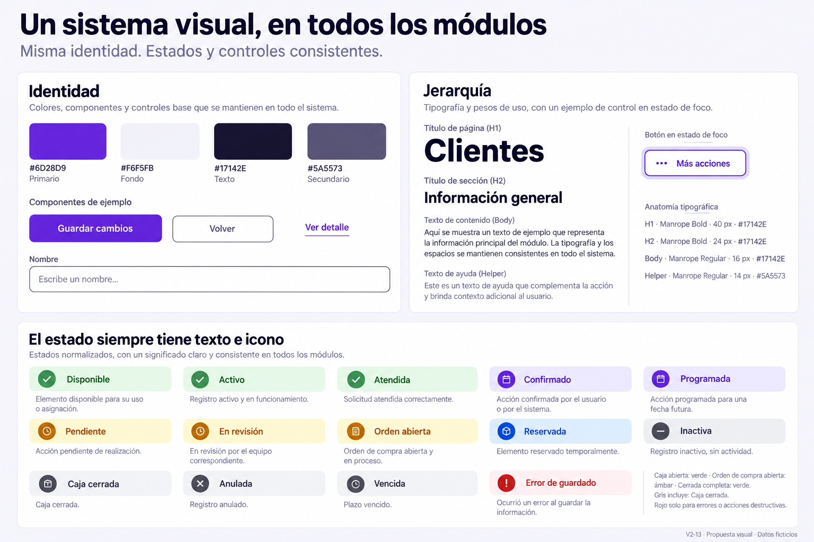

# Vixora — Entrega de diseño V2

Serie del 27 y 28 de octubre de 2026. **145 imágenes organizadas en 26 carpetas: 13 lotes originales y la ampliación V2-14 de Análisis.** Propuestas visuales y funcionales para el negocio de venta y servicio de iPhone, con datos ficticios.

- [Ver todas las pantallas, módulo por módulo](indice-final-v2.md).
- [Ver las doce imágenes de Análisis y métricas V2-14](33-analisis-metricas/README.md).
- [Ver las siete referencias compartidas V2-13](32-consistencia-accesibilidad/README.md).
- [Leer los criterios para implementar](criterios-implementacion-v2.md).
- [Consultar cobertura y variantes sin PNG independiente](cobertura-final-v2.md).
- [Consultar registro de cada lote y sus prompts](manifest-v2.md).

## Cómo utilizar la entrega

El índice final enlaza cada archivo existente con sus dimensiones. Los README de cada módulo explican la función de los botones, las reglas del negocio, los escenarios ficticios y las limitaciones. Productos comparte catálogo V2-04 e inventario V2-05; Técnicos reutiliza proveedores, con una ficha más completa en V2-11.

Para desarrollar, comenzar por los criterios transversales y después el módulo concreto. Las siete láminas finales unifican componentes sin regenerar todos los mockups anteriores. Los activos originales de marca, los colores escritos y las reglas funcionales prevalecen sobre pequeñas variaciones del render.

## Estado y alcance

Los 13 lotes planificados y la ampliación de métricas quedan entregados como diseño conceptual. Hay 103 vistas en desktop, 20 móviles, 13 tableros de estados, 6 láminas de referencia, 2 fichas contextuales y 1 desglose de métrica. Esto no significa que cada modal, documento, rol y error tenga su propia imagen; las variantes no dibujadas se enumeran expresamente en la cobertura.

Se mantiene la paleta violeta. Se propone reforzar el borde de los controles para reconocerlos mejor, conservando los divisores decorativos originales. Formularios con errores, confirmaciones, carga y navegación por teclado tienen criterios compartidos, pendientes de validar en la implementación.

La producción se realizó con ImageGen integrada; prompts y trazabilidad se conservan por lote. V2-13 preservó 126 imágenes anteriores y V2-14 conserva las 133 que ya existían, comprobadas por SHA-256. No se sobrescriben versiones V1.

Solo se añaden mockups y documentación en esta carpeta. No se modifican código, configuración o datos del CRM; no se crean usuarios ni operaciones de negocio. El último cierre revisa las propuestas disponibles, no vuelve a auditar la producción actual. Las imágenes no certifican accesibilidad ni comprueban contratos del backend.

